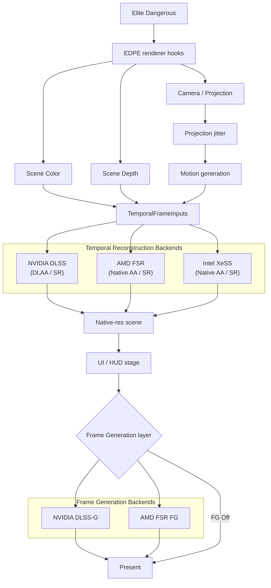
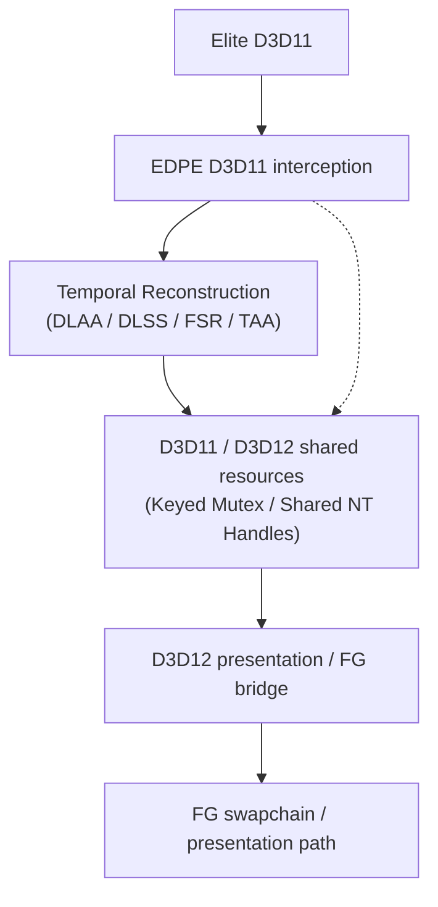
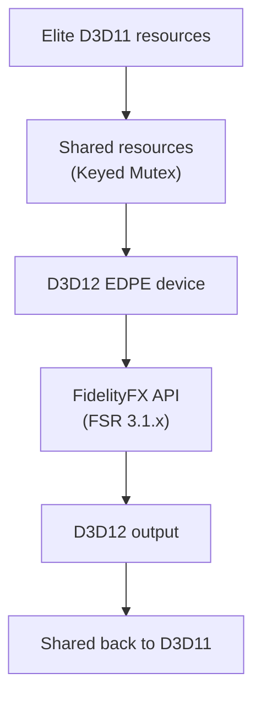
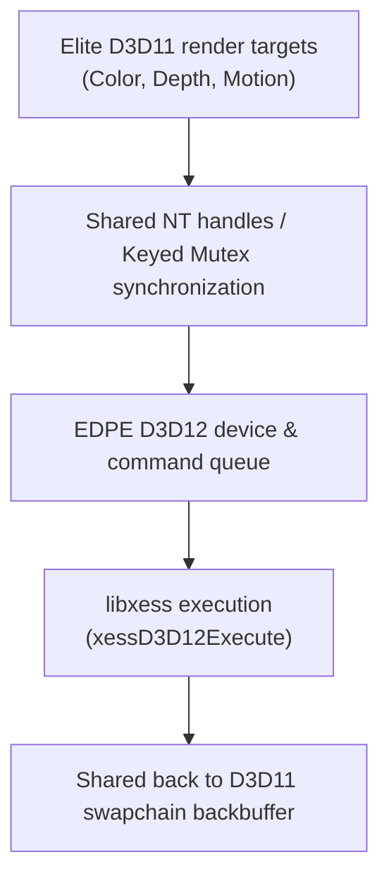
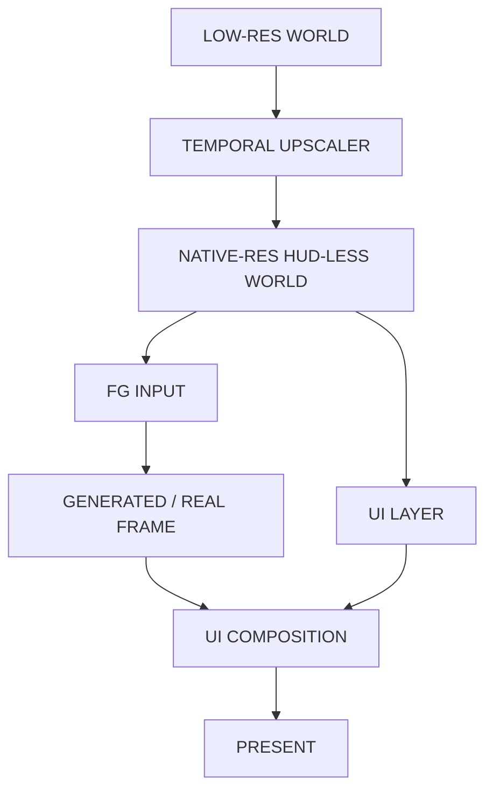
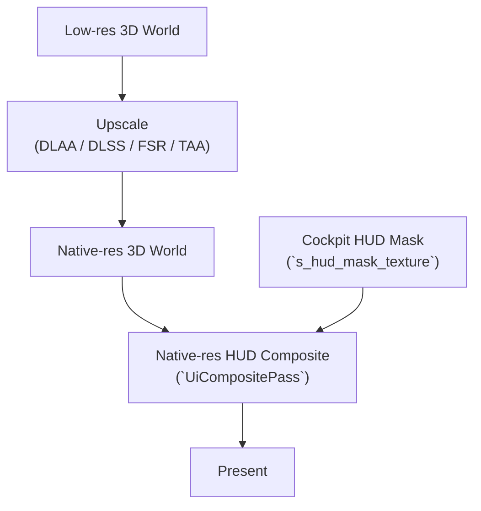
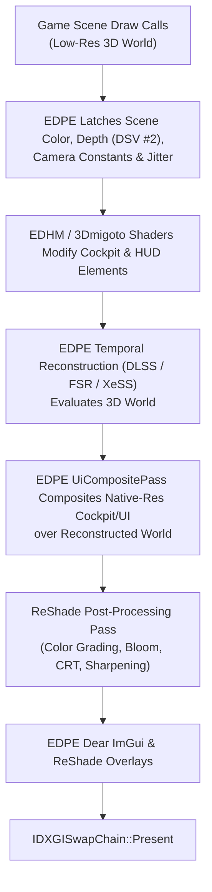

# EDPE — Elite Dangerous Performance Enhanced

## 1. Goal

Build **EDPE (Elite Dangerous Performance Enhanced)**, a standalone performance-enhancement injector/mod for the **2D Direct3D 11 renderer of Elite Dangerous**.

The initial focus is temporal upscaling and anti-aliasing:

* NVIDIA DLSS Super Resolution;
* NVIDIA DLAA;
* NVIDIA DLSS-NR (Ray Reconstruction / Neural Denoising);
* AMD FSR temporal upscaling / Native AA;
* Intel XeSS Super Resolution / Native AA;
* native D3D11 TAA;
* low-latency technologies (NVIDIA Reflex & AMD Anti-Lag / Anti-Lag 2) for responsive flight controls and frame pacing;
* vendor-neutral reconstruction infrastructure.

The architecture must also leave a clean path for later experimental Frame Generation support:

* NVIDIA DLSS Frame Generation / future supported DLSS-G modes;
* AMD FSR Frame Generation.

EDPE must not depend on native DLSS/FSR support from the Cobra engine.

The injector must eventually:

* run inside `EliteDangerous64.exe`;
* intercept Direct3D 11 / DXGI at appropriate points;
* identify the rendered 3D scene;
* obtain scene color;
* obtain scene depth;
* obtain camera/projection information;
* generate temporal motion vectors;
* apply projection jitter;
* execute the selected temporal upscaler;
* reconstruct a native-resolution image from a lower-resolution scene;
* preserve HUD/UI at native resolution where feasible;
* support seamless co-existence and proxy chaining with popular third-party tools and mods (ReShade post-processing, EDHM / 3Dmigoto cockpit HUD customization, Special K, RTSS);
* reduce input latency and CPU-GPU desync via NVIDIA Reflex and AMD Anti-Lag / Anti-Lag 2;
* expose configuration through **Dear ImGui**;
* provide GPU timing and debug views;
* support safe runtime switching;
* fail open and preserve the original game rendering path.

EDPE is a **rendering project only**.

Do not modify gameplay, networking or game logic.

---

# 2. Project identity

Official project name:

```text
EDPE
Elite Dangerous Performance Enhanced
```

Use `EDPE` consistently in:

```text
window titles
Dear ImGui
logs
configuration
documentation
build output
release names
version strings
Git tags
```

Recommended names:

```text
dxgi.dll
edpe.ini
edpe.log
```

---

# 3. Architectural principle

Do not build:

```text
DLSS pipeline
FSR pipeline
NVIDIA FG pipeline
AMD FG pipeline
```

as four mostly duplicated systems.

Instead use shared EDPE-produced temporal inputs:



Depth, motion, jitter and camera reconstruction belong to **EDPE**, not to an individual vendor backend.

---

# 4. Temporal upscaler abstraction

Design around a vendor-neutral interface.

Conceptually:

```cpp
enum class UpscalerBackend : uint32_t {
    None = 0,
    NvidiaDlss = 1,
    AmdFsr = 2,
    Taa = 3
    // IntelXess planned (Phase 16)
};

enum class UpscaleMode : uint32_t {
    Native = 0,           // 1:1 bypass / original game presentation
    NativeAA = 1,         // 1:1 native-resolution temporal AA (DLAA / FSR Native AA / TAA)
    Quality = 2,          // ~1.5x scaling per dimension (66.7% resolution)
    Balanced = 3,         // ~1.7x scaling per dimension (58.8% resolution)
    Performance = 4,      // 2.0x scaling per dimension (50.0% resolution)
    UltraPerformance = 5  // 3.0x scaling per dimension (33.3% resolution)
};

struct TemporalFrameInputs {
    ID3D11Texture2D* color = nullptr;
    ID3D11ShaderResourceView* colorSrv = nullptr;

    ID3D11Texture2D* depth = nullptr;
    ID3D11ShaderResourceView* depthSrv = nullptr;
    ID3D11ShaderResourceView* prevDepthSrv = nullptr;

    ID3D11Texture2D* motionVectors = nullptr;
    ID3D11ShaderResourceView* motionSrv = nullptr;

    // Reactive mask superseded in EDPE by UiCompositePass (native HUD isolation & composite)
    ID3D11Texture2D* transparencyMask = nullptr;
    ID3D11ShaderResourceView* transparencyMaskSrv = nullptr;

    ID3D11Texture2D* exposure = nullptr;
    ID3D11ShaderResourceView* exposureSrv = nullptr;

    uint32_t renderWidth = 0;
    uint32_t renderHeight = 0;
    uint32_t outputWidth = 0;
    uint32_t outputHeight = 0;

    float jitterX = 0.0f;
    float jitterY = 0.0f;
    float prevJitterX = 0.0f;
    float prevJitterY = 0.0f;

    float frameTimeMs = 0.0f;
    float sharpness = 0.0f;
    bool reset = false;

    CameraProjection cameraNow{};
    CameraProjection cameraPrevious{};

    bool depthInverted = true;
    bool depthInfinite = true;

    bool motionJittered = false;
    bool motionIsLowRes = true;
    bool colorIsHdr = true;
    float motionScaleX = 1.0f;
    float motionScaleY = 1.0f;
};
```

Exact APIs may change.

The important architectural rule is:

```text
Elite-specific reconstruction
        !=
vendor-specific upscaler code
```

---

# 5. Frame Generation abstraction

Frame Generation must be a **separate subsystem** from temporal upscaling.

Conceptually:

```cpp
enum class FrameGenerationBackend {
    Off,
    NvidiaDlssG,
    AmdFsr
};
```

Do not assume:

```text
DLSS SR -> NVIDIA FG only
FSR SR  -> AMD FG only
```

The architecture should permit supported combinations such as:

```text
DLSS SR + NVIDIA FG
DLSS SR + AMD FG

FSR SR + AMD FG
FSR SR + NVIDIA FG
```

only when the vendor API and generated inputs make the combination valid.

AMD explicitly separates FSR upscaling and Frame Generation, so cross-upscaler operation should remain architecturally possible.

Never expose an unsupported combination merely because the UI can represent it.

Capability detection decides what is actually available.

---

# 6. Important D3D11 / Frame Generation limitation

Elite Dangerous currently presents the target workload through Direct3D 11.

Modern Frame Generation paths cannot be treated as ordinary D3D11 post-process shaders.

Current vendor architecture must be treated as follows:

```text
EDPE base renderer:
Direct3D 11

DLSS SR / DLAA:
D3D11-capable temporal path

FSR temporal upscale:
implementation-dependent;
investigate D3D11 path and modern official FidelityFX path

NVIDIA DLSS Frame Generation:
requires Direct3D 12 integration

AMD FSR Frame Generation:
modern FidelityFX Frame Generation path uses
Direct3D 12 or Vulkan presentation infrastructure
```

Therefore:

**Do not make Frame Generation a requirement for the first EDPE releases.**

Frame Generation is a later research phase.

Likely architecture:



Possible technologies to investigate:

```text
D3D11On12
shared NT handles
D3D11_RESOURCE_MISC_SHARED_NTHANDLE
ID3D12Device::OpenSharedHandle
shared fences
wrapped resources
secondary D3D12 command queue
swapchain replacement/proxy
```

Do not implement this bridge until the ordinary D3D11 temporal-upscaling path is stable.

---

# 7. Primary reference — EDVR

Primary reverse-engineering/reference project:

```text
characterecho-sean/edvr-unofficial-patch
```

Do not port EDVR wholesale.

Study and selectively adapt/reimplement useful concepts.

## NVIDIA temporal path

Important files:

```text
src/d3d11/dlaa.cpp
src/d3d11/dlaa.h

src/d3d11/temporal_pass.cpp
src/d3d11/temporal_pass.h

src/d3d11/native_temporal.cpp
src/d3d11/depth_probe.cpp

src/common/temporal_math.h
```

Study:

```text
NGX initialization
DLSS/DLAA feature creation
NVSDK_NGX_D3D11_DLSS_Eval_Params
quality selection
render/output dimensions
MVLowRes
DepthInverted
jitter
depth capture
motion vectors
reactive masks
history reset
GPU timing
safe fallback
```

## AMD FSR path

Also study:

```text
src/d3d11/fsr3_engine.cpp
src/d3d11/fsr3_engine.h
docs/fsr-upscaler-design-2026-09-16.md
```

EDVR's FSR work is especially relevant because EDPE is also dealing with a legacy D3D11 renderer.

Determine precisely:

* which AMD code is official;
* which D3D11 portions originate from community ports;
* what OptiScaler/metarutaiga code is used;
* what license applies to each component;
* which assumptions EDVR made;
* which components are reusable;
* which should instead be rewritten.

Do not assume EDVR's D3D11 FSR integration is equivalent to AMD's current official FidelityFX API.

Validate behavior against AMD's official reference implementation.

## Other EDVR documentation

Study:

```text
docs/anti-aliasing.md
docs/per-object-motion.md
docs/foveated-dlss-design-2026-09-14.md
docs/fsr-upscaler-design-2026-09-16.md
docs/kinematic-motion-injection-2026-09-19.md
docs/crisp-ui-handoff.md
```

Do not reuse EDVR's NGX Project ID.

Do not port its:

```text
OpenVR runtime
OpenXR runtime
HMD submission
VR compositor
headset-specific code
VR foveation
```

unless a tiny isolated utility is directly relevant.

---

# 8. NVIDIA references

Use the current official NVIDIA:

```text
DLSS SDK / NGX
Streamline
DLSS Super Resolution documentation
DLSS Frame Generation documentation
Reflex documentation
```

as source of truth.

For DLSS SR / DLAA, investigate:

```cpp
NVSDK_NGX_D3D11_Init*
NVSDK_NGX_D3D11_GetCapabilityParameters
NVSDK_NGX_D3D11_AllocateParameters

NGX_DLSS_GET_OPTIMAL_SETTINGS

NGX_D3D11_CREATE_DLSS_EXT
NGX_D3D11_EVALUATE_DLSS_EXT

NVSDK_NGX_D3D11_DLSS_Create_Params
NVSDK_NGX_D3D11_DLSS_Eval_Params

NVSDK_NGX_D3D11_ReleaseFeature
NVSDK_NGX_D3D11_Shutdown*
```

Validate:

```text
Color
Depth
Motion vectors
Jitter
Render dimensions
Output dimensions
Frame time
Exposure
History reset
Reactive/bias mask
```

Do not reuse EDVR's Project ID.

---

# 9. NVIDIA Frame Generation

NVIDIA Frame Generation is a later optional EDPE feature.

Prefer the official **Streamline** integration path.

Do not attempt to fake DLSS-G by manually calling undocumented NGX entry points.

Research requirements including:

```text
Direct3D 12
Streamline interposer/integration
final color
HUD-less color
UI color
motion vectors
depth
camera matrices
frame index
camera reset state
dynamic-object information
resource lifetime
swapchain behavior
frame pacing
```

Also account for NVIDIA Reflex.

Treat correct Reflex/latency integration as part of the DLSS-G feature, not an unrelated optional checkbox.

DLSS-G should automatically stand down during:

```text
loading screens
menus where world rendering stops
video playback
major scene transitions
resolution changes
fullscreen/window-mode transitions
invalid temporal inputs
camera discontinuities
```

EDPE must query Streamline feature requirements rather than hardcoding GPU-generation support.

Future NVIDIA capabilities such as Multi Frame Generation should also be capability-driven.

Do not design EDPE around a fixed assumption that NVIDIA always inserts exactly one frame.

---

# 10. AMD references

Use current official:

```text
AMD GPUOpen
AMD FidelityFX SDK
AMD FSR SDK
FidelityFX API
FSR temporal upscaling documentation
FSR Frame Generation documentation
```

as source of truth.

FSR should be treated as two separate technologies:

```text
FSR Upscaling
FSR Frame Generation
```

Do not tightly couple them.

---

# 11. AMD FSR upscaling

EDPE should eventually offer:

```text
FSR Native AA
FSR Quality
FSR Balanced
FSR Performance
FSR Ultra Performance
```

where supported by the selected implementation.

FSR must consume the same EDPE temporal reconstruction data used for DLSS wherever conventions permit:

```text
Color
Depth
Motion vectors
Jitter
Render size
Output size
Frame delta
Reset
Reactive information
```

Build a dedicated AMD backend behind the generic upscaler interface.

Do not spread FidelityFX-specific structures throughout the Elite hooks.

---

# 12. FSR D3D11 strategy

Because EDPE targets a D3D11 game, FSR integration requires an explicit investigation phase.

Evaluate at least two approaches.

## Route A — proven D3D11 implementation

Study the D3D11 FSR implementation already exercised by EDVR and related open-source work.

Advantages:

```text
native D3D11 resources
low integration complexity
matches Elite's renderer
useful for proving the EDPE temporal inputs
```

Risks:

```text
community-maintained backend
version divergence from AMD reference
future compatibility
licensing/provenance complexity
```

## Route B — official current FidelityFX API

Investigate a D3D11 -> D3D12 interoperability layer that permits use of the current official FidelityFX backend.

Possible architecture:



Advantages:

```text
current official AMD implementation
shared foundation with future AMD FG
better forward compatibility
```

Risks:

```text
interop complexity
resource synchronization
extra copies if zero-copy sharing fails
presentation complexity
```

Benchmark both before choosing the production path.

Do not choose based solely on implementation convenience.

---

# 13. Intel references

Use current official:

```text
Intel XeSS SDK (libxess)
Intel GPUOpen / GitHub (intel/xess)
XeSS D3D12 headers (xess.h, xess_d3d12.h)
Intel XeSS API documentation
Intel Arc / XMX documentation
Universal DP4a fallback documentation
```

as source of truth for Intel XeSS temporal reconstruction.

Relevant technologies include:

* **Intel XeSS Super Resolution (SR):** AI-based temporal upscaler running high-quality neural network models;
* **Intel XeSS Native AA:** 1.0x native anti-aliasing reconstruction mode (introduced in XeSS 1.3+), analogous to DLAA and FSR Native AA;
* **Intel XMX (Xe Matrix Extensions):** Hardware-accelerated systolic matrix execution on Intel Arc (Alchemist, Battlemage, Celestial) GPUs;
* **Universal DP4a Model:** 8-bit integer dot product fallback model running on any vendor GPU (NVIDIA Pascal/Turing/Ampere/Ada, AMD RDNA/RDNA2/RDNA3, older Intel Iris/UHD);
* **Dynamic Model Selection:** Dynamic runtime discovery of XMX vs. DP4a model via `xessGetProperties`.

Do not assume XeSS requires an Intel GPU. The universal DP4a fallback is vendor-agnostic and provides high-quality AI reconstruction on AMD and older NVIDIA hardware lacking Tensor Cores.

---

# 14. Intel XeSS upscaling

EDPE should eventually offer:

```text
XeSS Native AA
XeSS Ultra Quality Plus
XeSS Ultra Quality
XeSS Quality
XeSS Balanced
XeSS Performance
XeSS Ultra Performance
```

where supported by the selected XeSS SDK version.

XeSS must consume the same EDPE temporal reconstruction inputs as DLSS, FSR, and Native TAA:

```text
Color (HDR or tone-mapped LDR)
Depth (inverted reversed-Z compatible via flags)
Motion vectors (screen-space, render or output resolution)
Subpixel jitter (Halton 2,3)
Render size
Output size
Frame delta
Exposure scale / texture
Responsive / reactive mask
History reset
```

Build a dedicated Intel backend (`IntelUpscalerBackend`) behind the generic `IUpscalerBackend` interface.

Do not spread `xess_*` types or `libxess` link dependencies into the engine context hooks or generic upscaler manager.

---

# 15. Intel XeSS D3D11 strategy

Because the official Intel XeSS SDK (`libxess`) natively targets Direct3D 12 (`xessD3D12CreateContext`), executing XeSS in a D3D11 game like Elite Dangerous requires an explicit interoperability strategy.

Evaluate two primary implementation routes:

## Route A — D3D11-to-D3D12 Interop Bridge (Preferred)

Leverage the Phase 13 shared resource infrastructure:



Advantages:

```text
uses official, uncompromised libxess SDK distribution directly
direct support for both XMX and DP4a kernels
shares presentation and device-bridge foundation with Frame Generation
cleanest forward compatibility with future XeSS SDK releases
```

Risks:

```text
requires robust zero-copy DXGI keyed-mutex / shared fence synchronization
interop overhead must be kept under ~0.3 ms
```

## Route B — Community / Proxy D3D11 XeSS Wrapper

Investigate standalone D3D11 XeSS wrapper patterns (such as OptiScaler's DX11-to-DX12 proxy layer or native D3D11 shims):

Advantages:

```text
simplified initial testing within D3D11 abstraction
allows early validation of motion vector and depth conventions prior to full D3D12 presenter completion
```

Risks:

```text
divergence from official Intel SDK updates
extra copy overhead if intermediate staging buffers cannot be eliminated
```

---

# 16. AMD Frame Generation

AMD FSR Frame Generation is a later experimental phase.

Use the current official FidelityFX Frame Generation API where technically possible.

It requires more than simply calling the FSR upscaler.

Plan for:

```text
two sequential rendered frames
motion vectors
depth
camera information
optical flow / FG preparation
frame interpolation context
presentation scheduling
frame pacing
UI composition
```

AMD FG should remain compatible with another temporal upscaler if the API supports the combination.

Therefore keep:

```text
UpscalerBackend
```

and:

```text
FrameGenerationBackend
```

independent.

Investigate AMD Anti-Lag 2 or the current AMD-recommended latency solution when implementing FG.

Do not advertise FG as improving input latency.

Generated frames improve displayed motion smoothness but are not equivalent to newly simulated game frames.

---

# 17. Frame Generation common inputs

Build a vendor-neutral description of FG inputs.

Conceptually:

```cpp
struct FrameGenerationInputs {
    // Final reconstructed world without UI.
    TextureHandle hudlessColor;

    // UI layer if separated.
    TextureHandle uiColor;

    TextureHandle depth;
    TextureHandle motionVectors;

    CameraState camera;

    uint32_t width;
    uint32_t height;

    uint64_t frameIndex;

    float frameTimeMs;

    bool cameraReset;
};
```

The exact backend resource types may differ between D3D11/D3D12.

Do not let that leak into the high-level EDPE renderer state.

---

# 18. HUD-less rendering becomes mandatory for FG

For temporal upscaling, native HUD separation is an image-quality improvement.

For Frame Generation it becomes a much more important requirement.

Target pipeline:



Do not enable production FG until EDPE can correctly distinguish world content from the HUD or otherwise provide the vendor API's supported UI handling mode.

Investigate:

```text
HUD shader signatures
HUD render targets
HUD alpha
pre-UI color
post-UI color
UI callback/composition
reactive mask
```

---

# 19. Dear ImGui

Use **Dear ImGui** for EDPE configuration.

Reference:

```text
ocornut/imgui
```

Initial backends:

```text
imgui_impl_win32
imgui_impl_dx11
```

If EDPE later replaces/proxies the presentation path through D3D12 for FG, preserve the ImGui abstraction so its renderer backend can be changed without rewriting settings logic.

Controls & Hotkeys:

* `F5`: Toggle EDPE Dear ImGui control panel (all input passes through to the game when closed)
* `F7`: Toggle real-time Performance Telemetry HUD (FPS, frametimes, frametime history graph, GPU stats)

Suggested UI:

```text
EDPE — Elite Dangerous Performance Enhanced
Version: v0.x.x

Rendering
[ ] Enabled

Upscaler
[ Native            ]
[ NVIDIA DLAA       ]
[ NVIDIA DLSS       ]
[ AMD FSR NativeAA  ]
[ AMD FSR           ]
[ Intel XeSS Native ]
[ Intel XeSS        ]
[ Native D3D11 TAA  ]

Quality
[ Native AA         ]
[ Ultra Quality +   ]
[ Ultra Quality     ]
[ Quality           ]
[ Balanced          ]
[ Performance       ]
[ Ultra Performance ]

NVIDIA DLSS preset
[ Auto | J | K | L | M ]

Intel XeSS model
[ Auto | XMX | DP4a ]

Frame Generation
[ Off               ]
[ NVIDIA DLSS-G     ]
[ AMD FSR FG        ]

Render:
1707 x 960

Output:
2560 x 1440

Render scale:
66.7%

Motion vectors:
[ Camera + Depth ]
[ Enhanced       ]

UI handling:
[ In temporal input ]
[ Native separate   ]

Debug
[ ] Depth
[ ] Motion vectors
[ ] Jitter
[ ] Reactive mask
[ ] HUD-less image
[ ] Final world
[ ] Generated frames
[ ] GPU timings
[ ] Frame pacing

Performance
Scene render:       xx.xx ms
Motion generation:   x.xx ms
Upscaler:            x.xx ms
Frame generation:    x.xx ms
EDPE total:          x.xx ms

Rendered FPS:       xx.x
Presented FPS:      xx.x
```

If Frame Generation is enabled, clearly distinguish:

```text
Rendered FPS
Presented FPS
```

Never mislabel generated frames as additional game simulation frames.

---

# 20. Project layout

Project architecture:

```text
/
├── AGENTS.md
├── PLAN.md
├── STATUS.md
├── README.md
├── CMakeLists.txt
├── edpe.ini
│
├── external/                # Third-party dependencies (imgui, DLSS SDK, FidelityFX SDK)
│   ├── imgui/
│   ├── DLSS/
│   └── ffx-dx11/
│
├── src/
│   ├── dllmain.cpp          # DllMain entry point and initialization
│   ├── dxgi_proxy.cpp / .def# DXGI factory export forwarding and hook injection (dxgi.dll)
│   ├── d3d11_proxy.cpp / .h # D3D11CreateDevice hook & system DLL forwarding
│   ├── dxgi_observer.cpp    # Swapchain creation & Present hooks, backbuffer tracking
│   ├── context_census.cpp/.h# Direct3D 11 pipeline observation, CB0 parsing, jitter injection
│   ├── temporal_inputs.h    # Shared TemporalFrameInputs data contract
│   ├── temporal_math.h      # Halton sequences, camera delta projection math
│   ├── motion_pass.cpp / .h # GPU camera-depth motion vector generation pass
│   ├── ngx_context.cpp / .h # NVIDIA NGX DLAA/DLSS evaluation wrapper
│   ├── upscaler_backend.cpp/.h # Multi-upscaler manager & backends (DLSS, FSR 3.1.2, TAA)
│   ├── taa_pass.cpp / .h    # Native Direct3D 11 TAA reconstruction pass
│   ├── ui_composite_pass.cpp/.h # Native UI composite pass (HUD preservation)
│   ├── hud_debug_pass.cpp/.h# Cockpit holographic HUD mask geometry and debug pass
│   ├── jitter_debug_pass.cpp/.h # Subpixel jitter real-time visualization pass
│   ├── jitter_logger.cpp/.h # Jitter diagnostics logger
│   ├── jitter_view_recorder.cpp/.h # Subpixel jitter telemetry recorder (F9)
│   ├── crash_logger.cpp/.h  # Minidump generation and crash diagnostics
│   ├── input_hook.cpp / .h  # Window procedure (WndProc) filtering and DirectInput hook
│   ├── perf_overlay.cpp/.h  # Real-time performance telemetry HUD & frametime graph (F7)
│   ├── profiler.h           # High-precision QPC per-pass execution profiler
│   ├── ui.cpp / .h          # Dear ImGui overlay (F5), hotkey handling, settings UI
│   ├── config.c / .h        # Central configuration (kVersion, edpe.ini serialization)
│   ├── log.cpp / .h         # Thread-safe diagnostic logging (edpe.log)
│   └── *_shader.h           # Compiled HLSL bytecode headers embedded in C/C++
│
├── tests/                   # Automated unit & integration test suites (14 tests)
├── tools/                   # Standalone diagnostic probes & SDK fetch scripts
└── docs/                    # Technical research, reverse-engineering notes & input contracts
```

# 21. Git workflow

Git history is part of the project deliverable.

Create a commit after **every important coherent change**.

Examples:

```text
bootstrap EDPE
add D3D11 proxy
hook DXGI Present
initialize Dear ImGui
track render targets
identify scene depth
add depth visualization
capture projection
add jitter
generate motion vectors
add temporal input abstraction
initialize NGX
add DLAA
add DLSS SR
add upscaler abstraction
add FSR backend
add native HUD separation
add D3D11/D3D12 interop prototype
add Streamline bootstrap
add NVIDIA FG prototype
add FidelityFX FG prototype
add frame pacing diagnostics
```

Do not place several unrelated substantial changes in one commit.

Before committing:

```text
build
test
review diff
inspect git status
check accidental files
```

Use descriptive messages.

---

# 22. Versioning and tags

EDPE uses:

```text
vMAJOR.MINOR.PATCH
```

There are currently no tags.

The first version must start at:

```text
v0.0.1
```

Use annotated tags.

Example:

```bash
git tag -a v0.0.1 -m "EDPE v0.0.1"
```

Rule:

```text
important change -> commit

stable coherent milestone -> tag
```

Do not tag every commit.

Possible early evolution:

```text
v0.0.1
basic EDPE injection

v0.0.x
renderer reconnaissance / temporal infrastructure

v0.0.x
working DLAA

v0.0.x
working DLSS Super Resolution

v0.0.x
working AMD FSR upscaling

v0.1.0
stable multi-upscaler EDPE architecture

v0.2.x
experimental D3D11/D3D12 presentation bridge

v0.3.x
experimental Frame Generation
```

Exact mapping depends on actual progress.

Do not reserve version numbers too rigidly.

Before tagging:

```text
working tree clean
build succeeds
tests pass
tag does not exist
correct commit checked out
```

Never force-move an existing release tag without explicit approval.

---

# 23. Phase 0 — reconnaissance

Before implementing reconstruction:

1. inspect the workspace;
2. read `AGENTS.md`;
3. inspect build files;
4. inspect Git history;
5. inspect tags;
6. verify x64;
7. determine game D3D11/DXGI behavior;
8. identify swapchain;
9. identify HWND;
10. determine backbuffer format;
11. determine presentation mode;
12. determine relevant RT sizes;
13. enumerate depth targets;
14. determine command-list usage;
15. observe resource lifetimes.

Create:

```text
docs/render-pipeline-observations.md
```

Do not alter output yet.

---

# 24. Phase 1 — D3D11 injection

Implement:

```text
EDPE loading
D3D11 device discovery
immediate context discovery
swapchain discovery
Present hook
logging
Dear ImGui
```

No temporal reconstruction.

Success:

> Elite operates normally with EDPE loaded and ImGui can be toggled safely.

Create `v0.0.1` once the first coherent working milestone exists and no earlier EDPE tag exists.

---

# 25. Phase 2 — resource census

Instrument:

```cpp
CreateTexture2D
CreateRenderTargetView
CreateDepthStencilView
CreateShaderResourceView

OMSetRenderTargets
RSSetViewports

Draw*
Dispatch

CopyResource
CopySubresourceRegion

Present
```

Track:

```text
dimensions
format
bind flags
usage
sample count
draw frequency
depth association
viewport
shader association
frame timing
copy relationships
```

Do not classify resources solely by dimensions.

---

# 26. Phase 3 — scene depth

Identify the real scene depth.

Measure:

```text
format
clear value
standard/reversed Z
near plane
far plane
SRV capability
resource lifetime
safe sampling point
```

Add:

```text
Debug -> Depth
```

Do not feed unverified depth to either DLSS or FSR.

---

# 27. Phase 4 — camera and projection

Locate:

```text
view
projection
view-projection
camera position
near/far
previous/current camera
```

Prefer constant-buffer inspection.

Avoid executable patching when graphics-level identification is possible.

Document findings in:

```text
docs/camera-reconstruction.md
```

---

# 28. Phase 5 — projection jitter

Implement temporal projection jitter.

Initial sequence:

```text
Halton 2,3
```

unless testing justifies another sequence.

Requirements:

```text
one offset per rendered frame
same offset for all associated scene work
known pixel convention
same jitter passed to temporal upscaler
automatic disable when reconstruction fails
```

---

# 29. Phase 6 — motion vectors

Initial texture:

```text
DXGI_FORMAT_R16G16_FLOAT
```

Initial convention to verify:

```text
current -> previous
render-resolution pixels
```

Generate from:

```text
per-pixel depth
current camera
previous camera
projection
```

Add:

```text
Debug -> Motion vectors
```

Do not add object-motion hacks before camera+depth reprojection is verified.

Later investigate:

```text
ships
station parts
HUD
particles
terrain
smoke
animated geometry
```

using EDVR as a reference.

---

# 30. Phase 7 — shared temporal input layer

Before maintaining multiple upscalers, formalize EDPE-owned resources:

```text
temporal color
depth
motion
jitter
reactive mask
camera state
history reset
render dimensions
output dimensions
```

This is the handoff point used by both:

```text
NVIDIA
AMD
```

Commit this abstraction independently.

---

# 31. Phase 8 — NVIDIA DLAA

Implement NVIDIA first at native resolution.

```text
input == output
```

Validate:

```text
NGX initialization
depth
motion
jitter
history
reset
output
```

Test:

```text
cockpit
station
space
yaw
pitch
roll
fast rotation
HUD
moving ships
```

Do not proceed merely because NGX returned success.

---

# 32. Phase 9 — NVIDIA DLSS Super Resolution

Enable:

```text
input < output
```

Support:

```text
Quality
Balanced
Performance
Ultra Performance
```

Use NGX optimal settings when possible.

Do not fake reduced-resolution rendering by first rendering the game at native resolution and then shrinking the completed frame.

Real GPU savings require Cobra to render fewer scene pixels.

---

# 33. Phase 10 — true render-scale control

Investigate in this order:

## A. Cobra's own scaling mechanism

Preferred.

## B. Existing Elite configuration

Use if it provides the correct internal/output split.

## C. Selective render-target scaling

Only if required.

Never resize all backbuffer-sized textures blindly.

Swapchain should remain native.

---

# 34. Phase 11 — AMD FSR upscaling

Once EDPE's temporal inputs are independently validated, implement AMD FSR.

First objective:

```text
FSR Native AA
```

Then:

```text
FSR Quality
FSR Balanced
FSR Performance
FSR Ultra Performance
```

Compare using identical EDPE-produced:

```text
depth
motion
jitter
render size
output size
```

against DLSS where possible.

This phase must explicitly evaluate:

```text
D3D11 backend

vs.

modern official FidelityFX backend through D3D11/D3D12 interop
```

Record:

```text
image quality
GPU cost
CPU cost
memory
latency
complexity
compatibility
```

before deciding which is the production EDPE AMD path.

---

# 35. Phase 12 — native-resolution HUD

**Status: Implemented & Verified in-game (Stage 2)**

Target architecture:



Elite's cockpit HUD, text, holograms, and menus are isolated from the scene LDR buffer and composited at native presentation resolution:
1. **Scene Color Isolation:** Clean pre-HUD 3D scene color (`s_clean_hdr_scene_texture`) is latched and fed directly to the active upscaler (DLAA / DLSS / FSR / TAA).
2. **Cockpit Holographic HUD Mask:** Cockpit HUD draws are replayed at native resolution into `s_hud_mask_texture` (`R11G11B10_FLOAT`) with viewport subpixel projection unjittering.
3. **UI Composition Pass:** `UiCompositePass` composites native-res emissive and additive HUD elements cleanly over the reconstructed world without blurry cutout blending.
4. **Validation:** Cockpit text, navigation compass, target reticles, and system holographic panels remain razor-sharp and free of temporal motion smearing.

---

# 36. Phase 13 — D3D11 / D3D12 interoperability research

Do not start FG before this point.

Build a contained experiment proving:

```text
D3D11 texture
     |
shared handle
     |
D3D12 access
     |
D3D12 compute
     |
shared result
     |
D3D11 access
```

Measure:

```text
synchronization cost
copy count
GPU time
CPU overhead
VRAM overhead
frame pacing
```

Zero-copy sharing is strongly preferred.

If interop cost removes the performance benefit, stop and document the result before attempting FG.

---

# 37. Phase 14 — AMD Frame Generation prototype

AMD FG is a reasonable first FG research target because FSR Frame Generation is intentionally separated from the upscaler.

Integrate:

```text
FidelityFX FG context
FG preparation
required camera information
motion/depth inputs
HUD-less color
UI composition
FG swapchain
frame pacing
```

Do not assume the first prototype is shippable.

Measure:

```text
generated FPS
rendered FPS
latency
GPU overhead
VRAM usage
pacing stability
UI artifacts
disocclusion artifacts
```

---

# 38. Phase 15 — NVIDIA Streamline / DLSS Frame Generation

Integrate Streamline only after D3D12 presentation/interop is understood.

First integrate Streamline **without FG enabled** and validate:

```text
manual hooking
resource tracking
feature requirements
resource tags
camera constants
frame indices
```

Then add NVIDIA Frame Generation.

Required inputs include:

```text
depth
motion vectors
HUD-less color
UI color
camera matrices
frame index
camera reset
```

Integrate NVIDIA Reflex correctly.

Do not ship NVIDIA FG with a broken or missing latency path.

Use capability queries to determine supported hardware/features.

Do not hardcode:

```text
RTX generation
FG multiplier
MFG multiplier
```

---

# 39. Phase 16 — Intel XeSS (Xe Super Sampling) temporal upscaling & Native AA

Implement Intel XeSS (Xe Super Sampling) temporal upscaling and XeSS Native AA as a first-class reconstruction backend within the EDPE multi-upscaler architecture.

XeSS provides AI-based neural network temporal reconstruction with broad hardware compatibility:
* **Intel Arc GPUs:** accelerated via XMX (Xe Matrix Extensions) systolic arrays;
* **NVIDIA / AMD / non-Arc GPUs:** accelerated via universal 8-bit integer DP4a instructions, allowing GeForce GTX/RTX, Radeon RX, and other non-Tensor hardware to run AI-driven temporal reconstruction.

Requirements and execution:

1. **SDK Integration & Licensing:**
   Integrate Intel XeSS SDK (`libxess.dll`, headers `xess.h`, `xess_d3d12.h`). Ensure binary redistribution compliance and dynamic loading so EDPE does not hard-crash if `libxess.dll` is missing.
2. **D3D11 / D3D12 Execution:**
   Utilize the Phase 13 D3D11/D3D12 interoperability bridge (shared NT handles / keyed mutex synchronization) to pass EDPE scene textures (`scene_ldr_source` or HDR, DSV #2 reversed-Z depth, and screen-space motion vectors) to the D3D12 XeSS context (`xessD3D12Execute`).
3. **Temporal Convention Translation:**
   - Map EDPE Halton (2,3) subpixel jitter to XeSS jitter parameters;
   - Pass inverted reversed-Z depth with `XESS_FLAG_INVERTED_DEPTH`;
   - Supply camera-depth motion vectors in render-resolution screen-space coordinates;
   - Configure exposure scale (auto-exposure or manual scale);
   - Wire history reset flags on camera cuts and scene transitions.
4. **Quality Modes:**
   Expose full XeSS quality range:
   - `XeSS Native AA` (1.0x render scale, anti-aliasing only);
   - `Ultra Quality Plus` (1.3x);
   - `Ultra Quality` (1.5x / 1.4x);
   - `Quality` (1.7x);
   - `Balanced` (2.0x);
   - `Performance` (2.3x);
   - `Ultra Performance` (3.0x).
5. **Hardware Model Detection & Diagnostics:**
   Query `xessGetProperties` to report active model (XMX vs DP4a) and driver status in Dear ImGui and `edpe.log`.
6. **Fail-Open Fallback:**
   If XeSS initialization, model loading, or D3D12 bridge dispatch fails, gracefully stand down, disable jitter, and fall back to native rendering or Native TAA without game disruption.

---

# 40. Phase 17 — Low-Latency Framework (NVIDIA Reflex & AMD Anti-Lag / Anti-Lag 2)

Implement a standalone, vendor-neutral low-latency framework integrating **NVIDIA Reflex** and **AMD Anti-Lag / Anti-Lag 2** into EDPE.

In Elite Dangerous Odyssey, pilots frequently encounter severe GPU-bound conditions when docking inside densely populated starports, exploring high-complexity surface settlements, traversing dense asteroid belts with volumetric fog, or maneuvering in Conflict Zones with dozens of combatants. Under heavy GPU load (98–100% utilization), Direct3D 11 and GPU driver pipelines buffer 2 to 3 frames in the render queue. This queue introduces 30–80 ms of input latency, resulting in sluggish flight stick (HOTAS), mouse, and keyboard response during critical combat maneuvers, fixed-weapon tracking, and Flight Assist Off (FA-off) drift corrections.

Furthermore, future Frame Generation (Phases 14 & 15) inserts interpolated frames into the presentation sequence, which compounds perceived input delay unless paired with aggressive frame-pacing and queue-flushing mechanisms.

Therefore, the low-latency framework serves two critical operational roles in EDPE:
1. **Standalone Latency Reduction:** Active during native rendering, DLAA, DLSS SR, FSR SR, XeSS, or native TAA, completely eliminating driver render queues and aligning CPU simulation with GPU execution without requiring Frame Generation;
2. **Frame Generation Companion:** Mandatorily engaged when NVIDIA DLSS-G or AMD FSR FG is active, keeping perceived control lag crisp and immediate despite interpolation queue depth.

### 1. NVIDIA Reflex Integration (`NvidiaReflexBackend`)
- **Direct3D 11 Native Integration:**
  Utilize the NVIDIA Reflex SDK and NvAPI Direct3D 11 entry points (`NvAPI_D3D_SetSleepMode`, `NvAPI_D3D_Sleep`, `NvAPI_D3D_SetLatencyMarker`). For Streamline-based DLSS Frame Generation (Phase 15), interface directly with the Streamline Reflex plugin (`sl.reflex`).
- **Operational Modes:**
  - `Off`: Standard D3D11 render queue depth (default driver buffering up to 3 frames);
  - `On`: Reflex dynamically inserts microsecond-precision sleep delays immediately prior to input sampling, pacing CPU frame dispatch to match GPU consumption and constraining render queue depth to ~0–1 frame;
  - `On + Boost`: Combines dynamic render queue reduction with an override of GPU power saving states, locking GPU core and memory clocks to maximum boost frequencies during transient CPU stalls or partial loads to minimize frame execution time.
- **Latency Marker Instrumentation:**
  Instrument the engine frame loop with explicit markers via `NvAPI_D3D_SetLatencyMarker`:
  - `SIMULATION_START`: Placed at the beginning of frame processing or window message pump (`PeekMessageW` / `GetMessageW` hook);
  - `INPUT_SAMPLE`: Latched immediately prior to Elite polling mouse, keyboard, DirectInput, or RawInput state;
  - `SIMULATION_END`: Latched after engine game logic and camera constant buffer updates complete;
  - `RENDER_SUBMIT_START`: Latched when the first draw call or constant buffer `Map` of the frame begins;
  - `RENDER_SUBMIT_END`: Latched after all scene draw calls and post-processing finish;
  - `PRESENT_START`: In `IDXGISwapChain::Present` immediately before handing off to the swapchain;
  - `PRESENT_END`: In `IDXGISwapChain::Present` immediately after the frame flip.
- **Precision Sleep Placement:**
  Dispatch `NvAPI_D3D_Sleep` before `SIMULATION_START` / `INPUT_SAMPLE`. By holding the CPU until the GPU is nearly finished rendering the prior frame, the pilot's control inputs are sampled at the latest possible instant before rendering begins, slashing input-to-photon latency.
- **Hardware Reflex Analyzer & Flash Indicator:**
  Provide support for the NVIDIA Reflex Analyzer (LDAT / integrated gaming monitor analyzers) by supporting an optional 16×16 white flash box triggered on mouse click events.

### 2. AMD Anti-Lag & Anti-Lag 2 Integration (`AmdAntiLagBackend`)
- **Evolution & Architecture:**
  - Support driver-level **AMD Anti-Lag** via AMD ADLX / Radeon driver integration;
  - Integrate **AMD Anti-Lag 2 SDK** (`amd_anti_lag.h` / FidelityFX / AGS), providing true in-game sub-frame synchronization markers matching Reflex capabilities.
- **Operational Modes:**
  - `Off`: Standard driver presentation queue;
  - `Anti-Lag`: Driver-level queue depth regulation;
  - `Anti-Lag 2`: In-engine SDK-level pacing with explicit synchronization markers.
- **Frame Alignment & Direct3D 11 Compatibility:**
  Anti-Lag 2 operates natively in Direct3D 11 and Direct3D 12. Insert Anti-Lag 2 synchronization markers (`amdAntiLag2SetLatencyMarker`) between simulation completion and render submission to throttle CPU dispatch when GPU-bound, preventing the DXGI/driver command queue from buffering excess frames.

### 3. Vendor-Neutral Latency Abstraction (`ILatencyBackend`)
Architect behind an abstracted interface decoupling latency control from the engine hooks:

```cpp
enum class LatencyMode {
    Off,
    On,
    OnBoost,       // Reflex On + Boost
    AntiLag2       // AMD Anti-Lag 2
};

enum class LatencyMarker {
    SimulationStart,
    SimulationEnd,
    InputSample,
    RenderSubmitStart,
    RenderSubmitEnd,
    PresentStart,
    PresentEnd
};

struct LatencyTelemetry {
    float gameToRenderLatencyMs;
    float simToPresentLatencyMs;
    float renderSubmitLatencyMs;
    float driverQueueLatencyMs;
    bool  reflexAvailable;
    bool  antiLagAvailable;
    bool  antiLag2Available;
};

class ILatencyBackend {
public:
    virtual ~ILatencyBackend() = default;
    virtual bool Initialize(ID3D11Device* device) = 0;
    virtual void Shutdown() = 0;
    virtual bool SetMode(LatencyMode mode) = 0;
    virtual void SetMarker(LatencyMarker marker, uint64_t frameId) = 0;
    virtual void Sleep() = 0;
    virtual LatencyTelemetry GetTelemetry() = 0;
};
```

- **Dynamic GPU Vendor Detection:**
  Inspect adapter vendor ID (`0x10DE` for NVIDIA, `0x1002` for AMD, `0x8086` for Intel) via `IDXGIAdapter::GetDesc`. Automatically select and initialize the appropriate backend. Gracefully grey out unsupported vendor technologies with clear explanatory tooltips in Dear ImGui.
- **Fail-Open Fallback:**
  If Reflex SDK, NvAPI, or AMD Anti-Lag SDK initialization fails or if driver support is absent, log a diagnostic warning, disable low-latency pacing, and proceed with standard presentation without disrupting the game.

### 4. Configuration & Runtime Telemetry (`edpe.ini`, ImGui & Telemetry HUD)
- **Configuration in `edpe.ini`:**
  ```ini
  [Latency]
  ; 0 = Off, 1 = On (Reflex / Anti-Lag), 2 = On+Boost (Reflex only)
  Mode=1
  ; 1 = Enable 16x16 white flash box on left click for Reflex Analyzer / LDAT
  FlashIndicator=0
  ```
- **Dear ImGui Controls (`F5`):**
  - Mode selector dynamically populated based on active GPU (`Off`, `On`, `On + Boost` on NVIDIA; `Off`, `Anti-Lag`, `Anti-Lag 2` on AMD);
  - Real-time latency metrics display:
    ```text
    Low Latency:          NVIDIA Reflex (On + Boost)
    Game-to-Render:       14.2 ms
    Render Submit:         1.8 ms
    Driver Queue Depth:   0.8 frames
    Pacing Status:        Synchronized (Zero Queue Buildup)
    ```
- **Performance Telemetry HUD (`F7`):**
  - Displays real-time low-latency indicator (`Reflex: BOOST` or `Anti-Lag 2`) and estimated input latency alongside FPS and frametimes.

---

# 41. Phase 18 — NVIDIA DLSS-NR (Ray Reconstruction / Neural Denoising)

Investigate and prototype NVIDIA DLSS Ray Reconstruction / Neural Radiance Denoiser (DLSS-NR / DLSS-RR) support via NVIDIA NGX (`NVSDK_NGX_Feature_RayReconstruction`) or Streamline (`SL_FEATURE_DLSS_RR`).

DLSS-NR replaces traditional handcrafted temporal/spatial denoisers by feeding noisy diffuse/specular signals into an AI neural model that reconstructs higher-quality lighting, specular reflections, and ambient occlusion while simultaneously performing temporal super-resolution.

Required investigation and inputs:

```text
Cobra G-Buffer surface normals (world or view space)
Cobra G-Buffer roughness / specular material parameters
Noisy radiance render targets (SSR reflections / ambient lighting)
Scene depth (DSV #2 reversed-Z)
Screen-space motion vectors
Subpixel projection jitter
Camera matrices and exposure
```

Goals:

1. **G-Buffer Discovery in Cobra:**
   Identify and isolate render-target binds containing view/world normals and surface roughness during the deferred G-Buffer lighting pass.
2. **NGX Ray Reconstruction Dispatch:**
   Initialize and dispatch `NVSDK_NGX_D3D11_CreateFeature` with `NVSDK_NGX_Feature_RayReconstruction` (or through the D3D12/Streamline bridge).
3. **Fail-Open Fallback:**
   If normal/roughness buffers are unavailable or if the active GPU lacks required Tensor Core capabilities, safely fall back to standard DLSS Super Resolution or DLAA.
4. **Validation:**
   Verify elimination of reflection smearing, ghosting, and noise on cockpit canopies, planetary ice/water surfaces, and station interior metallic structures.

---

# 42. Phase 19 — Third-party mod & ecosystem compatibility (ReShade, EDHM, 3Dmigoto, overlays)

Ensure robust, out-of-the-box compatibility and co-existence with essential Elite Dangerous visual mods and community graphics tools, specifically **ReShade**, **EDHM (Elite Dangerous HUD Mod)**, **3Dmigoto**, and standard overlays (**RTSS**, **Special K**, **Steam/Discord**).

Many pilots rely on EDHM to customize cockpits/menus and ReShade for stylized post-processing or color grading. EDPE must not force players into an either/or choice: temporal reconstruction must co-exist cleanly with these tools.

Key architectural requirements and technical execution:

### 1. Proxy DLL Chaining Architecture (`edpe.ini` `[Proxy]`)
- **DLL Name Collision Resolution:**
  Elite Dangerous loads proxy DLLs placed in the game directory (`elite-dangerous-odyssey-64/`). Since EDPE, ReShade, and EDHM/3Dmigoto all commonly masquerade as `dxgi.dll` or `d3d11.dll`, EDPE provides a configurable DLL proxy chaining loader.
- **Configuration & Auto-Discovery:**
  In `edpe.ini`:
  ```ini
  [Proxy]
  EnableProxyChain=1
  ; Target DLL to chain into (relative filename or absolute path).
  ; Examples: ReShade64.dll, d3d11_edhm.dll, dxgi_chain.dll
  ProxyDll=ReShade64.dll
  ```
  If `ProxyDll` is not explicitly set but known third-party binaries are present in the directory (e.g. `ReShade64.dll`, `dxgi_reshade.dll`, `d3d11_edhm.dll`), EDPE can auto-detect and chain into them automatically.
- **Export Forwarding & Transparent VTable Delegation:**
  `dxgi.dll` exports all necessary DXGI / D3D11 factory and device entry points (`CreateDXGIFactory`, `CreateDXGIFactory1`, `CreateDXGIFactory2`, `DXGIDeclareAdapterRemovalSupport`, `D3D11CreateDevice`, `D3D11CreateDeviceAndSwapChain`).
  When chaining is active, EDPE forwards the creation call down to the chained proxy DLL, intercepts the resulting interface pointers (wrapping or observing them), and retains its own lightweight hooks.
- **Fail-Open Fallback:**
  If the chained proxy DLL fails to load, is corrupt, or is missing exports, EDPE logs the diagnostic error and transparently falls back to the genuine Windows system DLL (`system32\dxgi.dll` / `system32\d3d11.dll`) without crashing.

### 2. Render Pipeline & Hook Execution Ordering
The execution order between EDPE and third-party tools is mathematically critical to image quality:



- **Post-Upscale ReShade Execution:**
  ReShade shader passes **must execute after EDPE temporal reconstruction and UI composition**.
  Running temporal upscaling on top of an image already altered by ReShade post-processing (film grain, bloom, chromatic aberration, color grading) severely corrupts temporal history, generates smear artifacts, and breaks motion vectors.
  Conversely, executing ReShade on the high-resolution reconstructed frame guarantees pristine post-processing fidelity.
- **ReShade Depth Buffer Alignment:**
  ReShade effects utilizing scene depth (e.g., MXAO, RTGI, Depth of Field) need access to the authoritative depth buffer.
  EDPE identifies DSV #2 (`DXGI_FORMAT_R32G8X24_TYPELESS`, reversed-Z) and provides documentation/configuration guidance for ReShade's generic depth add-on, eliminating depth-buffer hunting conflicts.

### 3. EDHM (Elite Dangerous HUD Mod) / 3Dmigoto Interoperability
- **Dynamic Shader Override Resiliency:**
  EDHM uses 3Dmigoto to intercept and replace pixel/vertex shaders for cockpit panels, HUD holograms, and cabin lighting.
  EDPE's Phase 12 (native-resolution HUD extraction and reactive mask pass) must **not** rely on brittle single pixel shader hashes that change when EDHM modifies shaders.
  Instead, HUD classification must combine multi-criteria heuristics:
  - Render target formats and binding order;
  - Depth-stencil states (e.g. depth write disabled, depth test configurations typical of UI passes);
  - Alpha / additive blend states;
  - Constant buffer size and layout (e.g. cockpit UI projection transforms);
  - Optional configurable EDHM shader hash wildcards/ranges.
- **Preservation of Custom Cockpit Themes:**
  EDPE isolates the native-resolution UI elements and composites them cleanly over the upscaled 3D exterior scene, preserving custom EDHM color palettes and cabin glow while rendering the space background with temporal clarity.

### 4. Cooperative Window & Input Routing (WndProc Chain)
- Hook `WndProc` cleanly using standard message procedure subclassing (`SetWindowLongPtrW` / `CallWindowProcW`).
- When the EDPE menu is inactive, immediately forward all mouse, keyboard, and joystick events down the chain without delay, preventing input lag or dropped keystrokes in ReShade (`Home` key), EDHM (`F11`), or Elite flight controls.
- When EDPE's Dear ImGui menu is open, handle mouse interaction within the ImGui window and cleanly pass through non-conflicting inputs.

### 5. Runtime Diagnostics & Third-Party Tool Detection
- During initialization, inspect loaded modules in the process memory space.
- Detect and log the presence of:
  - `ReShade64.dll` / `ReShade.ini`
  - `d3d11.dll` / `3Dmigoto` / `EDHM_UI.exe`
  - `RTSSHooks64.dll` (RivaTuner Statistics Server)
  - `SpecialK64.dll`
  - `gameoverlayrenderer64.dll` (Steam)
  - `DiscordHook64.dll`
- Expose third-party mod status in Dear ImGui and `edpe.log`:
  ```text
  Proxy Chaining:       Enabled (ReShade64.dll)
  Detected Hooks:       EDHM (3Dmigoto), RTSS
  Hook Order:           OK (Scene -> EDHM -> EDPE SR -> ReShade -> Present)
  ```
- If an incompatible hook ordering or conflicting DLL override is detected, display a helpful suggestion in the Dear ImGui status panel.

---

# 43. Frame pacing

Frame Generation requires its own diagnostics.

Measure and display:

```text
game simulation FPS
rendered FPS
presented FPS
generated frame count
CPU frame time
GPU frame time
FG GPU cost
present intervals
```

Do not calculate FPS purely from application `Present()` calls after FG is active.

A generated frame is not a new simulation frame.

---

# 44. Latency controls

Both standalone rendering/upscaling and Frame Generation must be paired with vendor-appropriate latency handling as defined in Phase 17:

For NVIDIA:

```text
Reflex SDK / NvAPI / Streamline Reflex
Low Latency (sleep marker alignment)
Reflex Boost (GPU clock pinning)
```

For AMD:

```text
AMD Anti-Lag (driver-level)
AMD Anti-Lag 2 SDK (in-engine marker pacing)
```

Do not claim "lower latency" simply because presented FPS increased.

Dear ImGui and Performance HUD should expose dedicated:

```text
Frame Generation
Low Latency
```

controls and status telemetry fields.

---

# 45. Runtime compatibility matrix

EDPE should construct capability state dynamically.

Example:

```text
NVIDIA DLSS SR       Available
NVIDIA DLAA          Available
NVIDIA DLSS-NR       Experimental / Capability-gated
AMD FSR              Available
Intel XeSS (XMX)     Available (Intel Arc)
Intel XeSS (DP4a)    Available (Universal fallback)
Native D3D11 TAA     Available
NVIDIA Frame Gen     Unavailable: D3D12 bridge disabled
AMD Frame Gen        Experimental
Proxy DLL Chaining   Available / Configured (ReShade64.dll)
EDHM Co-existence    Active (Heuristic HUD isolation)
NVIDIA Reflex        Available (On / On+Boost)
AMD Anti-Lag         Available (Anti-Lag / Anti-Lag 2)
```

Use vendor API capability queries wherever possible.

Grey out unsupported options.

Explain the reason in Dear ImGui.

---

# 46. Diagnostics

Log:

```text
EDPE version
GPU
vendor
driver information
backbuffer
render resolution
output resolution
depth format
motion format
upscaler
quality
FG backend
NGX status
FidelityFX status
Streamline status
history reset
resource recreation
interop state
fallback reason
proxy chaining status
detected third-party hooks
latency backend (Reflex / Anti-Lag / Anti-Lag 2)
latency mode (Off / On / Boost)
game-to-render latency
driver queue latency
```

Measure separately:

```text
depth preparation
motion generation
DLSS/FSR/XeSS upscale
HUD composition
D3D11/D3D12 interop
Frame Generation
EDPE total
```

Never block the render thread waiting for GPU queries.

---

# 47. Failure behavior

Every feature must fail open.

If an upscaler fails:

```text
disable upscaler
disable jitter if necessary
restore original rendering
Present original frame
```

If FG fails:

```text
disable FG
continue rendering real frames
```

An FG error must **not** disable otherwise-working DLSS/FSR.

Do not black-screen the game because a vendor SDK rejects an input.

---

# 48. Performance rules

Avoid:

```text
blocking GPU readback
Map() in normal full-frame path
blocking GetData
per-frame shader compilation
per-frame texture creation
per-frame feature recreation
unnecessary full-resolution copies
CPU copies between D3D11/D3D12
```

Prefer:

```text
GPU-only work
persistent resources
resource pooling
shared textures
shared fences
asynchronous timing
stable backend contexts
```

---

# 49. Scope exclusions for initial versions

Not initial-release requirements:

```text
Frame Generation
Multi Frame Generation
Ray Reconstruction (DLSS-NR)
Ray Regeneration
Vulkan game renderer
gameplay modifications
network modifications
anti-cheat bypassing
```

Unlike earlier development revisions, **Frame Generation, DLSS-NR (Ray Reconstruction), Intel XeSS, third-party mod compatibility (ReShade, EDHM, 3Dmigoto), and Low-Latency Framework (NVIDIA Reflex & AMD Anti-Lag / Anti-Lag 2)** are part of the overall EDPE roadmap.

They are explicitly planned later phases (Phases 13–19).

---

# 50. Development philosophy

Every significant graphics claim must be labelled:

```text
VERIFIED
MEASURED
SDK-DOCUMENTED
EXPERIMENTAL
```

Workflow:

```text
observe
-> log
-> reproduce
-> validate
-> implement
-> test
-> commit
```

Never:

```text
guess
-> patch
-> hope
```

---

# 51. Achieved milestone progression

The project has achieved the following verified milestones:

* **`v0.0.1`**: Initial framework, D3D11 device/swapchain hooks, Dear ImGui overlay integration.
* **`v0.1.0`**: Verified in-game NVIDIA DLAA evaluation (~0.3 ms GPU overhead).
* **`v0.2.1`**: Verified in-game DLSS Super Resolution, true sub-native render scaling, native UI protection.
* **`v0.3.5`**: Verified in-game AMD FSR 3.1.2 Native AA & Super Resolution, real-time performance HUD.
* **`v0.4.0` – `v0.4.10`**: Native D3D11 TAA reconstruction pass, subpixel de-jittering, star rotational motion vectors at infinity, canopy reflection filtering, HOTAS/input isolation, CPU overhead reduction, crash logger.
* **`v0.5.0`**: DXGI Keyed Mutex cross-device rendering, native UI composite pass, auxiliary camera rejection, runtime sharpening.
* **`v0.6.0`**: Real-time frametime graph in performance HUD, multi-backend automated benchmark, 66.66 ms telemetry rate limiting, DEV mode toggle.
* **`v0.7.0`**: Cockpit holographic HUD mask & composite pass, HUD debug visualizer, ProggyForever vector font overlay, cross-device Keyed Mutex synchronization, color source debounce.

---

# 52. Initial serious milestone

First major temporal milestone:

```text
Elite Dangerous 2D

+ EDPE D3D11 injector
+ Dear ImGui
+ valid depth
+ valid camera/projection
+ jitter
+ camera/depth motion vectors
+ temporal input abstraction
+ NVIDIA DLAA
+ runtime bypass
```

---

# 53. Multi-upscaler milestone

Next major target:

```text
NVIDIA DLAA
NVIDIA DLSS SR
AMD FSR Native AA
AMD FSR SR
Intel XeSS Native AA
Intel XeSS SR
Native D3D11 TAA

sharing the same:

depth
motion
jitter
camera
render-resolution controller
debug infrastructure
```

At this stage EDPE should no longer conceptually be a "DLSS injector".

It is a **vendor-neutral Elite Dangerous temporal reconstruction framework**.

---

# 54. Frame Generation milestone

Only after:

```text
stable SR
stable motion vectors
stable camera data
native HUD separation
D3D11/D3D12 interop
frame pacing diagnostics
```

attempt:

```text
AMD FSR Frame Generation
NVIDIA DLSS Frame Generation
```

Production readiness requires:

```text
correct UI
correct pacing
acceptable latency
no large presentation stalls
stable scene transitions
safe disable path
capability detection
```

---

# 55. Final target

A mature EDPE UI may look approximately like:

```text
EDPE — Elite Dangerous Performance Enhanced
v0.x.x

Rendering
Enabled:             Yes

Upscaler:            NVIDIA DLSS
Mode:                Quality
Output:              2560x1440
Render:              1707x960
Scale:               66.7%

Frame Generation:    AMD FSR FG
Low Latency:         Enabled

Motion:              Enhanced
HUD:                 Native

Performance

Game render:         13.4 ms
Motion:               0.18 ms
Upscale:              1.10 ms
Frame generation:     1.65 ms
EDPE overhead:        3.02 ms

Rendered FPS:        68
Presented FPS:       132
```

The final goal is not merely increasing the FPS counter.

EDPE should improve:

```text
rendering performance
image quality
frame stability
presentation smoothness
```

while keeping additional:

```text
latency
GPU overhead
VRAM use
artifacts
```

measurable and visible to the user.