# EDPE — Architecture & Roadmap (`PLAN.md`)

Authoritative technical roadmap for **EDPE (Elite Dangerous Performance Enhanced)**, a standalone rendering-performance mod for the **2D Direct3D 11 renderer of Elite Dangerous** (`EliteDangerous64.exe`).

- **Governance, build/test commands & engineering rules:** see `AGENTS.md`.
- **Verified current implementation, benchmarks & test inventory:** see `STATUS.md`.
- **Detailed per-phase research & input contracts:** see `docs/`.

---

## 1. Goal & Scope

Add modern temporal reconstruction, Frame Generation, and low-latency pacing to Elite Dangerous without depending on native Cobra engine support:

- **Temporal Upscaling & Anti-Aliasing:** NVIDIA DLAA / DLSS SR, AMD FSR 3.1.2 (D3D11), Native D3D11 TAA *(shipped)*; Intel XeSS (XMX/DP4a), AMD FSR 4 (4.1.2), DittoSR *(Phase 16)*; NVIDIA DLSS-NR *(Phase 18)*.
- **Frame Generation (via D3D11/D3D12 interop):** AMD FSR Frame Generation *(verified)*; NVIDIA Streamline DLSS-G / MFG *(capability-gated, awaiting Ada/Blackwell validation)*.
- **Low Latency:** NVIDIA Reflex (On / On+Boost) and AMD Anti-Lag / Anti-Lag 2 — standalone and coupled with FG *(Phase 17)*.
- **Ecosystem Compatibility:** Transparent proxy chaining and co-existence with ReShade, EDHM / 3Dmigoto, RTSS, and Special K *(Phase 19)*.

Rendering-only scope: never modify gameplay, networking, or anti-cheat behavior.

---

## 2. Core Pipeline & Abstractions

All Elite-specific observation (color, reversed-Z depth, CB0 camera/projection, Halton jitter, camera-depth/kinematic motion vectors, HUD isolation, history resets) is owned by EDPE and shared across all vendor backends.

```mermaid
flowchart TD
    ED["Elite Dangerous (D3D11)"] --> Hooks["EDPE D3D11/DXGI Hooks"]
    Hooks --> Color["Clean Scene Color"]
    Hooks --> Depth["Reversed-Z Depth (DSV #2)"]
    Hooks --> Cam["Camera / Projection (CB0)"]

    Cam --> Jitter["Halton (2,3) Jitter"]
    Jitter --> Motion["MotionPass (R16G16_FLOAT)"]
    Color --> Inputs["TemporalFrameInputs"]
    Depth --> Inputs
    Motion --> Inputs

    subgraph Upscalers ["IUpscalerBackend"]
        DLSS["NVIDIA DLAA / DLSS SR"]
        FSR["AMD FSR 3.1.2 (D3D11)"]
        TAA["Native D3D11 TAA"]
        DX12SR["D3D12 Bridge SR<br/>(XeSS / FSR 4 / DittoSR)"]
    end

    Inputs --> DLSS & FSR & TAA & DX12SR
    DLSS & FSR & TAA & DX12SR --> World["Native-Res HUD-Less World"]

    World --> UIComp["UiLayer / UiCompositePass"]
    World --> Bridge["D3D11D3D12Bridge<br/>(NT Handles + Shared Fences)"]
    UIComp --> Bridge

    Bridge --> FG{"IFrameGenerationBackend<br/>(AMD FSR FG / NVIDIA DLSS-G)"}
    FG --> Proxy["D3D12ProxyPresenter"]
    UIComp -- "FG Off" --> Present["D3D11 Present"]
    Proxy --> Present
```



### Key Vendor-Neutral Contracts
- **Upscaling (`src/temporal_inputs.h`, `src/upscaler_backend.h`):** `TemporalFrameInputs`, `UpscalerBackend` (`None`, `NvidiaDlss`, `AmdFsr`, `Taa`; Phase 16 adds `IntelXess`, `AmdFsr4`, `DittoSr`), `UpscaleMode` (`Native`, `NativeAA`, `Quality`, `Balanced`, `Performance`, `UltraPerformance`), `IUpscalerBackend`, `UpscalerManager`.
- **Frame Generation (`src/fg_backend.h`):** Strictly decoupled from `UpscalerBackend` so cross-vendor SR + FG (e.g. DLSS SR + AMD FSR FG) works whenever vendor capabilities allow. Core types: `FrameGenerationBackend` (`Off`, `AmdFsrFg`, `NvidiaDlssG`), `FrameGenerationInputs` (bridged D3D12 `hudlessColor`, `packedUiColorAndAlpha` / 3-layer UI, `depth`, `motionVectors`, camera matrices, monotonic `frameIndex`, `isPauseOrMenu`), `IFrameGenerationBackend`, `FrameGenerationManager`.
- **Low Latency (Phase 17):** `ILatencyBackend` decoupling NVIDIA Reflex (NvAPI / Streamline) and AMD Anti-Lag / Anti-Lag 2 from hooks.
- **Control Surface (`src/ui.cpp`, `src/perf_overlay.cpp`):** Dear ImGui (`F5` settings panel, `F7` real-time telemetry HUD). Unsupported options are capability-gated and greyed out with explanations.

---

## 3. Completed Phases (0–14, `v0.0.1`–`v0.8.0`)

Full verified details, shader hashes, GPU timings, and test targets live in `STATUS.md` and `docs/`.

| Phase | Scope | Status | Key Outcome / Artifacts |
|------:|-------|--------|-------------------------|
| 0 | Reconnaissance | Complete | 2D D3D11 pipeline & MRT layout documented (`docs/render-pipeline-observations.md`). |
| 1 | D3D11 / DXGI Injection | Verified | `dxgi.dll` proxy, `Present` hook, Win32+DX11 Dear ImGui (`F5`/`F7`), fail-open lifecycle. |
| 2 | Resource Census | Complete | `ContextCensus` tracking RT/DSV/SRV binds, 5376B CB0, draws, copies (`src/context_census.cpp`). |
| 3 | Scene Depth | Verified | Authoritative DSV #2 (`R32G8X24_TYPELESS`, reversed-Z, clear `0.0`, $B=0.025$). |
| 4 | Camera & Projection | Verified | `parseEliteCamera()` (`src/elite_camera.h`), primary camera latched once per frame (`docs/camera-reconstruction.md`). |
| 5 | Projection Jitter | Verified | Halton (2,3) subpixel offsets injected in CB0 words 1080–1095; automatic stand-down when inactive. |
| 6 | Motion Vectors | Verified | `MotionPass` (`R16G16_FLOAT`, current→prev render pixels) + skybox/star rotational & weapon/kinematic refinements. |
| 7 | Shared Temporal Layer | Verified | `TemporalFrameInputs`, `IUpscalerBackend`, `UpscalerManager`, unit-tested convention translations. |
| 8 | NVIDIA DLAA | Verified | Official NGX SDK (`v310.9.16`), EDPE-owned GUID, ~0.3 ms GPU time at 1440p (`docs/nvidia-dlaa-input-contract.md`). |
| 9 | NVIDIA DLSS SR | Verified | Low-res scene reconstruction (`Quality`–`UltraPerformance`, presets `Auto`/`E`/`J`/`K`/`L`/`M`). |
| 10 | True Render Scaling | Verified | Cobra native `<SSAAMultiplier>` auto-sync & depth-dimension detection (`render < output`). |
| 11 | AMD FSR & Native TAA | Verified | Native D3D11 FidelityFX FSR 3.1.2 (`AmdUpscalerBackend`, `docs/amd-fsr-input-contract.md`) + native D3D11 `TaaPass`. |
| 12 | Native-Res HUD | Verified | Pre-HUD clean scene latch, live native-res cockpit HUD redirection (`UiLayer`) & linear-light composite (`UiCompositePass`). |
| 13 | D3D11/D3D12 Interop | Verified | `D3D11D3D12Bridge` (NT handles + shared fences, ~0.08 ms copy) & `D3D12ProxyPresenter` child Flip-model swapchain (`docs/phase-13-d3d11-d3d12-interop-research.md`). |
| 14 | AMD FSR Frame Gen | Verified | `AmdFsrFgBackend` (DX12 `ffx_api` PrepareV2/FG), `FgUiPackPass` (`RGBA16F` premultiplied UI), `FgRuntime`, menu stand-down (`docs/phase-14-amd-fsr-frame-generation-research.md`). |

---

## 4. Active & Upcoming Phases (15–19)

### Phase 15 — NVIDIA Streamline / DLSS Frame Generation (Hardware Validation Remaining)
Reference: `docs/phase-15-nvidia-streamline-dlssg-research.md`.

- **Done (`v0.8.0`):** `NvidiaStreamlineFgBackend` integrates official Streamline v2.14.16 (`slInit`, `sl.reflex`, `sl.pcl`, `sl.dlss_g`) with dynamic capability queries (verified clean fail-open on RTX 3060: `Reflex=eOk`, `PCL=eOk`, `DLSS_G=eErrorNoSupportedAdapterFound`).
- **Remaining:**
  1. Validate live **DLSS-G** and capability-driven **Multi Frame Generation (MFG)** on Ada Lovelace (RTX 40+) and Blackwell (RTX 50+) with HAGS / vkd3d-proton.
  2. Verify Streamline resource tags (HUD-less color, UI color, depth, motion vectors, camera matrices, monotonic frame index, camera reset), frame pacing, and automatic stand-down on menus/loading/transitions.
  3. Keep NVIDIA Reflex coupled as a mandatory part of DLSS-G — never ship broken latency pacing or hardcoded GPU/multiplier tables.

---

### Phase 16 — Intel XeSS, AMD FSR 4 & DittoSR via D3D11/D3D12 Interop
Reference: `docs/phase-16-intel-xess-research.md`. All three run behind `IUpscalerBackend` as separate upscaler options (greyed out with reason when unsupported, failing open to native rendering).

#### 16A. Intel XeSS (1.3+ Native AA & Super Resolution)
- **SDK & Loading:** Dynamic load of official `libxess.dll` (`xess.h`, `xess_d3d12.h`) so EDPE never crashes if absent; verify binary redistribution compliance.
- **Execution:** Pass shared color, reversed-Z DSV #2 depth (`XESS_FLAG_INVERTED_DEPTH`), and render-res screen-space motion vectors over `D3D11D3D12Bridge` into `xessD3D12Execute` (keep interop overhead minimal).
- **Conventions & Modes:** Map Halton (2,3) jitter, exposure scale, and history reset. Support `Native AA` (1.0x), `Ultra Quality Plus` (1.3x), `Ultra Quality` (1.4x/1.5x), `Quality` (1.7x), `Balanced` (2.0x), `Performance` (2.3x), `Ultra Performance` (3.0x).
- **Diagnostics:** Query `xessGetProperties` to report active hardware model (**XMX** on Intel Arc vs universal **DP4a** on NVIDIA/AMD/older Intel) in ImGui and `edpe.log`.

#### 16B. AMD FSR 4 (4.1.2, Issue [#27](https://github.com/filispeen/EDPE/issues/27))
- **Motivation:** AMD's driver-level FSR 3.1 → FSR 4 override only covers D3D12 apps; Elite (D3D11) needs an in-process bridge for Radeon RX 7000 / 9000 GPUs.
- **Execution:** Share color, depth, and motion vectors over `D3D11D3D12Bridge`, dispatch FSR 4 on D3D12 via AMD's signed loader/upscaler DLLs, synchronize back to D3D11 via shared fence.
- **Runtime & Packaging:**
  - Support optional Agility SDK `D3D12Core.dll` beside `dxgi.dll`, falling back cleanly to the system D3D12 runtime when absent.
  - Keep AMD's signed DLLs out of git (fetch at build time like `external/ffx-sdk`); verify FidelityFX SDK license terms before release packaging.
  - Select the highest `4.x` provider exposed by AMD's runtime and refuse to run a `3.x` provider under the `AMD FSR 4.1.2` label.

#### 16C. DittoSR (Evaluated Against FSR 3.1.2)
- **Motivation:** Integrate [DittoSR](https://github.com/Vancete/DittoSR) (MIT-licensed lightweight temporal upscaler derived from Qualcomm Snapdragon GSR 2, shipped as a DX12 FidelityFX API provider) and benchmark image quality and GPU cost against EDPE's existing FSR 3.1.2 backend.
- **Execution:** Dispatch over `D3D11D3D12Bridge` via its DX12 FidelityFX API provider, or evaluate a native D3D11 port of its four HLSL compute passes if interop cost outweighs its lighter shader budget.
- **Validation:** Benchmark GPU frame time and visual stability (shimmering, fine geometry, high upscale ratios) against FSR 3.1.2 using EDPE's multi-backend comparison capture workflow.

---

### Phase 17 — Low-Latency Framework (NVIDIA Reflex & AMD Anti-Lag / Anti-Lag 2)
Reference: `docs/phase-17-low-latency-framework-research.md`.

Eliminates the 2–3 frame D3D11/driver render queue in GPU-bound scenes (starports, settlements, asteroid belts, Conflict Zones) both **standalone** (Native/DLAA/DLSS/FSR/XeSS/TAA) and **coupled with Frame Generation**.

- **NVIDIA Reflex (`NvidiaReflexBackend`):**
  - Native D3D11 via NvAPI (`NvAPI_D3D_SetSleepMode`, `NvAPI_D3D_Sleep`, `NvAPI_D3D_SetLatencyMarker`); delegate to `sl.reflex` when Streamline DLSS-G is active.
  - Modes: `Off`, `On` (sleep pacing before input sampling), `On + Boost` (max GPU clock pinning).
  - Markers: `SIMULATION_START` (message pump), `INPUT_SAMPLE` (prior to mouse/KB/DirectInput/RawInput polling), `SIMULATION_END`, `RENDER_SUBMIT_START`, `RENDER_SUBMIT_END`, `PRESENT_START`, `PRESENT_END`. Dispatch `NvAPI_D3D_Sleep` before `SIMULATION_START`/`INPUT_SAMPLE`.
  - Optional 16×16 white flash box on left click for NVIDIA Reflex Analyzer / LDAT.
- **AMD Anti-Lag / Anti-Lag 2 (`AmdAntiLagBackend`):**
  - Driver-level Anti-Lag (ADLX) and Anti-Lag 2 SDK (`amd_anti_lag.h` / `amdAntiLag2SetLatencyMarker`, native D3D11 & D3D12).
  - Modes: `Off`, `Anti-Lag`, `Anti-Lag 2`.
- **Vendor-Neutral Interface (`ILatencyBackend`):**
  ```cpp
  enum class LatencyMode { Off, On, OnBoost, AntiLag2 };
  enum class LatencyMarker {
      SimulationStart, SimulationEnd, InputSample,
      RenderSubmitStart, RenderSubmitEnd, PresentStart, PresentEnd
  };
  struct LatencyTelemetry {
      float gameToRenderLatencyMs, simToPresentLatencyMs, renderSubmitLatencyMs, driverQueueLatencyMs;
      bool reflexAvailable, antiLagAvailable, antiLag2Available;
  };
  class ILatencyBackend {
  public:
      virtual ~ILatencyBackend() = default;
      virtual bool Initialize(ID3D11Device* device) = 0;
      virtual void Shutdown() = 0;
      virtual bool SetMode(LatencyMode mode) = 0;
      virtual void SetMarker(LatencyMarker marker, uint64_t frameId) = 0;
      virtual void Sleep() = 0;
      virtual LatencyTelemetry GetTelemetry() = 0;
  };
  ```
- **Detection, Config & UI:** Auto-detect adapter PCI vendor (`0x10DE` / `0x1002` / `0x8086`), grey out unsupported vendor modes, fail open on SDK/driver errors. Persist in `edpe.ini` (`[Latency] Mode=1`, `FlashIndicator=0`). Display latency metrics in `F5` UI and status indicator (`Reflex: BOOST` / `Anti-Lag 2`) in `F7` HUD.

---

### Phase 18 — NVIDIA DLSS-NR (Neural Rendering / Ray Reconstruction)
Reference: `docs/phase-18-nvidia-dlss-rr-research.md`.

- **Goal:** Prototype `NVSDK_NGX_Feature_RayReconstruction` (via NGX or D3D12/Streamline bridge) to replace handcrafted temporal/spatial denoisers for specular reflections and ambient lighting alongside SR.
- **Required Cobra Discovery:** Isolate G-Buffer view/world surface normals, roughness/specular material targets, and noisy radiance targets (SSR / ambient lighting) during the deferred pass, paired with DSV #2 depth, motion vectors, jitter, camera matrices, and exposure.
- **Validation & Fallback:** Verify cleaner reflections on cockpit canopies, planetary ice/water, and station interiors; fail open to standard DLSS SR / DLAA whenever G-Buffer targets or Tensor Core support are unavailable.

---

### Phase 19 — Third-Party Mod & Ecosystem Compatibility
Reference: `docs/phase-19-mod-compatibility-research.md`.

Ensure seamless co-existence with **ReShade**, **EDHM (3Dmigoto)**, **RTSS**, **Special K**, and **Steam/Discord** overlays.

- **Proxy DLL Chaining (`edpe.ini` `[Proxy]`):**
  - Config: `EnableProxyChain=1`, `ProxyDll=ReShade64.dll` (plus auto-discovery for `ReShade64.dll`, `dxgi_reshade.dll`, `d3d11_edhm.dll`).
  - Forward all DXGI/D3D11 exports (`CreateDXGIFactory*`, `DXGIDeclareAdapterRemovalSupport`, `D3D11CreateDevice*`), retain lightweight EDPE hooks, and fail open to `system32\dxgi.dll` / `d3d11.dll` if the chained DLL fails to load.
- **Critical Pipeline Order:**
  ```mermaid
  flowchart TD
      Scene["Low-Res 3D Scene"] --> Latch["EDPE Latch (Color, DSV #2, CB0, Jitter)"]
      Latch --> EDHM["EDHM / 3Dmigoto Cockpit & HUD Shaders"]
      EDHM --> Recon["EDPE Temporal Reconstruction (DLSS / FSR / XeSS / TAA)"]
      Recon --> UIComp["EDPE UiCompositePass (Native-Res HUD)"]
      UIComp --> ReShade["ReShade Post-Processing"]
      ReShade --> Overlays["EDPE ImGui + ReShade / RTSS Overlays"]
      Overlays --> Present["IDXGISwapChain::Present"]
  ```
  - **ReShade must run post-upscale** (pre-upscale bloom/grain/LUT corrupts temporal history). Document DSV #2 reversed-Z depth alignment for ReShade's Generic Depth add-on.
- **EDHM / 3Dmigoto Resiliency:** Avoid brittle single PS hashes for HUD classification; combine RT format/bind order, depth-stencil & blend states, constant-buffer layout, and optional user hash wildcards so custom cockpit themes stay crisp at native resolution.
- **Cooperative Input & Diagnostics:** Standard `WndProc` subclassing (`SetWindowLongPtrW`/`CallWindowProcW`) preserving ReShade (`Home`), EDHM (`F11`), and flight controls. Detect loaded modules (`ReShade64.dll`, `d3d11.dll`/3Dmigoto, `RTSSHooks64.dll`, `SpecialK64.dll`, `gameoverlayrenderer64.dll`, `DiscordHook64.dll`) and report chaining/hook-order status in `F5` UI and `edpe.log`.

---

## 5. Deep-Dive Research Index (`docs/`)

- `docs/render-pipeline-observations.md`, `docs/render-passes.md`, `docs/renderdoc-pipeline-analysis.md` — Cobra D3D11 renderer RE.
- `docs/camera-reconstruction.md`, `docs/motion-vector-prototype.md`, `docs/map-jitter-analysis.md` — camera, jitter, motion math.
- `docs/shared-temporal-inputs.md`, `docs/elite-input-conventions.md`, `docs/nvidia-dlaa-input-contract.md`, `docs/amd-fsr-input-contract.md` — temporal input contracts.
- `docs/roadmap-research-overview.md` & `docs/phase-13`..`phase-19-*-research.md` — interop, FG, XeSS, low latency, DLSS-NR, and mod compatibility research.
