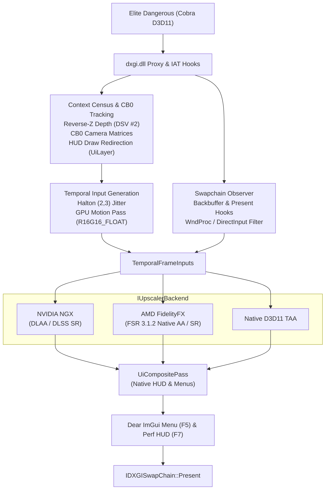

<div align="center">

# EDPE<br><sub>(Elite Dangerous Performance Enhanced)</sub>

[](https://github.com/filispeen/EDPE/releases/latest)
[](https://github.com/filispeen/EDPE/actions/workflows/CI.yml)
[](STATUS.md)
[]()
[]()
[](https://discord.gg/KxDBRcKwMK)

</div>

EDPE is a `dxgi.dll` proxy for the 2D Direct3D 11 renderer in Elite Dangerous (Cobra engine). It intercepts DXGI and Direct3D 11 calls to add temporal anti-aliasing and upscaling, leaving game binaries, gameplay, and network code untouched.

## Current status (`v0.7.2`)

As of November 2026 (`v0.7.2`), the working pipeline covers:

* `dxgi.dll` proxy forwarding system DXGI calls while hooking `IDXGIFactory::CreateSwapChain`, `IDXGISwapChain::Present`, and `D3D11CreateDevice` / `D3D11CreateDeviceAndSwapChain` via IAT. Constant buffer discovery stops once the scene camera is found, `Map()`/`Unmap()` and `OMSetRenderTargets()` use pre-filtered, per-frame memoized camera/jitter paths and a persistent 4-way RTV metadata cache, and `edpe.log` writes on a dedicated background worker thread.
* Reversed-Z scene depth discovery (`DSV #2`, `DXGI_FORMAT_R32G8X24_TYPELESS`, $B=0.025$) and once-per-frame parsing of the 5376-byte `CB0` camera buffer, with a 2nd-order kinematic filter and projection fallback to reject auxiliary eye, mirror, canopy reflection, and sagittal probes.
* Halton `(2,3)` subpixel projection jitter injected into `CB0` words `1080`-`1095` (standing down when reconstruction is off), viewmodel sub-pass jitter coherence and scaled 208-byte `CB0` support for on-foot weapons/tools, paired with an optimized GPU pass (CPU precomputed relative camera transform) that renders current-to-previous motion vectors to `DXGI_FORMAT_R16G16_FLOAT`, including analytical rotational motion at infinity for the skybox and stars.
* Backend-neutral `TemporalFrameInputs` feeding `IUpscalerBackend` implementations for NVIDIA DLAA and DLSS Super Resolution (NGX Project ID `48d353f3-d07b-4048-876b-09f8622f5a27`, presets `Auto`, `E`, `J`, `K`, `L`, `M`), AMD FSR 3.1.2 Native AA and Super Resolution (native D3D11 compute), and native D3D11 TAA. Render scale is detected from scene depth versus swapchain dimensions, and `Custom.4.4.fxcfg` / `Custom.4.0.fxcfg` `<SSAAMultiplier>` stays synced when enabled.
* Native UI and cockpit HUD separation (`UiLayer` and `UiCompositePass`): pre-HUD clean scene color goes to the upscaler without redundant intermediate copies, cockpit holographic draws are redirected to `s_hud_mask_texture` (`R11G11B10_FLOAT`) with viewport unjittering, planetary rings and pre-sky atmosphere stay in the world buffer, the on-foot helmet visor overlay separates cleanly via post-upscale tonemapped delta, and native menus plus HUD are composited back over the reconstructed world.
* Multi-device DXGI Keyed Mutex synchronization, Smooth Motion auxiliary device isolation, hardened context hook races, color-source debouncing, crash minidump logging, DirectInput and `WndProc` input isolation when the menu is open (protecting flight controls and HOTAS), async GPU timestamp queries (zero overhead when the Performance HUD and profiler are disabled), and optional `EnableProfiler=1` QPC/GPU sub-pass profiling (`EDPE PROFILE` / `EDPE PROFILE_SUB`).
* Dear ImGui overlay (`F5`, ProggyForever vector font), toggleable Performance HUD (`F7`) with a 120-sample frametime graph (`8.3 ms` and `16.6 ms` reference lines, 15 Hz text refresh, background NVML GPU/VRAM polling), sequential comparison capture to `comparison/` (16-frame warmup, 5-second wait between backends), and `DEV=0` / `DEV=1` gating for developer panels and `F9` (`jitter_view.log`).

## Roadmap

| Phase | Milestone | Status | Summary |
|:---:|:---|:---|:---|
| 0-2 | Reconnaissance and resource census | Verified | Tracked D3D11 context calls, swapchain layout (`2560x1440 R8G8B8A8`), MRT bindings, and `CB0` lifecycle. |
| 3 | Scene depth extraction | Verified | Confirmed `DSV #2` reversed-Z depth buffer ($B=0.025$) for full-frame geometry. |
| 4 | Camera and projection tracking | Verified | Parsed the 5376-byte dynamic `CB0` and latched the primary 3D camera once per frame. |
| 5 | Projection jitter injection | Verified | Injected Halton `(2,3)` jitter into `CB0` with fail-open bypass when upscaling is off. |
| 6 | Motion vectors pass | Verified | Generated screen-space camera-depth motion vectors into `R16G16_FLOAT` plus skybox rotational motion. |
| 7 | Shared temporal input layer | Verified | Implemented backend-neutral `TemporalFrameInputs` and `IUpscalerBackend`. |
| 8 | NVIDIA DLAA | Verified | Integrated official NGX DLAA at native resolution (~0.3 ms GPU time at 1440p). |
| 9-10 | Render scale and NVIDIA DLSS SR | Verified | Lowered 3D render scale via Cobra `<SSAAMultiplier>` (< 1.0x) with automatic resolution detection. |
| 11 | AMD FSR 3.1.2 | Verified | Integrated native D3D11 FidelityFX FSR 3.1.2 for both Native AA and Super Resolution. |
| 12 | Native-resolution HUD separation | Verified | Redirected cockpit HUD draws to `s_hud_mask_texture` (`UiLayer`) and composited native UI over the upscaled scene (`UiCompositePass`). |
| 13-15 | D3D11/D3D12 interop and Frame Generation | Not started | Planned D3D11/D3D12 bridge for NVIDIA DLSS Frame Generation (Streamline) and AMD FSR Frame Generation. |
| 16 | Intel XeSS | Planned | Planned Intel XeSS Native AA and Super Resolution (XMX on Arc, DP4a fallback) via D3D11/D3D12 interop. |
| 17 | Low-latency integration | Planned | Planned standalone and FG-coupled latency pacing via NVIDIA Reflex and AMD Anti-Lag / Anti-Lag 2. |
| 18 | NVIDIA DLSS-NR | Research | Investigating NGX Neural Rendering for reflections and lighting. |
| 19 | Third-party mod compatibility | Planned | Planned proxy DLL chaining and compatibility with ReShade, EDHM, and 3Dmigoto. |

See [STATUS.md](STATUS.md) for verified test and capture logs, and [PLAN.md](PLAN.md) for the full technical roadmap.

## Architecture

Elite-specific observation and temporal input generation stay inside EDPE; vendor SDK calls sit behind `IUpscalerBackend`.



If an upscaler backend fails to initialize or evaluate, EDPE disables jitter, restores the unscaled game frame, and presents normally.

## Controls and hotkeys

| Hotkey | Action | Notes |
|:---:|:---|:---|
| `F5` | Toggle EDPE menu | Opens and closes the Dear ImGui panel. When closed, mouse and keyboard input passes straight to the game. |
| `F7` | Toggle Performance HUD | Shows or hides FPS, 1% low FPS, game/upscaler/total frametimes, frametime graph, GPU usage, and VRAM usage. |
| `F9` | Record jitter diagnostics | Available only when `DEV=1`. Starts or stops frame-indexed logging to `jitter_view.log`. |

Inside the `F5` menu:

* `HUD & UI Scaling`: toggle the Performance HUD, pick one of 8 anchor positions (or drag the HUD directly while the menu is open), and adjust `HUD Scale` and `UI Scale` (`0.50x` to `2.50x`).
* `Upscaler & Image Quality`: switch between `Native (Bypass)`, `NVIDIA DLSS / DLAA`, `AMD FSR (Native AA / SR)`, and `TAA (Temporal Anti-Aliasing)`, choose the DLSS preset (`Auto`, `E (CNN Fast)`, `J`, `K`, `L`, `M`), adjust sharpening (`0.00` to `1.00`), and toggle `Preserve Native UI`.
* `Debug View`: switch between `None` and `Subpixel Jitter` to highlight jittered pixels in green over a desaturated scene. (The HUD mask debug pass in `hud_debug_pass.cpp` has no UI toggle and is only exercised by `hud_debug_test` or `[HUD] DebugView=1` in `edpe.ini`.)
* Developer panels (`DEV=1`): sequential comparison capture across active backends (`comparison/`), DSV bind sequence and snapshot viewers (depth, scene color, emissive, motion, HUD mask), jitter overrides and `jitter.log` controls, and motion vector tuning (`ZeroMotion`, `InvertX`, `InvertY`, `Scale`).

## Configuration (`edpe.ini`)

EDPE reads and writes `edpe.ini` in the same folder as `EliteDangerous64.exe`, and writes runtime diagnostics to `edpe.log`.

Upscaling quality ratios follow Elite Dangerous's in-game **Supersampling** setting (`Options -> Graphics -> Display -> Supersampling` or `<SSAAMultiplier>` in `Custom.4.4.fxcfg` / `Custom.4.0.fxcfg`), determined automatically from scene depth dimensions:

* `1.0x`: Native AA (DLAA, FSR Native AA, or TAA)
* `0.67x`: Quality
* `0.58x`: Balanced
* `0.50x`: Performance
* `0.33x`: Ultra Performance

Example `edpe.ini` matching the keys read by `src/config.h` (note that `edpe.ini` in the repository ships with a minimal subset, and missing keys fall back to `config.h` defaults):

```ini
[Upscaler]
; 0 = Native (Bypass), 1 = NVIDIA DLSS/DLAA, 2 = AMD FSR, 3 = Native D3D11 TAA
Backend=0
; DLSS Preset: 0 = Auto (K), 5 = E (CNN Fast), 10 = J, 11 = K, 12 = L, 13 = M
Preset=0
AutoSyncEliteConfig=1
PreserveNativeUi=1
HdrInput=0
Sharpness=0.50

[Jitter]
Enabled=1
InvertX=0
InvertY=0
SwapXY=0
Scale=1.00
; Repo edpe.ini defaults to 8; config.h fallback is 32 if omitted
PhaseCount=8

[Motion]
ZeroMotion=0
InvertX=0
InvertY=0
Scale=1.00

[Overlay]
ShowPerfOverlay=1
EnableProfiler=0
; 0=Top-Left, 1=Top, 2=Top-Right, 3=Left, 4=Right, 5=Bottom-Left, 6=Bottom, 7=Bottom-Right
Corner=1
Scale=1.50          ; Performance HUD scale (0.50 - 2.50 in UI)
UiScale=1.00        ; Menu UI scale (0.50 - 2.50 in UI)
PosX=1900.0         ; Custom dragged X (-1.0 uses Corner)
PosY=496.0          ; Custom dragged Y (-1.0 uses Corner)
DEV=0               ; 0 = standard mode, 1 = show dev panels and enable F9
```

## Building

Requirements:

* Windows 10/11 x64
* Visual Studio 2022 with **Desktop development with C++** (MSVC x64 toolchain and Windows SDK)
* CMake 3.25 or newer
* Python 3 (CMake runs `tools/fetch_ffx_dx11.py` automatically if `external/ffx-dx11` is missing)
* `external/imgui` Git submodule
* Optional: NVIDIA NGX SDK under `external/DLSS` (if omitted, CMake builds without DLAA/DLSS support)

Clone and initialize submodules:

```powershell
git clone https://github.com/filispeen/EDPE.git
cd EDPE
git submodule update --init --recursive
```

Optionally, `install-build-requirements.ps1` installs Git, CMake, and Visual Studio Build Tools via `winget` and initializes submodules:

```powershell
powershell -NoProfile -ExecutionPolicy Bypass -File .\install-build-requirements.ps1
```

Configure and build from an **x64 Native Tools Command Prompt for VS 2022** (or x64 Developer PowerShell):

```powershell
cmake -S . -B build -A x64
cmake --build build --config Release --parallel
```

Build outputs:

* `build/Release/dxgi.dll`: compiled proxy DLL
* `build/stage/dxgi.dll` (and `build/stage/nvngx_dlss.dll` when `external/DLSS` is present): staged runtime files

Run the 15 automated tests with CTest:

```powershell
ctest --test-dir build -C Release --output-on-failure
```

Test targets in `CMakeLists.txt`:

* `temporal_math`: Halton sequence generation, projection blocks, matrix rejection invariants
* `camera_delta`: camera delta math, event flags, scene reset detection
* `capture_format`: half-float, float11/10 unpackers, depth contrast, Reinhard tone mapping
* `temporal_inputs`: scaling math, input validation, NVIDIA/AMD conventions, fail-open behavior
* `motion_gpu`: Direct3D 11 GPU motion pass
* `ui_composite`: native UI isolation and holographic HUD mask compositing
* `hud_debug`: HUD debug pass modes and null fallback safety
* `dxbc_fanout`: shader bytecode interception and hashing
* `jitter_view_report`: jitter diagnostics report generation
* `crash_logger`: SEH crash minidump generation
* `ui_menu_size`: Dear ImGui menu sizing and layout bounds
* `vtable_hook`: `LiveCopy` vtable hook initialization, drift detection, and unhook restoration
* `proxy_smoke`: DLL load, Present hook, and input pass-through
* `proxy_shader_probe`: shader bytecode interception smoke test
* `proxy_alias_smoke`: staged `dxgi.dll` loading smoke test

## Installation

1. Build the project or download a release archive from [Releases](https://github.com/filispeen/EDPE/releases/latest).
2. Open the folder containing `EliteDangerous64.exe` (for example `Products\elite-dangerous-odyssey-64` or `Products\elite-dangerous-64`).
3. Copy `build/stage/dxgi.dll` (and `build/stage/nvngx_dlss.dll` for NVIDIA DLAA/DLSS) next to `EliteDangerous64.exe`. Remove any legacy `d3d11.dll` from older versions.
4. Launch Elite Dangerous through the Frontier Launcher or Steam.
5. Press `F5` in-game to open the menu and select an upscaler backend. Check `edpe.log` next to `EliteDangerous64.exe` if something fails to initialize.

To uninstall, delete or rename `dxgi.dll` and `nvngx_dlss.dll` in the game folder.

## Project structure

```text
EDPE/
├── external/
│   └── imgui/                          # Dear ImGui submodule (plus optional DLSS / ffx-dx11 SDKs)
├── src/
│   ├── shaders/
│   │   └── ui_layer_composite_cs.hlsl  # Compute shader for native UI layer compositing
│   ├── camera_delta.h                  # Camera motion delta and reset detection
│   ├── capture_format.h                # Texture format unpackers and tone-mapping helpers
│   ├── cobra_camera_inject.h           # CB0 projection jitter injection helpers
│   ├── code_hook.h / vtable_hook.h     # Inline/IAT and LiveCopy vtable hooking utilities
│   ├── config.h / version.cpp          # Central edpe.ini serialization and kVersion
│   ├── context_census.cpp / .h         # D3D11 observation, CB0 parsing, pipeline orchestration
│   ├── crash_logger.cpp / .h           # Unhandled exception handler and minidump writer
│   ├── d3d11_proxy.cpp / .h            # D3D11CreateDevice IAT hooks
│   ├── dinput_proxy.h                  # DirectInput8 isolation when menu is active
│   ├── dllmain.cpp                     # DLL entry point
│   ├── dxbc_hash.cpp / dxbc_fanout.h   # DXBC shader hashing and draw fanout
│   ├── dxgi_observer.cpp               # Swapchain Present / ResizeBuffers observation
│   ├── dxgi_proxy.cpp / .def           # dxgi.dll export forwarding and factory hooks
│   ├── elite_camera.h                  # 5376-byte CB0 camera parser
│   ├── hud_debug_pass.cpp / .h         # HUD mask debug shader pass (with hud_debug_shader.h)
│   ├── input_hook.cpp / .h             # WndProc and DirectInput interception
│   ├── jitter_debug_pass.cpp / .h      # Subpixel jitter debug visualization pass
│   ├── jitter_logger.cpp / .h          # Background jitter.log writer
│   ├── jitter_view_recorder.cpp / .h   # F9 jitter_view.log recorder (DEV=1)
│   ├── log.cpp / .h                    # Asynchronous background edpe.log writer
│   ├── motion_pass.cpp / .h            # GPU camera-depth and skybox motion pass
│   ├── ngx_context.cpp / .h            # NVIDIA NGX DLAA/DLSS wrapper
│   ├── perf_overlay.cpp / .h           # F7 Performance HUD and NVML poller
│   ├── profiler.h                      # QPC per-pass profiler
│   ├── sharpen_pass.cpp / .h           # Sharpening pass helpers
│   ├── taa_pass.cpp / .h               # Native D3D11 TAA compute pass
│   ├── temporal_inputs.h               # Backend-neutral TemporalFrameInputs contract
│   ├── temporal_math.h                 # Halton sequence and matrix validation math
│   ├── ui.cpp / .h                     # Dear ImGui F5 menu, snapshot windows, hotkeys
│   ├── ui_composite_pass.cpp / .h      # Native UI and HUD mask composite pass
│   ├── ui_layer.cpp / .h               # Live cockpit HUD draw redirection layer
│   └── upscaler_backend.cpp / .h       # IUpscalerBackend implementations (DLSS, FSR 3.1.2, TAA)
├── tests/                              # 13 source files producing 15 CTest targets
├── tools/
│   ├── fetch_ffx_dx11.py               # Fetches and builds FidelityFX DX11 SDK
│   └── ngx_probe/                      # Standalone hardware NGX diagnostic probe
├── docs/                               # Reverse-engineering notes and backend input contracts
├── PLAN.md                             # 19-phase architectural roadmap
├── STATUS.md                           # Verified empirical findings and milestone log
└── AGENTS.md                           # Project architecture and engineering rules
```

## Documentation

* [STATUS.md](STATUS.md): verified facts, milestone logs, and test status
* [PLAN.md](PLAN.md): full 19-phase roadmap
* [AGENTS.md](AGENTS.md): engineering rules and architecture boundaries
* [BUILD.md](BUILD.md): legacy NMake build notes
* [docs/render-pipeline-observations.md](docs/render-pipeline-observations.md): Elite Dangerous MRT layout, depth buffers, and pass order
* [docs/nvidia-dlaa-input-contract.md](docs/nvidia-dlaa-input-contract.md): NVIDIA NGX DLAA input requirements
* [docs/amd-fsr-input-contract.md](docs/amd-fsr-input-contract.md): AMD FidelityFX FSR input requirements
* [docs/elite-input-conventions.md](docs/elite-input-conventions.md): Cobra camera, coordinate system, and projection conventions
* [docs/shared-temporal-inputs.md](docs/shared-temporal-inputs.md): `TemporalFrameInputs` specification

## Acknowledgments

* [characterecho-sean/edvr-unofficial-patch](https://github.com/characterecho-sean/edvr-unofficial-patch): reference for depth discovery and motion injection in Cobra
* [ocornut/imgui](https://github.com/ocornut/imgui): Dear ImGui overlay
* NVIDIA NGX SDK and AMD FidelityFX SDK

світла пам'ять соні, моїй любій кішці яка померла 24 січня 26-го року около 1:00 AM, день коли вона помирала і останній раз в своєму житті лежала у мене на ногах поки я працював над цим проєктом
