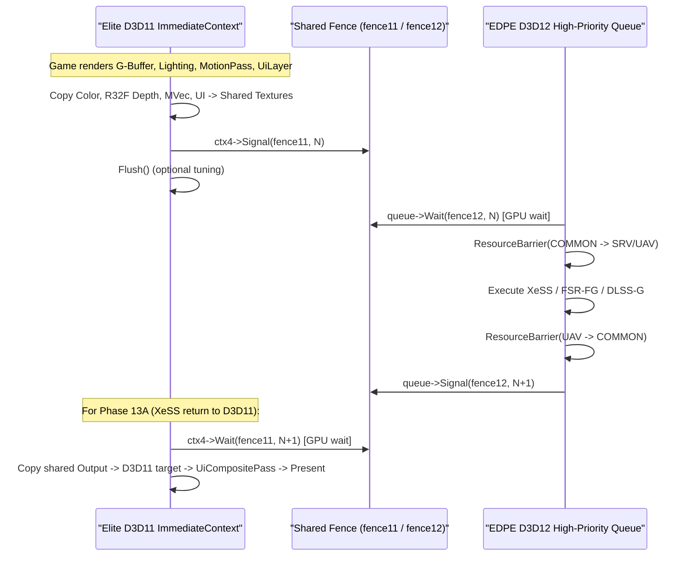

# Phase 13 Research: D3D11 / D3D12 Interoperability Architecture

**Date:** 2026-11-14  
**Scope:** Phase 13 ([PLAN.md](../PLAN.md) §§6, 17, 32, 34, 36; `AGENTS.md` D3D11/D3D12 boundary)  
**Unlocks:** Phase 14 (AMD FSR FG), Phase 15 (NVIDIA DLSS-G), Phase 16 (Cross-vendor Intel XeSS), Phase 18 (D3D12 DLSS-RR)  
**Status:** RESEARCH COMPLETE — Ready for isolated prototype and benchmark harness.

---

## 1. Why Phase 13 Exists

Elite Dangerous (Cobra engine) is a native **Direct3D 11** application (`VERIFIED`). However, three of EDPE's remaining roadmap targets require or strongly depend on Direct3D 12:

| Target Feature | Native D3D11 Support? | Why D3D12 Interop Is Needed |
|:---|:---|:---|
| **Intel XeSS SR / Native AA** (Phase 16) | **Intel Arc only** (`libxess_dx11.dll`, `SDK-DOCUMENTED`) | Cross-vendor DP4a fallback (NVIDIA RTX/GTX, AMD RDNA, Intel Iris Xe) exists **only** in `libxess.dll` via D3D12 (or Vulkan). |
| **AMD FidelityFX Frame Generation** (Phase 14) | **No** (`SDK-DOCUMENTED`) | `ffx_framegeneration.h` and `ffx_api_framegeneration_dx12.h` require a D3D12 `ID3D12CommandQueue` + D3D12 Flip-model `IDXGISwapChain4` (or Vulkan). |
| **NVIDIA Streamline DLSS-G** (Phase 15) | **No** (`SDK-DOCUMENTED`) | `sl.dlss_g.dll` supports only D3D12 (or Vulkan) and requires a D3D12 `IDXGISwapChain` + `ID3D12CommandQueue` + HAGS. |
| **NVIDIA DLSS-NR** (Phase 18) | Yes in NGX (`NVSDK_NGX_D3D11_DLSSD_Eval_Params`), **No** in Streamline (`sl.dlss_d` D3D12/VK preferred) | Needed if integrating via Streamline alongside DLSS-G. |

---

## 2. Architecture Options Evaluated

Three real-world interoperability architectures exist in the Windows graphics ecosystem.

### Option A1 — Native D3D11 + Secondary D3D12 Compute Bridge (Shared NT Handles + Fences)
Used in production for Elite Dangerous by **`Siegfried-Origin/EDAA`** ([`addon/src/xess.cpp`](https://github.com/Siegfried-Origin/EDAA/blob/master/addon/src/xess.cpp), MIT license, `REFERENCE-CODE`) and by zero-copy GPU capture/compositor bridges.

* **How it works:**
  1. Elite Dangerous creates and runs entirely on its native `ID3D11Device` and `IDXGISwapChain`.
  2. EDPE creates a secondary `ID3D12Device` on the **exact same `IDXGIAdapter`** (`IDXGIDevice::GetAdapter(&adapter)` $\rightarrow$ `D3D12CreateDevice(..., D3D_FEATURE_LEVEL_12_0, ...)`).
  3. Shared textures (`color`, `depth_R32F`, `motion`, `output`, optional `mask`) are created with `D3D11_RESOURCE_MISC_SHARED_NTHANDLE | D3D11_RESOURCE_MISC_SHARED` (recommended to allocate via D3D11 or D3D12 as `D3D12_HEAP_FLAG_SHARED`), exported via `IDXGIResource1::CreateSharedHandle()`, and opened on the other device via `ID3D12Device::OpenSharedHandle()` / `ID3D11Device5::OpenSharedTexture1()` (or vice-versa).
  4. Cross-API GPU ordering uses a **shared timeline fence** (`ID3D12Device::CreateFence(0, D3D12_FENCE_FLAG_SHARED)` + `CreateSharedHandle` $\rightarrow$ `ID3D11Device5::OpenSharedFence`), avoiding CPU stalls:
     * D3D11 `CopyResource` inputs $\rightarrow$ `ID3D11DeviceContext4::Signal(fence11, N)`
     * D3D12 `queue->Wait(fence12, N)` $\rightarrow$ `ExecuteCommandLists` (XeSS / FG) $\rightarrow$ `queue->Signal(fence12, N+1)`
     * D3D11 `ID3D11DeviceContext4::Wait(fence11, N+1)` $\rightarrow$ `CopyResource` output back to D3D11 scene/backbuffer.
* **Pros:** Zero D3D11On12 overhead on Cobra's thousands of D3D11 draw calls; 100% compatible with **EDHM / 3Dmigoto** (`d3d11.dll`); isolated failure domain; supports zero-copy GPU-GPU synchronization without `Flush()` blocking CPU.
* **Cons:** Does **not** create a D3D12 Flip-model `IDXGISwapChain4`, so Option A1 alone handles **Phase 16 (XeSS)** and **Phase 18 (D3D12 DLSS-RR)**, while **Phases 14 & 15 (Frame Generation)** require Option A2.

### Option A2 — Native D3D11 + Secondary D3D12 FG Presenter (`Dx11wDx12SC` Proxy Swapchain)
Used in production for adding D3D12 Frame Generation to D3D11 games by **`optiscaler/OptiScaler`** (`OptiScaler/with_dx12/dx11_with_dx12_sc.cpp`, GPL-3.0 reference, `REFERENCE-CODE`).

* **How it works:**
  1. The game's D3D11 device still renders the entire 3D world and HUD on native D3D11 (preserving Cobra stability and EDHM/3Dmigoto).
  2. When EDPE intercepts `IDXGIFactory::CreateSwapChain` / `CreateSwapChainForHwnd` (`src/dxgi_observer.cpp`), instead of presenting the game's original D3D11 swapchain visibly:
     * A real D3D11 swapchain is bound to a **1×1 hidden window** (or offscreen dummy HWND) so Cobra's `GetBuffer(0)` and D3D11 RTV rendering keep working untouched.
     * EDPE creates a **D3D12 Flip-model `IDXGISwapChain4`** (`DXGI_SWAP_EFFECT_FLIP_DISCARD`, `bufferCount >= 2`) attached to the **real visible Elite Dangerous `HWND`** and backed by EDPE's secondary `ID3D12CommandQueue` (and wrapped by AMD `ffxCreateContextDescFrameGenerationSwapChain*` or NVIDIA `slUpgradeInterface`).
  3. On every frame, EDPE copies the reconstructed HUD-less world (and optionally UI layers or final backbuffer) into shared NT-handle textures, signals `fence11`, waits on D3D12 queue, runs Frame Generation + UI composition, and presents via the visible D3D12 FG swapchain.
* **Pros:** Unlocks **both AMD FSR FG and NVIDIA DLSS-G** without converting Elite's D3D11 engine to D3D11On12; keeps EDHM/3Dmigoto intact; allows clean fail-open switch back if FG is toggled off (though swapchain tearing down/rebuilding on toggle requires `ResizeBuffers` / careful lifetime management, or keeping the D3D12 presenter persistent while FG is `mode=Off`).
* **Cons:** Most complex component in Phase 13. Requires careful handling of:
  * Exclusive Fullscreen vs Borderless (`SetFullscreenState`, `DXGI_SWAP_CHAIN_FLAG_ALLOW_TEARING`),
  * `ResizeBuffers` synchronization (`WaitForQueueIdle` before releasing shared backbuffers),
  * Blt-to-Flip format conversion (`PrepareDx12FlipFormat` — e.g., sRGB backbuffer views cannot be created directly as Flip swapchain formats; use `_UNORM` swapchain + sRGB RTV on D3D11 side),
  * ReShade / Steam / RTSS overlay ordering (`Phase 19`).

### Option B — Full `D3D11On12CreateDevice` Replacement (REJECTED for EDPE)
* **How it works:** Intercept `D3D11CreateDevice` (`src/d3d11_proxy.cpp`) and return a `D3D11On12CreateDevice` wrapper backed by a D3D12 device (`REFERENCE-CODE`: `OptiScaler` legacy path, Microsoft `D3D11On12`).
* **Why EDPE MUST REJECT Option B (`VERIFIED` against ecosystem bugs):**
  1. **10–15% CPU/GPU Performance Regression (`MEASURED` by OptiScaler):** Translating every Cobra D3D11 draw call, dynamic `CB0` `Map(WRITE_DISCARD)`, G-Buffer MRT bind, and state change through `D3D11On12` wipes out Super Resolution framerate gains.
  2. **Breaks EDHM & 3Dmigoto (`VERIFIED` in `bo3b/3Dmigoto#183`):** 3Dmigoto hooks D3D11 devices and does not export/support `D3D11On12CreateDevice`.
  3. **Resource & Driver Instability:** Requires Agility SDK (`D3D12Core.dll`) workarounds for older Windows builds and risks `DXGI_ERROR_DEVICE_REMOVED` on Cobra's deferred contexts (`CreateDeferredContext`).

**Decision (`PLAN.md` §32):** Adopt **Option A1** first (Phase 13A) for zero-swapchain-risk XeSS / DLSS-RR compute interop, then extend cleanly to **Option A2** (Phase 13B) behind an isolated `D3D11D3D12Bridge` + `ProxySwapChainD3D12` prototype.

---

## 3. Critical Low-Level Interop Rules (`SDK-DOCUMENTED` & `REFERENCE-CODE`)

### 3.1 Shared Textures vs Depth Format Constraint
Cobra's scene depth `DSV #2` is `DXGI_FORMAT_R32G8X24_TYPELESS` (`D32_FLOAT_S8X24_UINT`).
* **`SDK-DOCUMENTED` WDDM Interop Pitfall:** `D3D11_RESOURCE_MISC_SHARED_NTHANDLE` is **NOT supported** across WDDM D3D11↔D3D12 shared heaps on planar depth-stencil formats (`R32G8X24_TYPELESS` / `D32_FLOAT_S8X24_UINT`), and upscalers (XeSS, DLSS-G, FSR FG) do not need stencil bits anyway. *(Note: On Intel Arc's **native D3D11** path `libxess_dx11.dll`, `R32G8X24_TYPELESS` IS supported directly without copying; the `R32_FLOAT` copy is strictly for the D3D11→D3D12 shared bridge.)*
* **Solution (used in both `EDAA` and `OptiScaler`):** Allocate the shared depth buffer as **`DXGI_FORMAT_R32_FLOAT`** with `D3D11_BIND_SHADER_RESOURCE | D3D11_BIND_RENDER_TARGET` (or `UNORDERED_ACCESS`) and run a tiny fullscreen/compute copy pass extracting `.r` from `DSV #2` SRV into the shared `R32_FLOAT` texture before signaling `fence11`. (Alternatively, piggyback this 1-line write onto EDPE's existing `MotionPass` compute shader to avoid an extra full-screen pass!)

### 3.2 `D3D11_RESOURCE_MISC_SHARED_NTHANDLE` vs `KEYEDMUTEX`
* EDPE already uses `IDXGIKeyedMutex` for multi-device D3D11-to-D3D11 safety (`STATUS.md` `v0.7.0`).
* However, for **D3D11 $\leftrightarrow$ D3D12** compute/FG queues, **Shared NT Handles + `ID3D11Fence`/`ID3D12Fence`** are strictly superior to `KEYEDMUTEX`:
  * `KEYEDMUTEX` serializes at `AcquireSync`/`ReleaseSync` coarse boundaries and is incompatible with asynchronous D3D12 compute/present queues used by Streamline `sl.dlss_g` and FidelityFX `allowAsyncWorkloads`.
  * `ID3D11Fence` / `ID3D12Fence` (`ID3D11Device5` + `ID3D11DeviceContext4`, Win10 1703+ / RS2) implements pure GPU-side `Signal`/`Wait` pipelining with **zero CPU waits** except when recycling an in-flight `ID3D12CommandAllocator` ring slot (e.g., `kAllocatorCount = 4` or `8`).

### 3.3 Synchronization Pipeline Diagram



---

## 4. Concrete EDPE C++ Prototype Design (`D3D11D3D12Bridge`)

Notice how clean the `EDAA` (`addon/src/xess.cpp`) pattern adapts to EDPE's COM/RAII style (`AGENTS.md`), matching the exact adapter LUID already captured in `src/d3d11_proxy.cpp`:

> **`SDK-DOCUMENTED` State & Handle Invariants:**
> 1. Shared cross-API D3D12 textures (`D3D12_HEAP_FLAG_SHARED`) enter and leave D3D12 command lists in **`D3D12_RESOURCE_STATE_COMMON`**. Because backends such as Intel XeSS do **not** emit automatic state transitions (`XeSS-SR Developer Guide 2.0`), EDPE must explicitly call `transitionResource(...)` to transition inputs (`COMMON` → `NON_PIXEL_SHADER_RESOURCE`) and outputs (`COMMON` → `UNORDERED_ACCESS`), then transition back to `D3D12_RESOURCE_STATE_COMMON` before `queue_->Signal(...)`.
> 2. Both `CreateSharedHandle` calls (fence & textures) return kernel NT `HANDLE`s that must be closed immediately after `OpenSharedHandle` / `OpenSharedFence` via `CloseHandle` on **every** code path (including early failure returns) to avoid handle leaks during `ResizeBuffers`.

```cpp
// Proposed isolated module: src/d3d12_bridge.h (Phase 13A)
#pragma once
#include <d3d11_4.h>
#include <d3d12.h>
#include <dxgi1_4.h>
#include <wrl/client.h>
#include <array>
#include <cstdint>

namespace edpe {

struct SharedBridgeTexture {
    Microsoft::WRL::ComPtr<ID3D11Texture2D> d3d11;
    Microsoft::WRL::ComPtr<ID3D12Resource> d3d12;
    uint32_t width = 0;
    uint32_t height = 0;
    DXGI_FORMAT format = DXGI_FORMAT_UNKNOWN;

    void reset() {
        d3d12.Reset();
        d3d11.Reset();
        width = height = 0;
        format = DXGI_FORMAT_UNKNOWN;
    }
};

class D3D11D3D12Bridge {
public:
    static constexpr uint32_t kAllocatorCount = 4;

    static void transitionResource(
        ID3D12GraphicsCommandList* cmdList,
        ID3D12Resource* resource,
        D3D12_RESOURCE_STATES before,
        D3D12_RESOURCE_STATES after) {
        if (!cmdList || !resource || before == after) return;
        D3D12_RESOURCE_BARRIER barrier{};
        barrier.Type = D3D12_RESOURCE_BARRIER_TYPE_TRANSITION;
        barrier.Flags = D3D12_RESOURCE_BARRIER_FLAG_NONE;
        barrier.Transition.pResource = resource;
        barrier.Transition.Subresource = D3D12_RESOURCE_BARRIER_ALL_SUBRESOURCES;
        barrier.Transition.StateBefore = before;
        barrier.Transition.StateAfter = after;
        cmdList->ResourceBarrier(1, &barrier);
    }

    bool initialize(ID3D11Device* d3d11Device) {
        if (!d3d11Device) return false;
        if (FAILED(d3d11Device->QueryInterface(IID_PPV_ARGS(&device11_5_)))) {
            return false; // Requires Windows 10 1703+ (WDDM 2.2+)
        }

        Microsoft::WRL::ComPtr<IDXGIDevice> dxgiDev;
        Microsoft::WRL::ComPtr<IDXGIAdapter> adapter;
        if (FAILED(d3d11Device->QueryInterface(IID_PPV_ARGS(&dxgiDev))) ||
            FAILED(dxgiDev->GetAdapter(&adapter))) {
            return false;
        }

        // CRITICAL: Match the exact GPU adapter Elite chose (multi-GPU/laptop safe).
        if (FAILED(D3D12CreateDevice(adapter.Get(), D3D_FEATURE_LEVEL_12_0,
                                     IID_PPV_ARGS(&device12_)))) {
            return false;
        }

        D3D12_COMMAND_QUEUE_DESC qDesc{};
        qDesc.Type = D3D12_COMMAND_LIST_TYPE_DIRECT;
        qDesc.Priority = D3D12_COMMAND_QUEUE_PRIORITY_HIGH;
        if (FAILED(device12_->CreateCommandQueue(&qDesc, IID_PPV_ARGS(&queue_)))) {
            return false;
        }

        for (uint32_t i = 0; i < kAllocatorCount; ++i) {
            if (FAILED(device12_->CreateCommandAllocator(
                    D3D12_COMMAND_LIST_TYPE_DIRECT, IID_PPV_ARGS(&allocators_[i])))) {
                return false;
            }
        }
        if (FAILED(device12_->CreateCommandList(
                0, D3D12_COMMAND_LIST_TYPE_DIRECT, allocators_[0].Get(),
                nullptr, IID_PPV_ARGS(&cmdList_)))) {
            return false;
        }
        cmdList_->Close();

        HANDLE sharedFenceHandle = nullptr;
        if (FAILED(device12_->CreateFence(0, D3D12_FENCE_FLAG_SHARED,
                                          IID_PPV_ARGS(&fence12_))) ||
            FAILED(device12_->CreateSharedHandle(fence12_.Get(), nullptr,
                                                 GENERIC_ALL, nullptr, &sharedFenceHandle)) ||
            !sharedFenceHandle) {
            if (sharedFenceHandle) CloseHandle(sharedFenceHandle);
            return false;
        }
        const HRESULT openHr = device11_5_->OpenSharedFence(
            sharedFenceHandle, IID_PPV_ARGS(&fence11_));
        CloseHandle(sharedFenceHandle); // Always close immediately before error checks
        if (FAILED(openHr)) return false;

        fenceEvent_ = CreateEventW(nullptr, FALSE, FALSE, nullptr);
        device11_ = d3d11Device;
        return fenceEvent_ != nullptr;
    }

    bool createSharedTexture(uint32_t width, uint32_t height, DXGI_FORMAT format,
                             UINT d3d11BindFlags, SharedBridgeTexture& out) {
        out.reset();
        D3D11_TEXTURE2D_DESC desc{};
        desc.Width = width;
        desc.Height = height;
        desc.MipLevels = 1;
        desc.ArraySize = 1;
        desc.Format = format;
        desc.SampleDesc.Count = 1;
        desc.Usage = D3D11_USAGE_DEFAULT;
        desc.BindFlags = d3d11BindFlags;
        desc.MiscFlags = D3D11_RESOURCE_MISC_SHARED_NTHANDLE | D3D11_RESOURCE_MISC_SHARED;

        if (FAILED(device11_5_->CreateTexture2D(&desc, nullptr, &out.d3d11))) {
            return false;
        }
        Microsoft::WRL::ComPtr<IDXGIResource1> res1;
        HANDLE ntHandle = nullptr;
        if (FAILED(out.d3d11.As(&res1)) ||
            FAILED(res1->CreateSharedHandle(
                nullptr, DXGI_SHARED_RESOURCE_READ | DXGI_SHARED_RESOURCE_WRITE,
                nullptr, &ntHandle)) ||
            !ntHandle) {
            if (ntHandle) CloseHandle(ntHandle);
            out.reset();
            return false;
        }
        const HRESULT hr = device12_->OpenSharedHandle(ntHandle, IID_PPV_ARGS(&out.d3d12));
        CloseHandle(ntHandle); // Always close NT handle immediately regardless of hr
        if (FAILED(hr)) {
            out.reset();
            return false;
        }
        out.width = width;
        out.height = height;
        out.format = format;
        return true;
    }

    void waitGpuIdle() {
        if (!queue_ || !fence12_ || !fenceEvent_) return;
        const uint64_t target = ++fenceValue_;
        if (SUCCEEDED(queue_->Signal(fence12_.Get(), target)) &&
            fence12_->GetCompletedValue() < target) {
            fence12_->SetEventOnCompletion(target, fenceEvent_);
            WaitForSingleObject(fenceEvent_, 5000);
        }
    }

    // Wait only if allocator slot is still executing on GPU (typically never stalls).
    ID3D12GraphicsCommandList* beginCommandList(uint32_t& outSlot) {
        outSlot = frameCounter_++ % kAllocatorCount;
        const uint64_t waitVal = allocatorFence_[outSlot];
        if (waitVal > 0 && fence12_->GetCompletedValue() < waitVal) {
            fence12_->SetEventOnCompletion(waitVal, fenceEvent_);
            WaitForSingleObject(fenceEvent_, 5000);
        }
        allocators_[outSlot]->Reset();
        cmdList_->Reset(allocators_[outSlot].Get(), nullptr);
        return cmdList_.Get();
    }

    // D3D11 context signals inputs ready -> D3D12 waits -> runs cmdList -> signals done.
    uint64_t submitAfterD3D11Signal(ID3D11DeviceContext4* ctx4, uint32_t slot, bool flushD11) {
        const uint64_t d11Done = ++fenceValue_;
        ctx4->Signal(fence11_.Get(), d11Done);
        if (flushD11) ctx4->Flush();

        cmdList_->Close();
        queue_->Wait(fence12_.Get(), d11Done);
        ID3D12CommandList* lists[] = {cmdList_.Get()};
        queue_->ExecuteCommandLists(1, lists);

        const uint64_t d12Done = ++fenceValue_;
        queue_->Signal(fence12_.Get(), d12Done);
        allocatorFence_[slot] = d12Done;
        return d12Done;
    }

private:
    ID3D11Device* device11_ = nullptr; // Non-owning
    Microsoft::WRL::ComPtr<ID3D11Device5> device11_5_;
    Microsoft::WRL::ComPtr<ID3D12Device> device12_;
    Microsoft::WRL::ComPtr<ID3D12CommandQueue> queue_;
    std::array<Microsoft::WRL::ComPtr<ID3D12CommandAllocator>, kAllocatorCount> allocators_;
    Microsoft::WRL::ComPtr<ID3D12GraphicsCommandList> cmdList_;
    Microsoft::WRL::ComPtr<ID3D12Fence> fence12_;
    Microsoft::WRL::ComPtr<ID3D11Fence> fence11_;
    HANDLE fenceEvent_ = nullptr;
    uint64_t fenceValue_ = 0;
    std::array<uint64_t, kAllocatorCount> allocatorFence_{};
    uint32_t frameCounter_ = 0;
};

} // namespace edpe
```

---

## 5. Phase 13B Swapchain Proxy Challenges (Before Phases 14 & 15)

When extending Option A1 to Option A2 (`ProxySwapChainD3D12`), research from `OptiScaler` (`dx11_with_dx12_sc.cpp`) highlights five critical edge cases EDPE must solve cleanly:

1. **Streamline Compatibility on D3D12 Device Creation:**
   If Phase 15 (Streamline) is enabled, `slInit()` **must** be called before `D3D12CreateDevice` and `CreateSwapChain`, OR with `PreferenceFlag::eUseManualHooking` (`slSetD3DDevice` + `slUpgradeInterface`), so Streamline attaches to EDPE's secondary `ID3D12Device` / `ID3D12CommandQueue` / `IDXGISwapChain4` without touching Cobra's D3D11 device (`ProgrammingGuideManualHooking.md`).
2. **Thread-Safe `Present` vs `ResizeBuffers` Mutex:**
   Alt+Tab, display scaling changes, or Frontier borderless/fullscreen switches trigger `ResizeBuffers` while asynchronous FG presentation threads may still be presenting. Acquire a `std::shared_mutex` + `waitGpuIdle()` before releasing any `SharedBridgeTexture` or calling `ResizeBuffers` (`OptiScaler` `Dx11wDx12Sync::PresentResizeMutex()`).
3. **Flip-Model Flag Sanitization (`PrepareFGResize`):**
   Cobra may request Blt-model flags (`DXGI_SWAP_CHAIN_FLAG_GDI_COMPATIBLE`) or `BufferCount == 1`. The visible D3D12 FG swapchain must enforce `BufferCount >= 2`, `DXGI_SWAP_EFFECT_FLIP_DISCARD`, strip `DXGI_SWAP_CHAIN_FLAG_GDI_COMPATIBLE`, and preserve initial `DXGI_SWAP_CHAIN_FLAG_ALLOW_TEARING`.
4. **HDR / ColorSpace Re-Application:**
   Re-apply `SetColorSpace1` (`DXGI_COLOR_SPACE_RGB_FULL_G2084_NONE_P2020` / `G22_NONE_P709`) to the D3D12 FG swapchain whenever the game updates its color space or after resize.
5. **Hidden D3D11 Swapchain Window:**
   A hidden 1×1 `HWND` (with `WS_DISABLED`, non-focus-stealing) keeps Cobra's original D3D11 swapchain valid so `GetBuffer()` and ImGui/ReShade fallback never fail if FG shuts down (`Fail-Open`).

---

## 6. Required Measurements & Benchmark Plan (`AGENTS.md` Gate)

Per `AGENTS.md` ("Before adopting an interop architecture, measure copy count, GPU/CPU synchronization, GPU/CPU overhead, VRAM, frame pacing"), EDPE should build a standalone test (`tests/d3d11_d3d12_bridge_test.cpp`) before touching Cobra's `IDXGISwapChain`:

| Metric | Target Budget (1440p) | Measurement Method |
|:---|:---|:---|
| Shared texture round-trip copy cost (4 textures + 1 return copy) | `< 0.25 ms` GPU time | D3D11 + D3D12 timestamp queries (`ID3D12QueryHeap`) |
| Fence wait CPU overhead | `< 0.05 ms` (zero blocking WaitForSingleObject in steady state) | QPC around `submitAfterD3D11Signal` & `allocatorFence_` hits |
| Extra VRAM footprint (Option A1, 1440p Quality) | `~35–55 MB` | `DXGI_QUERY_VIDEO_MEMORY_INFO` delta before/after `resize()` |
| Extra VRAM footprint (Option A2 Swapchain + FG buffers) | Measure explicitly per backend | `DXGI_QUERY_VIDEO_MEMORY_INFO` + `ffxQuery` / `slDLSSGGetState` |
| Present interval stability (`Option A2` bypass vs native D3D11) | $\sigma < 0.3\text{ ms}$ delta | ETW / `IDXGISwapChain::GetFrameStatistics` |

If Option A1/A2 interop overhead exceeds the framerate benefit of XeSS or Frame Generation at target settings, stop and document measurements before proceeding (`AGENTS.md`).

---

## 7. Linux / Proton (DXVK + vkd3d-proton) Interop Requirements

When implementing the D3D11-to-D3D12 shared-resource bridge for future Frame Generation or D3D12 upscaler backends under Proton/Wine (DXVK for D3D11 + vkd3d-proton for D3D12), enforce the following verified constraints:

1. **Shared Texture Creation Flags:** Create every cross-API bridge texture with both `D3D11_RESOURCE_MISC_SHARED_KEYEDMUTEX | D3D11_RESOURCE_MISC_SHARED_NTHANDLE` in `MiscFlags` and include `D3D11_BIND_RENDER_TARGET` in `BindFlags` (alongside `D3D11_BIND_SHADER_RESOURCE` and optional `D3D11_BIND_UNORDERED_ACCESS`).
2. **Mandatory `IDXGIKeyedMutex::AcquireSync(0)` on D3D11 Accesses:** Always pair D3D11 reads/writes on shared textures with `AcquireSync(0, ...)` / `ReleaseSync(0)`. DXVK does not strictly enforce keyed-mutex acquisition on D3D11 copies, whereas native Windows 11 D3D11 silently drops copies and compute dispatches without it — testing on Proton alone can mask a Windows 11 failure.
3. **Proton FSR 4 Discovery:** On AMD RDNA 4 / Proton builds that ship AMD's FSR 4 driver component, users must launch Elite Dangerous with `FSR4_UPGRADE=1 %command%` for Proton to expose FSR 4 upgrade discovery.
