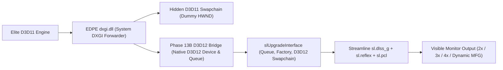

# Phase 15 Research: NVIDIA Streamline & DLSS Frame Generation

**Date:** 2026-11-14  
**Scope:** Phase 15 ([PLAN.md](../PLAN.md) §§5, 14–16, 18, 35, 39; `AGENTS.md` NVIDIA FG rules)  
**Prerequisites:** Phase 13B (D3D12 Proxy Swapchain), Phase 17 (Streamline `sl.reflex` + `sl.pcl`), Phase 14 (`IFrameGenerationBackend` abstraction validated)  
**Status:** RESEARCH COMPLETE — Critical `ManualHooking` architecture identified for `dxgi.dll` proxy.

---

## 1. Authoritative SDK & System Requirements (`SDK-DOCUMENTED`)

Official repository: **`NVIDIA-RTX/Streamline`** (`v2.14.16` verified). Per `AGENTS.md`, EDPE **must** use official Streamline (`sl.interposer.dll`, `sl.common.dll`, `sl.dlss_g.dll`, `sl.reflex.dll`, `sl.pcl.dll`) and **must never** use undocumented NGX Frame Generation calls directly.

| Requirement | Verified Value (`ProgrammingGuideDLSS_G.md` v2.14.16) |
|:---|:---|
| **OS & Scheduling** | Windows 10 20H1 (build `19041+`) or Windows 11 with **Hardware-Accelerated GPU Scheduling (HAGS)** enabled. Streamline returns `sl::Result::eErrorOSOutOfDate` or adapter capability failure otherwise. |
| **Graphics API** | **D3D12** (or Vulkan) — **not D3D11**. Requires EDPE's Phase 13B D3D12 Proxy Swapchain (`IDXGISwapChain3`/`4` with `GetCurrentBackBufferIndex`). |
| **Hardware & MFG** | Ada Lovelace (RTX 40 series: 2x, `numFramesToGenerateMax == 1`) and Blackwell (RTX 50 series: up to 4x, `numFramesToGenerateMax >= 2`, plus Dynamic MFG). **Must be queried via `slDLSSGGetState()`, never hardcoded!** |
| **Dynamic MFG Driver** | GeForce Driver **`595.41+`** on D3D12 (`bIsDynamicMFGSupported == Boolean::eTrue`). |
| **Mandatory Reflex** | `sl.reflex` **MUST** be active while DLSS-G runs (`DLSSGStatus::eFailReflexNotDetectedAtRuntime`). Standalone NVAPI Reflex cannot coexist with `sl.dlss_g`. |
| **Security** | Verify digital signatures with `sl::security::verifyEmbeddedSignature()` before loading `sl.interposer.dll`. |

---

## 2. Critical Integration Challenge: Manual Hooking vs `dxgi.dll` Proxy

By default, Streamline expects to replace/hook system `dxgi.dll` globally (`sl.interposer.dll` wraps every DXGI factory, D3D12 device, and swapchain). However, **EDPE itself IS `dxgi.dll`** (`VERIFIED` in [src/dxgi_proxy.cpp](../src/dxgi_proxy.cpp)). Global interposing inside a `dxgi.dll` proxy causes recursive hooks, third-party overlay conflicts (ReShade/Special K), and unnecessary D3D11 proxy overhead.

### Verified Solution: `PreferenceFlag::eUseManualHooking` (`SDK-DOCUMENTED`)
Inspecting `NVIDIA-RTX/Streamline/docs/ProgrammingGuideManualHooking.md` (v2.14.16) yields the exact architecture for EDPE:

1. **Do NOT link `sl.interposer.lib` statically** against EDPE's D3D11/DXGI imports (so D3D11 stays 100% native). Load `sl.interposer.dll` dynamically after signature verification and resolve `slInit`, `slUpgradeInterface`, `slGetNativeInterface`, `slSetD3DDevice`, `slGetFeatureFunction`, etc.
2. **Initialize Streamline early** (`slInit(pref)`), setting:
   ```cpp
   sl::Preferences pref{};
   pref.flags |= sl::PreferenceFlag::eUseManualHooking;
   pref.flags |= sl::PreferenceFlag::eDisableCLStateTracking; // Optional if restoring manually
   pref.applicationId = /* NVIDIA AppID or projectId */;
   pref.projectId = "48d353f3-d07b-4048-876b-09f8622f5a27"; // EDPE's own Project ID (NOT EDVR's!)
   const sl::Feature features[] = {
       sl::kFeatureDLSS_G,
       sl::kFeatureReflex,
       sl::kFeaturePCL
   };
   pref.featuresToLoad = features;
   pref.numFeaturesToLoad = _countof(features);
   ```
   *(Note from `ProgrammingGuideManualHooking.md` §3.0: With `eUseManualHooking`, D3D devices may even be created before or after `slInit`, provided `slSetD3DDevice` and `slUpgradeInterface` are called before rendering/present.)*
3. **Inform Streamline of EDPE's Secondary D3D12 Device Only:**
   ```cpp
   // Pass NATIVE D3D12 device (never pass Elite's D3D11 device!)
   slSetD3DDevice(nativeD3D12Device);
   ```
4. **Upgrade ONLY the D3D12 Factory / SwapChain / Queue (`slUpgradeInterface`):**
   Per `sl_hooks.h` (`FunctionHookID`), Streamline's DLSS-G plugin only requires proxy interception on:
   * `IDXGIFactory::CreateSwapChain` / `CreateSwapChainForHwnd`
   * `ID3D12Device::CreateCommandQueue` (so Streamline sees EDPE's D3D12 present queue)
   * `IDXGISwapChain::Present`, `Present1`, `GetBuffer`, `ResizeBuffers`, `ResizeBuffers1`, `GetCurrentBackBufferIndex`, `SetFullscreenState`.

   EDPE keeps **both** `nativeSwapchain` (for non-intercepted methods like `GetFullscreenDesc`) and `proxySwapchain` (upgraded via `slUpgradeInterface(&proxySwapchain)`), calling `proxySwapchain` for the `sl_hooks.h` methods whenever DLSS-G is active!
5. **Mandatory `presentCommon()` Invariant (`ProgrammingGuideManualHooking.md` §2.0):**
   Calling `proxySwapchain->Present(...)` guarantees `sl.common`'s `presentCommon()` runs **once per frame** and properly handles `ResizeBuffers` transitions, preventing internal VRAM leaks.
6. **Manual Tagging & State Restoration:**
   Because command lists aren't SL-wrapped in manual hooking mode, EDPE explicitly fills `sl::Resource::state` (`D3D12_RESOURCE_STATES` when consumed by SL) inside `slSetTagForFrame` and restores D3D12 descriptor heaps/root signatures/PSOs if any subsequent EDPE D3D12 work uses the same command list (`§7.1`).



---

## 3. Exact `sl.dlss_g` Options, Constants & Tagging (`sl_dlss_g.h`)

### 3.1 Capability Detection & Multi Frame Generation (MFG)
Never hardcode RTX 40 vs RTX 50 or multipliers (`AGENTS.md`):

```cpp
sl::DLSSGState state{};
sl::DLSSGOptions opts{};
const bool fgAllowed = userEnabled && inputs.isValid() && !isFullscreenMenuActive;
opts.mode = fgAllowed ? (dynamicMfg ? sl::DLSSGMode::eDynamic : sl::DLSSGMode::eOn)
                      : sl::DLSSGMode::eOff;
opts.flags = sl::DLSSGFlags::eRetainResourcesWhenOff |       // Zero stutter when toggling FG in F5 UI
             sl::DLSSGFlags::eEnableFullscreenMenuDetection; // Pause FG cleanly in Elite full-screen menus!
opts.enableUserInterfaceRecomposition = sl::Boolean::eTrue; // Enable separate HUDless + UI composition

if (SL_SUCCEEDED(slDLSSGGetState(viewport, state, &opts))) {
    const uint32_t maxGen = state.numFramesToGenerateMax;    // 1 = 2x, 2 = 3x, 3 = 4x
    const bool hasDynMfg  = (state.bIsDynamicMFGSupported == sl::Boolean::eTrue);
    opts.numFramesToGenerate = std::clamp(requestedExtraFrames, 1u, std::max(1u, maxGen));
    opts.dynamicTargetFrameRate = targetFps;                 // 0.0f = auto match monitor Hz
}
slDLSSGSetOptions(viewport, opts);
```
> **Menu / Invalid-Input Tag Hygiene:** When switching to `DLSSGMode::eOff` during fullscreen menus (Galaxy/System Map, Main Menu) or when `!TemporalFrameInputs::isValid()`, explicitly clear frame tags (pass `nullptr` resource in `slSetTagForFrame`) while retaining `eRetainResourcesWhenOff` so stale HUDless/UI surfaces are never reused.

### 3.2 `slSetConstants` (Mandatory Per Frame)
Check `DLSSGStatus::eFailCommonConstantsInvalid` in `state.status`. Streamline requires `sl::Constants` per frame via `slSetConstants(consts, *frameToken, viewport)`:
* `cameraViewToClip`, `clipToCameraView`, `clipToPrevClip`, `prevClipToClip` (derived directly from EDPE's verified `CB0` projection + `CameraDelta` view delta!)
* `cameraPos`, `cameraUp`, `cameraRight`, `cameraFwd` (world-space basis from `CB0`)
* `cameraNear`, `cameraFar`, `cameraFOV`, `cameraAspectRatio`
* `jitterOffset` (`{jitterX, jitterY}`), `mvecScale` (`{1.0f / renderWidth, 1.0f / renderHeight}` if SL expects UV or `{1.0f, 1.0f}` — **note `sl::Constants::mvecScale` converts MV buffer to normalized UV `[0..1]` space! Always verify in `ProgrammingGuide.md` §7.0 & test harness!**)
* `depthInverted = sl::Boolean::eTrue`
* `reset = inputs.reset ? sl::Boolean::eTrue : sl::Boolean::eFalse`.

### 3.3 Resource Tags & UI Recomposition (`sl_dlss_g.h` + `ProgrammingGuideDLSS_G.md`)
| Streamline Tag | EDPE Source Texture (Bridged to D3D12) | Format Notes & Caveats (`SDK-DOCUMENTED`) |
|:---|:---|:---|
| `sl::kBufferTypeDepth` | Shared `R32_FLOAT` copy of `DSV #2` | Must match `mvecDepthWidth` / `mvecDepthHeight`. |
| `sl::kBufferTypeMvec` | Shared `R16G16_FLOAT` from `MotionPass` | Unjittered current $\rightarrow$ previous vectors. |
| `sl::kBufferTypeHUDLessColor` | Shared copy of `worldReconstruction` (pre-`UiCompositePass`) | Linear or tonemapped **without** HUD. Avoid raw scRGB FP16 if using `HDRFormat` restrictions; `R10G10B10A2_UNORM` or `R8G8B8A8_UNORM` is universally supported by DLSS-G! |
| `sl::kBufferTypeUIColorAndAlpha` | Shared `fgPackedUiTex_` generated by `packPremultipliedUiForFgCs` from all 3 [`UiLayer`](../src/ui_layer.cpp#L15-L83) textures (`ldrLayerTex_` + `hdrLayerTex_.a` + `multLayerTex_`) | **CRITICAL `SDK-DOCUMENTED` constraints:** Must be **premultiplied alpha**, **cannot use 10-bit 2-bit-alpha (`R10G10B10A2`)**, and **cannot use FP16 scRGB** — use `DXGI_FORMAT_R8G8B8A8_UNORM`. Packing $\text{UI}_{rgb} = \max(L_{rgb} - \text{blackFloor} \cdot T, 0)$ and $\text{UI}_a = 1 - T \cdot \text{luma}(M_{rgb})$ preserves dark `multLayerTex_` panel backdrops without per-frame flickering. |

> **`SDK-DOCUMENTED` Mutually-Exclusive UI Tag Rule (`ProgrammingGuideDLSS_G.md`):**
> **NEVER** tag both `sl::kBufferTypeUIAlpha` and `sl::kBufferTypeUIColorAndAlpha` in the same frame! Official Streamline docs warn: *"If both buffers are tagged, Streamline will use the UI Alpha buffer"* — silently discarding full-color UI recomposition. Always tag strictly **`kBufferTypeHUDLessColor` + `kBufferTypeUIColorAndAlpha`** (`fgPackedUiTex_`).

### 3.4 Async Resource Synchronization (`inputsProcessingCompletionFence`)
When `DLSSGQueueParallelismMode` overlaps game rendering and optical flow:
* Query `state.inputsProcessingCompletionFence` and `state.lastPresentInputsProcessingCompletionFenceValue` from `slDLSSGGetState()` on the present thread.
* Before EDPE overwrites or frees tagged shared D3D12 textures (`hudlessColor`, `depth`, `mvec`, `uiColorAndAlpha`), insert a D3D12 queue `Wait()` on that fence value (`sl_dlss_g.h` lines 173–179)! (Using a ring buffer of 2–3 shared D3D12 input texture sets avoids stalling D3D11 copies entirely.)

---

## 4. Mandatory `sl.reflex` + `sl.pcl` Coupling

Inspecting `include/sl_reflex.h` & `include/sl_pcl.h`:
1. Call `sl::FrameToken* frameToken; slGetNewFrameToken(frameToken, &frameIndex);` once per frame.
2. Call `slReflexSetOptions(reflexOpts)` (setting `mode = eLowLatency` or `eLowLatencyWithBoost`; `frameLimitUs` optional). Note: `sl.dlss_g` automatically caps/paces to avoid VSync overshoot when `DLSSGMode::eOn` is active.
3. Call `slReflexSleep(*frameToken)` right before game input polling (`Phase 17`).
4. Emit `slPCLSetMarker(sl::PCLMarker::eSimulationStart / eSimulationEnd / eRenderSubmitStart / eRenderSubmitEnd / ePresentStart / ePresentEnd, *frameToken)`.
   * **`SDK-DOCUMENTED` Gotcha:** Because `eUseManualHooking` intercepts `Present` explicitly via `proxySwapchain`, **match the same `*frameToken`** across `slSetConstants`, `slSetTagForFrame`, `slReflexSleep`, and `proxySwapchain->Present`!

---

## 5. Risks, Diagnostics & Fail-Open Matrix

* **`sl_status` Diagnostics (`AGENTS.md`):** Decode `DLSSGState::status` bitmask (`eFailResolutionTooLow`, `eFailReflexNotDetectedAtRuntime`, `eFailHDRFormatNotSupported`, `eFailCommonConstantsInvalid`, `eFailGetCurrentBackBufferIndexNotCalled`) directly into `edpe.log` and the Dear ImGui F5 Status panel.
* **Distinguishing FPS (`AGENTS.md`):** Exposed separately in `F7` Performance HUD and `F5`:
  * `Simulation / Rendered FPS` = Elite D3D11 frame rate (`1000 / simDeltaMs`)
  * `Presented FPS` = `Rendered FPS × (1 + numFramesToGenerate)` (verified via `state.numFramesActuallyPresented`)
  * Never report Presented FPS as game Simulation FPS.
* **Fail-Open Rule:** If `slInit`, signature check, `slIsFeatureSupported(kFeatureDLSS_G)`, or `proxySwapchain->Present` fails, set `DLSSGMode::eOff`, keep active SR (`DLSS`/`FSR`/`XeSS`) running, and present real frames cleanly via the native swapchain interface.

---

## 6. Prototype Implementation & Live Verification (2026-11-20)

- **SDK:** `NVIDIA-RTX/Streamline` `v2.14.16` staged in gitignored `external/streamline/` (`include`, `docs`, shipping `bin/x64/{sl.interposer,sl.common,sl.dlss_g,sl.reflex,sl.pcl,nvngx_dlssg}.dll`).
- **Source Files:**
  - [nvidia_sl_fg_backend.h](../src/nvidia_sl_fg_backend.h) & [nvidia_sl_fg_backend.cpp](../src/nvidia_sl_fg_backend.cpp): `NvidiaStreamlineFgBackend` implementing `IFrameGenerationBackend` (`FrameGenerationBackend::NvidiaDlssG`) with dynamic `sl.interposer.dll` loading, `sl::security::verifyEmbeddedSignature`, `eUseManualHooking | eUseFrameBasedResourceTagging`, factory + queue `slUpgradeInterface` swapchain replacement, mandatory `sl.reflex` + `sl.pcl` frame-token synchronization, `computeFgCameraMatrices` -> `sl::Constants` (`mvecScale = {motionScaleX / renderWidth, motionScaleY / renderHeight}`), mutually-exclusive `kBufferTypeHUDLessColor` + `kBufferTypeUIColorAndAlpha` tagging, `DLSSGStatus` decoding, and `recreatePlainSwapChain()` fail-open teardown.
  - [d3d12_presenter.h](../src/d3d12_presenter.h) & [d3d12_presenter.cpp](../src/d3d12_presenter.cpp): added `swapChainFlags()` accessor and `setPresentMarkerHooks()` (`ePresentStart` / `ePresentEnd` + `slDLSSGGetState` directly bracketing `IDXGISwapChain4::Present`).
  - [nvidia_sl_fg_test.cpp](../tests/nvidia_sl_fg_test.cpp): CTest target `nvidia_sl_fg` exercising unit/ABI checks, live `probeCapabilities()`, and hardware `D3D12ProxyPresenter` + `FrameGenerationManager` integration.
- **Measured Verification on `NVIDIA GeForce RTX 3060` (`DeviceId=0x2504`, Windows 11, Release x64):**
  - `sl::security::verifyEmbeddedSignature`: **PASSED** on `sl.interposer.dll`, `sl.common.dll`, `sl.dlss_g.dll`, `sl.pcl.dll`, `sl.reflex.dll`.
  - `slInit` + `slSetD3DDevice`: **PASSED** (`slVersion = 2.14.16`).
  - `slIsFeatureSupported(kFeatureReflex)`: **`eOk`** (`rc=0`, `ver=2.14.16`); `slIsFeatureSupported(kFeaturePCL)`: **`eOk`**.
  - `slIsFeatureSupported(kFeatureDLSS_G)`: **`eErrorNoSupportedAdapterFound`** (`rc=6`, expected capability-driven rejection on Ampere RTX 3060; `maxGen=0`, `dynamicMfg=0`).
  - `FrameGenerationManager::selectBackend(NvidiaDlssG)` failed open to `FrameGenerationBackend::Off` with descriptive `unavailableReason`, leaving the plain `D3D12ProxyPresenter` swapchain presenting frames at 2560×1440 without crash or frame drop.
  - Full live `DLSS-G` frame-generation loop inside `nvidia_sl_fg_test` remains conditional on an Ada RTX 40+ / Blackwell RTX 50+ adapter where `probeCapabilities()` reports `dlssgSupported=true`.
