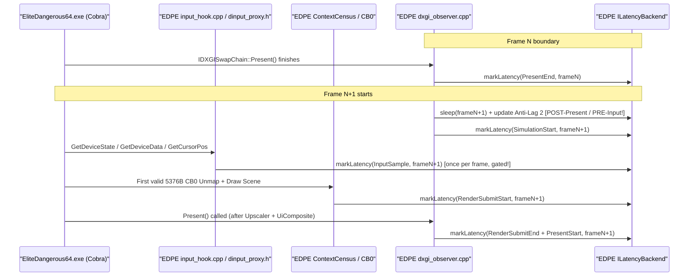

# Phase 17 Research: Low-Latency Integration (NVIDIA Reflex & AMD Anti-Lag / Anti-Lag 2)

**Date:** 2026-11-14  
**Scope:** Phase 17 ([PLAN.md](../PLAN.md) §§15, 19, 34, 43, 45; `AGENTS.md` Latency & Low-Latency Framework)  
**Prerequisites:** Phase 1 (`dxgi_observer.cpp`, `input_hook.cpp`); required **before** Phases 14 & 15 Frame Generation (`AGENTS.md`)  
**Status:** RESEARCH COMPLETE — Ready for standalone D3D11 (`Phase 17A`) followed by FG-coupled D3D12 (`Phase 17B`).

---

## 1. Strategic Role: Why Phase 17 Precedes Frame Generation (`VERIFIED` + `SDK-DOCUMENTED`)

Per `AGENTS.md`:
> *"Low-latency technologies operate **both standalone** (with native rendering, DLAA, DLSS, FSR, XeSS, or native TAA) and **coupled with Frame Generation**... In GPU-bound scenarios (orbital starports, planetary settlements, fleet combat), Reflex and Anti-Lag 2 eliminate the 2–3 frame driver/D3D11 render queue, slashing input lag for flight sticks/HOTAS, mouse, and keyboard. For Frame Generation (Phases 14 & 15), Reflex or Anti-Lag 2 is mandatory to prevent interpolation presentation lag from degrading flight responsiveness."*

Split Phase 17 cleanly into two gated stages:
* **Phase 17A (Standalone D3D11 — Zero Interop Needed):** Integrates **NVAPI Reflex (D3D11)** and **AMD Anti-Lag 2 DX11 SDK** directly into EDPE's existing `dxgi.dll` pipeline (`v0.7.0`), delivering immediate responsiveness gains for HOTAS/mouse/VR-2D flight right now.
* **Phase 17B (FG-Coupled D3D12):** Coordinates **Streamline `sl.reflex` + `sl.pcl`** (for NVIDIA DLSS-G, Phase 15) and **`ffx_antilag2_dx12.h`** (for AMD FSR FG, Phase 14), preventing conflicting double-sleep hooks.

---

## 2. Authoritative Vendor APIs & Open-Source References

### 2.1 NVIDIA Reflex (`SDK-DOCUMENTED`)
NVIDIA exposes Reflex through **two non-interchangeable** paths depending on whether Streamline (`sl.dlss_g`) owns the swapchain:

1. **Path A — Standalone D3D11 (`NvAPI`, MIT-compatible / Redistributable NVAPI headers):**
   * Works natively on `ID3D11Device*` with **zero Streamline runtime DLLs (`sl.interposer.dll`)**.
   * Core functions:
     * `NvAPI_D3D_SetSleepMode(IUnknown* pDev, NV_SET_SLEEP_MODE_PARAMS* pSetSleepModeParams)`: enables `bLowLatencyMode` (`On`), `bLowLatencyBoost` (`On + Boost` pinning GPU clocks during light loads), and `minimumIntervalUs` (optional frame cap, `0` = uncapped).
     * `NvAPI_D3D_Sleep(IUnknown* pDev)`: blocks CPU just before input sampling / simulation start so the GPU drains to 1 queued frame.
     * `NvAPI_D3D_SetLatencyMarker(IUnknown* pDev, NV_LATENCY_MARKER_PARAMS* pSetLatencyMarkerParams)`: records frame ID + marker stage (`SIMULATION_START`, `SIMULATION_END`, `RENDERSUBMIT_START`, `RENDERSUBMIT_END`, `PRESENT_START`, `PRESENT_END`, `INPUT_SAMPLE`, `OUT_OF_BAND_RENDERSUBMIT_START/END`, `OUT_OF_BAND_PRESENT_START/END`, `TRIGGER_FLASH`).
     * `NvAPI_D3D_GetLatency(IUnknown* pDev, NV_LATENCY_RESULT_PARAMS* pGetLatencyParams)`: reads back hardware timestamps (`simStartTime`..`driverEndTime`, `osRenderQueueStartTime`..`gpuRenderEndTime`) for EDPE's `F7` Performance HUD!
   * *Note (`REFERENCE-CODE` in `src/perf_overlay.cpp`):* EDPE already dynamically queries NVML; loading `nvapi64.dll` via `NvAPI_QueryInterface` follows the exact same zero-import fail-open pattern.

2. **Path B — Streamline-Coupled (`NVIDIA-RTX/Streamline` v2.14.16, `sl_reflex.h` & `sl_pcl.h`, MIT):**
   * **Mandatory when `sl.dlss_g` (Phase 15) is active:** `sl.dlss_g` refuses to activate unless `sl.reflex` is enabled (`sl::ReflexMode::eLowLatency` or `eLowLatencyWithBoost`).
   * Core calls (`sl_reflex.h` + `sl_pcl.h`):
     * `slReflexSetOptions(const sl::ReflexOptions& options)` (`mode`, `frameLimitUs`, `useMarkersToOptimize`, `virtualKey` for latency analyzer).
     * `slReflexSleep(const sl::FrameToken& frame)` — **IMPORTANT:** When Streamline Reflex is active (`Phase 15`), EDPE **must NOT** also call raw `NvAPI_D3D_Sleep` on the D3D11 device (calling both produces double-frame-rate halving and broken pacing; `VERIFIED` invariant in `Streamline` & `OptiScaler`).
     * `slPCLSetMarker(sl::PCLMarker marker, const sl::FrameToken& frame)` (in Streamline v2.x, latency markers live in `sl.pcl` and use the **exact same `FrameToken`** passed to `slSetTagForFrame` and `Present`).
     * `slReflexGetState(sl::ReflexState& state)`: returns hardware capability (`lowLatencyAvailable`, `flashIndicatorDriverControlled`) and `ReflexReport[64]` (`totalLatencyUs` = `gpuRenderEndTime - simStartTime`).

### 2.2 AMD Anti-Lag 2 SDK (`SDK-DOCUMENTED`)
Official repository: **`GPUOpen-LibrariesAndSDKs/AntiLag2-SDK`** (**MIT License**, header-only C++ wrappers `ffx_antilag2_dx11.h` and `ffx_antilag2_dx12.h`, dynamically querying `amdxc64.dll` via `AmdExtD3DCreateInterface` for `IAmdExtAntiLagApi`).

* **DX11 API (`ffx_antilag2_dx11.h` — `APIData_v1`):**
  * `AMD::AntiLag2DX11::Context ctx{};`
  * `AMD::AntiLag2DX11::Initialize(&ctx)` (does not even require a device pointer — opens `amdxc64.dll` directly).
  * `AMD::AntiLag2DX11::Update(&ctx, bool enabled, unsigned int maxFPS)`: places the Anti-Lag 2 frame sleep/pacing point once per frame **before input sampling**; automatically activates AMD's built-in OSD (`Alt+Shift+L`, Right-Ctrl hardware bypass) on Adrenalin 24.6.1+ drivers!
  * `AMD::AntiLag2DX11::DeInitialize(&ctx)` on teardown.
* **DX12 API (`ffx_antilag2_dx12.h` — `APIData_v2` for Phase 14 FSR FG):**
  * `AMD::AntiLag2DX12::Initialize(&ctx, ID3D12Device* device)`
  * `AMD::AntiLag2DX12::Update(&ctx, bool enabled, unsigned int maxFPS)`
  * `AMD::AntiLag2DX12::MarkEndOfFrameRendering(&ctx)`: marks end of GPU submission before Present/FG.
  * `AMD::AntiLag2DX12::SetFrameGenFrameType(&ctx, bool bInterpolatedFrame)`: **critical FG invariant** — tells the AMD driver inside `presentCallback` / interpolation path whether the upcoming Present is a real simulated frame (`false`) or an interpolated frame (`true`) so Anti-Lag 2 only aligns CPU pace against real frames!
* *Fallback for pre-RDNA / older Adrenalin drivers:* If `amdxc64.dll` rejects `IAmdExtAntiLagApi` (`featureID` unsupported), Anti-Lag 2 safely returns an error code and driver-level Anti-Lag (1) handles pacing; EDPE reports status clearly in ImGui (`"AMD Anti-Lag 2 (Driver Fallback)"` or `"Unavailable"`).

### 2.3 Intel XeLL & Cross-Vendor Bridge Insights (`REFERENCE-CODE`)
* Inspecting **`optiscaler/fakenvapi`** (`ll_antilag2.cpp`, `ll_xell.cpp`, `low_latency_d3d.cpp`, **MIT License**) provides two verified architectural lessons for EDPE:
  1. **Intel XeLL (`libxell.dll`):** Intel Arc GPUs expose `xellD3D12CreateContext`, `xellSleep`, `xellAddMarkerData`, and `xellGetFramesReports` (requires D3D12 device from Phase 13A; optional third backend `LowLatencyBackend::IntelXeLL`).
  2. **`CallSpot` Injection Ordering:** Real games sometimes fail to invoke `Sleep` before OS/game input polling, leaving input sampled *before* the sleep stall (adding up to 16 ms unnecessary latency). `fakenvapi` distinguishes `SleepCall` (ideal: immediately *before* game input / simulation) vs `SimulationStart` fallback (when game doesn't expose an explicit sleep boundary).

---

## 3. Exact Placement in Elite Dangerous & EDPE (`VERIFIED` Code Audit)

Unlike arbitrary Unreal Engine games where engines natively call `Reflex::Sleep()` cleanly before `PeekMessageW`, Cobra does not export a native Reflex hook. Therefore, EDPE must synthesize clean marker boundaries from its existing verified hooks:



### 3.1 Mapping Verified EDPE Hook Sites
1. **Sleep & `SimulationStart` Placement ([`src/dxgi_observer.cpp`](../src/dxgi_observer.cpp)):**
   * Inspecting Elite's main loop via [`src/dxgi_observer.cpp`](../src/dxgi_observer.cpp) and [`src/input_hook.cpp`](../src/input_hook.cpp): Elite polls DirectInput/Win32 messages immediately *after* `IDXGISwapChain::Present` returns on the render/main loop!
   * Therefore, invoking **`latencyBackend->sleep(frameId + 1)` + `mark(SimulationStart, frameId + 1)` at the tail of `Hooked_Present` (after `origPresent` returns, right before yielding control back to `EliteDangerous64.exe`)** aligns the sleep *directly before* Cobra reads HOTAS (`IDirectInputDevice8::GetDeviceData`/`GetDeviceState` in [`src/dinput_proxy.h`](../src/dinput_proxy.h#L52-L75)) and runs Frame `N+1` simulation!
   * **Caution:** Always check `DXGI_PRESENT_TEST` flag — **never** call `Sleep()` or advance `frameId` on `DXGI_PRESENT_TEST` calls!
2. **`InputSample` Marker ([`src/dinput_proxy.h`](../src/dinput_proxy.h#L52-L75), [`src/input_hook.cpp`](../src/input_hook.cpp#L109-L121)):**
   * Cobra may call `GetDeviceState` / `GetDeviceData` multiple times per frame (mouse, keyboard, joystick, throttle). Use an `std::atomic<uint64_t> lastInputMarkerFrame` latch so `InputSample` is emitted **once per `frameId`** on the first active HOTAS/mouse poll after `SimulationStart`.
   * Do **not** fire `InputSample` when `UiMenuVisible()` is true (`F5` Dear ImGui open), as EDPE zeroes out game device state there.
3. **`RenderSubmitStart` / `RenderSubmitEnd` ([`src/context_census.cpp`](../src/context_census.cpp)):**
   * `RenderSubmitStart`: at the first primary 3D scene `OMSetRenderTargets` / `CB0 Unmap` latch (`s_camera_now`) per frame.
   * `RenderSubmitEnd` + `PresentStart`: immediately inside `Hooked_Present` right before submitting the upscaler / composite / original `Present` (avoiding counting the sleep stall itself inside GPU render latency!).
4. **`AntiLag2DX12::MarkEndOfFrameRendering` & `SetFrameGenFrameType`:**
   * When Phase 14 (FSR FG) runs on the D3D12 proxy queue, forward real vs. interpolated flag (`SetFrameGenFrameType(isInterpolated)`) and `MarkEndOfFrameRendering` per `ffx_antilag2_dx12.h`.

---

## 4. Vendor-Neutral `ILatencyBackend` Design (`EXPERIMENTAL`)

Per `AGENTS.md`, Cobra hooks never call `NvAPI_*`, `slReflex*`, or `AMD::AntiLag2*` directly:

```cpp
// Proposed src/latency_backend.h
enum class LowLatencyMode : uint32_t {
    Off = 0,
    NvidiaReflexOn = 1,
    NvidiaReflexBoost = 2,
    AmdAntiLag2 = 3,
    IntelXeLL = 4          // Optional Phase 17B / D3D12
};

enum class LatencyMarker : uint32_t {
    SimulationStart,
    SimulationEnd,
    RenderSubmitStart,
    RenderSubmitEnd,
    PresentStart,
    PresentEnd,
    InputSample,
    TriggerFlash
};

struct LatencyTelemetry {
    bool available = false;
    bool active = false;
    bool flashIndicatorSupported = false;
    float totalSystemLatencyMs = 0.0f;   // GPU render end - Sim start (driver-free / full pipeline)
    float simulationMs = 0.0f;
    float renderSubmitMs = 0.0f;
    float driverQueueMs = 0.0f;
    float gpuRenderMs = 0.0f;
    wchar_t statusText[128] = L"Off";
};

class ILatencyBackend {
public:
    virtual ~ILatencyBackend() = default;
    virtual LowLatencyMode mode() const = 0;
    virtual bool isAvailable() const = 0;
    virtual const wchar_t* unavailableReason() const = 0;
    virtual bool initialize(ID3D11Device* d3d11Dev, ID3D12Device* d3d12Dev = nullptr) = 0;
    virtual void shutdown() = 0;
    virtual void configure(bool enable, bool boost, uint32_t maxFpsCap, bool fgActive) = 0;
    virtual void sleep(uint64_t frameId) = 0;
    virtual void setMarker(LatencyMarker marker, uint64_t frameId) = 0;
    virtual LatencyTelemetry queryTelemetry() const = 0;
};
```

### Key Guardrails
1. **Mutually Exclusive Active Pacing:** Only **one** latency sleep loop may run per frame (`Streamline sl.reflex` overrides standalone `NvAPI Reflex` when Phase 15 DLSS-G is active; `ffx_antilag2_dx12` supersedes `ffx_antilag2_dx11` when Phase 14 FSR FG wraps the swapchain).
2. **FPS Cap Interaction:** Setting an in-app frame limit via Reflex/Anti-Lag 2 (`minimumIntervalUs` / `maxFPS`) uses low-overhead driver/sleep pacing **instead of** double-stalling on driver V-Sync backpressure. Expose optional `MaxFPS = 0` (`edpe.ini [Latency]`) and greyed-out reason tooltips in Dear ImGui (`F5`).
3. **Standalone Latency Telemetry in `F7` Perf HUD:** Even without an LDAT hardware mouse analyzer, `NvAPI_D3D_GetLatency` / `slReflexGetState` breakdown (`Sim` + `Queue` + `GPU`) immediately proves whether Reflex eliminated driver render-queue buildup in Elite stations!

---

## 5. Measurement & Validation Plan (`AGENTS.md` + `GPUOpen`)

1. **Software Measurement (GPU-side Queue Elimination):**
   * Log `osRenderQueueMs` (`driverStart - presentEnd` / `gpuRenderStart - renderSubmitEnd`) in a busy planetary settlement or Coriolis starport with `Latency = Off` vs `Reflex On` / `Reflex Boost` / `Anti-Lag 2`. Expected: queue wait drops from ~1–2 frame intervals (~16–33 ms at 60 FPS GPU-bound) to **< 1–3 ms**.
2. **End-to-End Photodiode / Software Optical Validation:**
   * **AMD Built-in Anti-Lag 2 OSD (`SDK-DOCUMENTED`):** Press `Alt+Shift+L` in Elite; hold **Right-Ctrl** to live A/B toggle Anti-Lag 2 delay reduction and verify driver OSD engages cleanly on `EliteDangerous64.exe`.
   * **Open-Source Frame Latency Meter (`GPUOpen-Tools/frame_latency_meter`):** Use FLM (mouse-click / screen-flash pixel change detector) alongside EDPE's **Reflex Flash Indicator** (`NV_LATENCY_MARKER_PARAMS` `TRIGGER_FLASH` bound to mouse click / `F8` debug mode) to measure click-to-photon latency across `Native`, `DLSS`, `FSR`, and `FG` without proprietary NVIDIA LDAT hardware.
3. **Fail-Open Behavior:**
   * Missing `nvapi64.dll` / non-NVIDIA GPU / pre-RDNA1 or non-Adrenalin-24.6+ driver $\rightarrow$ grey out option in ImGui with explicit reason string; never block or drop `Present`.
