# Phase 19 Research: Third-Party Mod & Ecosystem Compatibility

**Date:** 2026-11-14  
**Scope:** Phase 19 ([PLAN.md](../PLAN.md) §§1, 45; [README.md](../README.md#roadmap))  
**Target Ecosystem:** **EDHM (Elite Dangerous HUD Mod / 3Dmigoto)**, **ReShade**, **Special K**, **RTSS (RivaTuner)**, **Steam / Discord / NVIDIA Overlays**  
**Status:** RESEARCH COMPLETE — Ready for implementation hardening (`Phase 19`).

---

## 1. Existing Elite Dangerous Ecosystem Conflict Map (`VERIFIED` + `REFERENCE-CODE`)

Elite Dangerous players heavily rely on third-party graphics tools stacked in the game folder (`EliteDangerous64.exe`). Right now in `v0.7.0`, EDPE occupies `dxgi.dll` and already partially protects against a custom `d3d11.dll` (`chooseSystemD3D11` in [`src/system_dll.h`](../src/system_dll.h) / [`src/d3d11_proxy.cpp`](../src/d3d11_proxy.cpp)), **but critical multi-mod gaps remain**:

| Tool / Overlay | Default Filename / Injection Method | Conflict with EDPE `v0.7.0` | Provenance / Reference Evidence |
|:---|:---|:---|:---|
| **EDHM-UI (`3Dmigoto`)** | `d3d11.dll` (+ `d3dcompiler_47.dll`, `nvapi64.dll` wrapper) | **HIGH (Functional):** Overrides Cobra's cockpit HUD pixel shaders with custom bytecode! **Breaks EDPE [`UiLayer::shouldInterceptDraw`](../src/ui_layer.cpp)** exact shader-hash allowlist, causing EDHM-recolored HUDs to lose native protection and ghost through DLSS/FSR! | `EDHM-UI` / `3Dmigoto` (`bo3b/3Dmigoto`); `Siegfried-Origin/EDAA` [`docs/addon.md`](https://github.com/Siegfried-Origin/EDAA) |
| **ReShade (Non-Addon & Addon)** | `dxgi.dll` (collides directly!) or `d3d11.dll` | **CRITICAL (File Collision):** Both EDPE and ReShade ship as **`dxgi.dll`**. Even when chained, ReShade may abort (`RESHADE_DISABLE_LOADING_CHECK` issue) or inject **before** EDPE upscaling / **before** FG presentation, breaking depth alignment and blurring sharpened ReShade passes. | `crosire/reshade`; `OptiScaler/dllmain.cpp` (`LoadReShade`, env var fix) |
| **Special K (`SpecialK64.dll`)** | `dxgi.dll` / global injection service | **HIGH (Hook Order & FG Clash):** If Special K hooks DXGI `Present` *after* AMD/NVIDIA FG wraps the swapchain, swapchain destruction or double overlays deadlock (`OptiScaler` notes). | `OptiScaler/dllmain.cpp` (`SpecialK64.dll` pre-hook timing) |
| **RTSS / Steam / Discord / NVIDIA App Overlays** | In-process Detours/IAT `Present` hooks | Overlays drawn *before* Frame Generation's final swapchain present get fed into optical flow/motion or torn between generated frames; conversely RTSS frame limiters conflict with Reflex/Anti-Lag 2 (Phase 17). | `OptiScaler` + NVIDIA Streamline `ProgrammingGuideDLSS_G.md` |

---

## 2. Solving EDHM (`3Dmigoto` `d3d11.dll`) Coexistence (`VERIFIED` in EDPE Source)

### 2.1 Existing Strength: `LoadSystemDll` / `chooseSystemD3D11`
Inspecting [`src/d3d11_proxy.cpp`](../src/d3d11_proxy.cpp) and [`src/dxgi_proxy.cpp`](../src/dxgi_proxy.cpp) confirms EDPE already prevents infinite proxy recursion by resolving `d3d11.dll` / `dxgi.dll` via `GetSystemDirectoryW` when chaining system exports, and intercepts `D3D11CreateDevice` / `CreateSwapChain`. When EDHM's `d3d11.dll` sits alongside EDPE's `dxgi.dll`:
* Elite loads EDHM's `d3d11.dll` for `D3D11CreateDevice` AND loads EDPE's `dxgi.dll` for `CreateDXGIFactory1`.
* **Hook Chain Invariant:** `Game -> EDHM d3d11.dll (replaces PS bytecode in CreatePixelShader / PSSetShader) -> EDPE ContextCensus hook -> System d3d11.dll`. Because EDPE hooks the *live* `ID3D11DeviceContext` vtable returned to the game (or chains above/below EDHM depending on install order), EDPE receives **EDHM's modified pixel shader bytecode hashes** in `PSSetShader`!

### 2.2 The Broken Link: `UiLayer` Exact Shader-Hash Matching vs. EDHM Overrides
In [`STATUS.md`](../STATUS.md#L163-L168) and `src/ui_layer.cpp`, EDPE identifies Pass 35 cockpit HUD draws using four exact `VS + PS` FNV/CRC bytecode hashes:
* `VS=0x81216C77F90DEDD6, PS=0xAB82734FE19EFB9D` (icons/text/gauges)
* `VS=0x2CECEC3065EF0D4A, PS=0xA4D03619D631B186` (holographic panels/radar)
* `VS=0x5559BD94B6852E83, PS=0xEA02FAC2BD6C643C` (target hologram)
* `VS=0x5559BD94B6852E83, PS=0xE95634B0F61D218F` (player hologram)

**Why EDHM Breaks This:** EDHM (`d3dx.ini` `[ShaderOverride*]`) replaces those exact **Pixel Shaders** with custom HLSL bytecode (recoloring shields, radar, gauges, thermal profiles). Consequently, `PS` hashes no longer match `0xAB82734F...`, `0xA4D03619...`, etc.! **Critically, EDHM rarely replaces the Vertex Shaders (`0x81216C77F90DEDD6`, `0x2CECEC3065EF0D4A`, `0x5559BD94B6852E83`), OR replaces only a subset while keeping identical Pass 35 render-target + blend state.**

### 2.3 Three-Tier Resilient HUD Classification Strategy (`EXPERIMENTAL`)
To guarantee 100% EDHM compatibility without breaking EDPE's non-HUD scene draws:

1. **Tier 1 (Vertex-Shader-Anchored Pass 35 Rule — Highest Precision):**
   * Verify in EDHM's `ShaderFixes/` whether EDHM leaves Cobra's 3 HUD **Vertex Shaders** (`0x81216C77F90DEDD6`, `0x2CECEC3065EF0D4A`, `0x5559BD94B6852E83`) untouched!
   * When Pass 35 is active (`RTV0 == sceneHdrTarget` after deferred lighting, depth test/write state matching HUD overlay, additive/alpha blend active), **any draw using those verified HUD Vertex Shaders** (regardless of custom EDHM Pixel Shader hash!) is redirected into `UiLayer`!
   * Still run the existing exact `VS + PS` match first as fast path; fall back to `VS + PassState` match if an unknown `PS` appears inside Pass 35.
2. **Tier 2 (`edpe.ini` User/EDHM Override List):**
   * Allow `[HUD]` `CustomVertexShaders=` / `CustomPixelShaders=` hex hash overrides + an in-menu (`DEV=1`) *"Capture Unknown Pass 35 Shaders"* diagnostic button that logs unrecognised `VS/PS` hashes seen inside Pass 35 with zero stuttering.
3. **Tier 3 (Pre-EDHM Bytecode Check / Hook Order Guard):**
   * Inspect if EDHM hooks `CreatePixelShader` via IAT or vtable; log in `edpe.log` whenever `GetModuleHandleW(L"d3d11.dll")` resolves inside the game directory (`EDHM / 3Dmigoto detected`), so users immediately see active mod-compatibility status in `F5`.

---

## 3. Proxy DLL Chaining & Execution Order (`ReShade` + `Special K`) (`REFERENCE-CODE`)

Inspecting **`optiscaler/OptiScaler`** (`src/dllmain.cpp`, **GPL-3.0 — studied purely for architectural/Win32 loader behavior**) reveals the exact industry-standard loader rules needed for clean ReShade and Special K compatibility:

### 3.1 Target Render-Pipeline Ordering
To preserve sharp anti-aliased graphics and prevent ReShade's sharpening/film-grain/LUTs from confusing temporal history or Frame Generation optical flow, enforce this exact order:

```mermaid
flowchart LR
    Game["Elite / Cobra (D3D11 Scene + CB0)"] --> EDHM["EDHM (3Dmigoto d3d11.dll PS Overrides)"]
    EDHM --> Scene["Low-Res Scene + Depth (DSV #2) + MVs"]
    Scene --> Upscale["EDPE IUpscalerBackend (DLSS / FSR / XeSS / TAA)"]
    Upscale --> HudComp["EDPE UiLayer::composite (Native Unjittered HUD)"]
    HudComp --> FG["Optional Phase 14/15 Frame Generation (Real + Interpolated)"]
    FG --> ReShade["Optional ReShade64.dll (Post-Upscale, Native Depth Hook)"]
    ReShade --> ImGui["EDPE Dear ImGui (F5 / F7 Perf HUD) + Steam/Discord"]
    ImGui --> Present["Final IDXGISwapChain::Present"]
```



* **Why ReShade goes AFTER EDPE Upscaling:** ReShade effects (`CAS`, `LumaSharpen`, `Levels`, `Technicolor2`, DOF) expect **native output resolution**, zero subpixel jitter, and un-warped straight HUD text (or ReShade's own HUD-exclusion masks).
* **Generic Depth Alignment:** ReShade's `Generic Depth` add-on reads Cobra's `DSV #2`. When `<SSAAMultiplier> < 1.0` (DLSS/FSR/XeSS Performance/Quality), `DSV #2` is at **render resolution** (e.g., 1706×960) while the backbuffer is 2560×1440. Document clearly in EDPE's UI/docs that ReShade depth shaders require ReShade's aspect-ratio / resolution matching (or `Generic Depth` auto-scale), and **do not break `DSV #2`'s clear/bind signature**.

### 3.2 `[Proxy]` Chaining Architecture in `edpe.ini` (`EXPERIMENTAL`)
Rename ReShade's installer `dxgi.dll` to **`ReShade64.dll`** (or any path configured in `edpe.ini`) and let EDPE (`dxgi.dll`) sit at the front of the chain:

```ini
[Proxy]
; Optional chained DXGI / D3D11 proxy loaded cleanly by EDPE (empty = disabled)
ChainDxgiDll=ReShade64.dll
; Set RESHADE_DISABLE_LOADING_CHECK=1 automatically when loading chained ReShade
ReShadeDisableLoadingCheck=1
```

**Verified Win32 Loader Rules (`OptiScaler` lessons + Windows DLL Loader Locks):**
1. **`RESHADE_DISABLE_LOADING_CHECK=1`:** Official ReShade `v5.x`/`v6.x` refuses to initialize if another `dxgi.dll` proxy already exists in the process unless `SetEnvironmentVariableW(L"RESHADE_DISABLE_LOADING_CHECK", L"1")` is set **before** `LoadLibraryW(L"ReShade64.dll")`!
2. **Never `LoadLibrary` inside `DllMain`:** Calling `LoadLibraryW` inside `DllMain` violates Windows loader-lock rules and deadlocks Steam Overlay / ReShade / NGX worker threads. Defer `[Proxy]` chaining cleanly to `syncConfigOnce()` ([`src/dxgi_proxy.cpp`](../src/dxgi_proxy.cpp#L14-L30)) or right before `CreateDXGIFactory` forwarding!
3. **Export Forwarding for `ChainDxgiDll`:** Forward `CreateDXGIFactory`, `CreateDXGIFactory1`, `CreateDXGIFactory2`, `DXGIDeclareAdapterRemovalSupport` through the loaded `ChainDxgiDll` module (so `ReShade64.dll` creates/wraps the real factory/swapchain *after* EDPE hooks the base interface, placing ReShade's `Present` hook downstream of EDPE's upscaler).
4. **Special K (`SpecialK64.dll`) Pre-Load:** If `SpecialK64.dll` is present or loaded via `LoadLibrary`, ensure it is initialized **before** any Phase 14/15 Frame Generation swapchain wrapping occurs (`OptiScaler/dllmain.cpp` rule) so Special K does not hook an opaque wrapped swapchain proxy and crash on resize.

---

## 4. Compatibility Matrix & Diagnostic Visibility (`AGENTS.md` + `PLAN.md`)

EDPE (`F5` overlay & `edpe.log`) should detect loaded modules on startup (`EnumProcessModules` or `GetModuleHandleW`) and display a **Mod Ecosystem Status** summary:

| Detected Module | Detection Signal | Automatic EDPE Action | User Status in `F5` Overlay |
|:---|:---|:---|:---|
| `d3d11.dll` in game dir (`EDHM / 3Dmigoto`) | Path != `System32` | Enable Pass 35 VS-anchored HUD fallback (`Tier 1`); bypass local `d3d11.dll` for EDPE internal helpers | `"EDHM / 3Dmigoto detected (VS-anchored HUD protection active)"` |
| `ReShade64.dll` (via `[Proxy]`) or `ReShade64` loaded | `GetModuleHandleW` / `edpe.ini` | Set `RESHADE_DISABLE_LOADING_CHECK=1`, chain factory creation so ReShade runs post-upscale | `"ReShade chained (post-upscale order)"` |
| `ReShade` competing as `dxgi.dll` | Export fingerprint mismatch / user conflict | Log warning; instruct renaming ReShade to `ReShade64.dll` via `[Proxy]` | Warning banner if two `dxgi` overlays detected |
| `SpecialK64.dll` | `GetModuleHandleW(L"SpecialK64.dll")` | Warn if Phase 14/15 FG is enabled concurrently; coordinate hook timing before FG swapchain wrap | `"Special K active (FG swapchain warning if unstable)"` |
| `RTSSHooks64.dll` / `GameOverlayRenderer64.dll` | `GetModuleHandleW` | Log presence; warn in `Latency` panel if RTSS FPS cap conflicts with Reflex/Anti-Lag 2 pacing | `"RTSS / Steam Overlay detected"` |

---

## 5. Verification Plan (`EXPERIMENTAL`)

1. **Automated Unit Tests (`tests/proxy_chaining_test.cpp`):**
   * Verify `edpe.ini` `[Proxy]` parser handles missing/invalid `ChainDxgiDll` safely without crashing or regressing `proxy_smoke`.
   * Verify Tier-1 Pass 35 HUD classifier still isolates all 30 holographic draws when a synthetic Pixel Shader hash is mutated (`UiLayer` test extension).
2. **Real-World Stack Matrix Tests (In-Game):**
   * **Test A (`EDPE dxgi.dll` + `EDHM d3d11.dll`):** Verify recolored cockpit HUD stays razor-sharp at DLSS `Performance` (50% scale) with zero ghosting during pitch/roll.
   * **Test B (`EDPE dxgi.dll` -> `ReShade64.dll`):** Verify `Home` opens ReShade AND `F5` opens EDPE cleanly with zero input conflicts, ReShade shaders apply cleanly without subpixel jitter wobble, and resize (`Alt+Enter`) stays crash-free.
   * **Test C (`EDPE` + `EDHM` + `ReShade64` + `Steam Overlay`):** 10-minute station/supercruise/planet stability run with `edpe.log` confirming clean module order and zero loader deadlocks.
