# Phase 19 Research: Third-Party Mod & Ecosystem Compatibility

**Date:** 2026-11-14  
**Scope:** Phase 19 ([PLAN.md](../PLAN.md) §§1, 45; [README.md](../README.md#roadmap))  
**Target Ecosystem:** **EDHM (Elite Dangerous HUD Mod / 3Dmigoto)**, **ReShade**, **Special K**, **RTSS (RivaTuner)**, **Steam / Discord / NVIDIA Overlays**  
**Status:** RESEARCH COMPLETE — Ready for implementation hardening (`Phase 19`).

---

## 1. Existing Elite Dangerous Ecosystem Conflict Map (`VERIFIED` + `REFERENCE-CODE`)

Elite Dangerous players heavily rely on third-party graphics tools stacked in the game folder (`EliteDangerous64.exe`). Right now in `v0.7.0`, EDPE occupies `dxgi.dll` and already protects against a custom `d3d11.dll` (`LoadSystemDll` in [`src/system_dll.h#L6-L13`](../src/system_dll.h#L6-L13), `chooseSystemD3D11` in [`src/vtable_hook.h#L45`](../src/vtable_hook.h#L45), and `resolveRealSystemD3D11` in [`src/d3d11_proxy.cpp#L129-L145`](../src/d3d11_proxy.cpp#L129-L145)), **but critical multi-mod gaps remain**:

| Tool / Overlay | Default Filename / Injection Method | Conflict with EDPE `v0.7.0` | Provenance / Reference Evidence |
|:---|:---|:---|:---|
| **EDHM-UI (`3Dmigoto`)** | `d3d11.dll` (+ `d3dcompiler_47.dll`, `nvapi64.dll` wrapper) | **HIGH (Functional):** Overrides Cobra's cockpit HUD pixel shaders with custom HLSL bytecode from `ShaderFixes/`! **Breaks the 14 `(vsHash, psHash)` pairs** in [`UiLayer::shouldInterceptDraw`](../src/ui_layer.cpp#L579-L595), causing EDHM-recolored holographic panels/gauges to miss native protection and ghost through DLSS/FSR! | `EDHM-UI` / `3Dmigoto` (`bo3b/3Dmigoto`); `Siegfried-Origin/EDAA` |
| **ReShade (Non-Addon & Addon)** | `dxgi.dll` (collides directly!) or `d3d11.dll` | **CRITICAL (File Collision):** Both EDPE and ReShade ship as **`dxgi.dll`**. Even when chained, ReShade may abort (`RESHADE_DISABLE_LOADING_CHECK` issue) or inject **before** EDPE upscaling / **before** FG presentation, breaking depth alignment and blurring sharpened ReShade passes. | `crosire/reshade`; `OptiScaler/dllmain.cpp` (`LoadReShade`, env var fix) |
| **Special K (`SpecialK64.dll`)** | `dxgi.dll` / global injection service | **HIGH (Hook Order & FG Clash):** If Special K hooks DXGI `Present` *after* AMD/NVIDIA FG wraps the swapchain, swapchain destruction or double overlays deadlock (`OptiScaler` notes). | `OptiScaler/dllmain.cpp` (`SpecialK64.dll` pre-hook timing) |
| **RTSS / Steam / Discord / NVIDIA App Overlays** | In-process Detours/IAT `Present` hooks | Overlays drawn *before* Frame Generation's final swapchain present get fed into optical flow/motion or torn between generated frames; conversely RTSS frame limiters conflict with Reflex/Anti-Lag 2 (Phase 17). | `OptiScaler` + NVIDIA Streamline `ProgrammingGuideDLSS_G.md` |

---

## 2. Solving EDHM (`3Dmigoto` `d3d11.dll`) Coexistence (`VERIFIED` in EDPE Source)

### 2.1 Existing Strength: `LoadSystemDll` / `chooseSystemD3D11` / `resolveRealSystemD3D11`
Inspecting [`src/system_dll.h#L6-L13`](../src/system_dll.h#L6-L13), [`src/vtable_hook.h#L45`](../src/vtable_hook.h#L45), and [`src/d3d11_proxy.cpp#L129-L145`](../src/d3d11_proxy.cpp#L129-L145) confirms EDPE already prevents infinite proxy recursion by resolving `d3d11.dll` / `dxgi.dll` via `GetSystemDirectoryW` + `LOAD_LIBRARY_SEARCH_SYSTEM32` when forwarding device/factory exports, while keeping EDPE's device-creation and context hooks intact. When EDHM's `d3d11.dll` sits alongside EDPE's `dxgi.dll`:
* Elite loads EDHM's `d3d11.dll` for `D3D11CreateDevice` AND loads EDPE's `dxgi.dll` for `CreateDXGIFactory1`.
* **Hook Chain Reality:** 3Dmigoto (`EDHM`) intercepts shader loading and calls `CreatePixelShader` on the underlying system device with **EDHM's modified HLSL bytecode from `ShaderFixes/`** (or swaps shaders dynamically in `PSSetShader`). Therefore, hooking `observedCreatePixelShader` ([`src/d3d11_proxy.cpp#L57-L68`](../src/d3d11_proxy.cpp#L57-L68)) observes **EDHM's modified `psHash`**, not Cobra's vanilla bytecode hash!

### 2.2 Exact Source Reality: `UiLayer::shouldInterceptDraw` vs. EDHM Overrides
Inspecting the actual code of [`UiLayer::shouldInterceptDraw`](../src/ui_layer.cpp#L559-L596) reveals two distinct shader groups inside Pass 35 (when `isHdrTarget == true`):

1. **Already EDHM-Resilient (`src/ui_layer.cpp#L564-L577`) — 13 Pure UI `VS-only` Hashes:**
   * `0x81216C77F90DEDD6ull`, `0x1989E6D3B405FDE0ull`, `0x925ACEDA0153AA5Bull`, `0xB7790CBFC6554097ull`, `0xE508648660A352B2ull`, `0x5DA53D8B0133341Eull`, `0xDF3503CD07F9B10Cull`, `0x5453D19B6D362364ull`, `0x44DDCDEBAEA137D8ull`, `0xA2C2D5510BF1926Dull`, `0x9B34C331902DC1EDull`, `0x9611A454527F7FEBull`, `0xB932058F26B76691ull`.
   * Because these 13 vertex shaders already match **independently of `psHash`**, draws using them continue to work cleanly even when EDHM replaces their pixel shaders!
2. **Vulnerable to EDHM (`src/ui_layer.cpp#L579-L595`) — 14 VS Groups / 18 Exact `(vsHash, psHash)` Pairs:**
   * Includes `0x2CECEC3065EF0D4Aull` (`ps == 0xA4D03619D631B186ull`: holographic panels/center radar), `0x5559BD94B6852E83ull` (player/target 3D holograms), `0xB12F7A618E1BDE98ull`, `0xC31238331D8AC3D4ull` (3 PS variants), plus 10 additional paired UI shaders.
   * **Why Blindly Moving Lines `579-595` to Unconditional VS-Only Is Dangerous:** Several vertex shaders in those 14 groups are shared utility vertex shaders reused by non-HUD world geometry/glass earlier in the frame. Converting them to unconditional `vsHash`-only matching risks capturing 3D scene elements into `UiLayer`!
   * **Why EDHM Breaks Lines `579-595`:** EDHM's `[ShaderOverride*]` directives replace the pixel shaders (`PS`) on radar, holo-panels, ship holograms, and cockpit gauges so `psHash` no longer matches lines `579-595`.

### 2.3 Three-Tier Resilient HUD Classification Strategy (`EXPERIMENTAL`)
To protect 100% of EDHM-modified HUD elements **without** misclassifying shared 3D geometry:

1. **Tier 1 (Context-Gated VS Fallback for `src/ui_layer.cpp#L579-L595` — Primary Solution):**
   * Run the existing exact checks (`L564-L577` VS-only + `L579-L595` exact `(vsHash, psHash)` pairs) first as the zero-cost fast path.
   * When an exact `psHash` misses on one of the **14 VS hashes from `L579-L595`**, allow fallback `VS-only` interception **ONLY when ALL context gates hold**:
     1. **HUD Phase Latched:** At least one draw matching the **13 pure UI `VS-only` hashes (`L564-L577`)** (or an exact `(vsHash, psHash)` HUD pair) has already occurred on the current HDR `RTV0` in the current frame (Pass 35 HUD phase active), **AND**
     2. **HUD Depth-Stencil State:** `OMGetDepthStencilState` confirms depth writes are disabled (`D3D11_DEPTH_WRITE_MASK_ZERO`, matching holographic UI overlays rather than opaque world meshes), **AND**
     3. Optional `edpe.ini [HUD] EdhmCompatMode = Auto | Force | Off` (enabled automatically when non-System32 `d3d11.dll` is detected!).
2. **Tier 2 (`edpe.ini` User/EDHM Allowlist + Diagnostic Capture):**
   * Support `[HUD]` `CustomPixelShaders=` / `CustomVertexShaders=` hex allowlists in `edpe.ini` (loaded into [`UiLayer`](../src/ui_layer.h)), plus an in-menu (`DEV=1`) *"Log Unmatched Pass 35 Shaders"* diagnostic capture for edge-case EDHM themes that replace a Vertex Shader too.
3. **Tier 3 (EDHM/3Dmigoto Detection & Honest Caveat on `CreatePixelShader`):**
   * Because 3Dmigoto substitutes compiled HLSL from `ShaderFixes/` before calling system `CreatePixelShader`, `observedCreatePixelShader` ([`src/d3d11_proxy.cpp#L57-L68`](../src/d3d11_proxy.cpp#L57-L68)) cannot recover Cobra's original `psHash`. Use `GetModuleHandleW(L"d3d11.dll")` path inspection strictly to detect EDHM presence, auto-arm **Tier 1 Context-Gated VS Fallback**, and report status clearly in `F5` / `edpe.log`.

---

## 3. Proxy DLL Chaining & Execution Order (`ReShade` + `Special K`) (`REFERENCE-CODE`)

Inspecting **`optiscaler/OptiScaler`** (`src/dllmain.cpp`, **GPL-3.0 — studied purely for architectural/Win32 loader behavior**) reveals the exact industry-standard loader rules needed for clean ReShade and Special K compatibility:

### 3.1 Target Render-Pipeline Ordering
To preserve sharp anti-aliased graphics and prevent ReShade's sharpening/film-grain/LUTs from confusing temporal history or Frame Generation optical flow, enforce this exact order:

```mermaid
flowchart LR
    Game["Elite / Cobra (D3D11 Scene + CB0)"] --> EDHM["EDHM (3Dmigoto d3d11.dll PS Overrides)"]
    EDHM --> Scene["Low-Res Scene + Depth (DSV #2) + MVs"]
    Scene --> Upscale["EDPE IUpscalerBackend (DLSS / FSR / XeSS / TAA)"]
    Upscale --> HudComp["EDPE UiLayer::composite (Native Unjittered HUD)"]
    HudComp --> FG["Optional Phase 14/15 Frame Generation (Real + Interpolated)"]
    FG --> ReShade["Optional ReShade64.dll (Post-Upscale, Native Depth Hook)"]
    ReShade --> ImGui["EDPE Dear ImGui (F5 / F7 Perf HUD) + Steam/Discord"]
    ImGui --> Present["Final IDXGISwapChain::Present"]
```



* **Why ReShade goes AFTER EDPE Upscaling:** ReShade effects (`CAS`, `LumaSharpen`, `Levels`, `Technicolor2`, DOF) expect **native output resolution**, zero subpixel jitter, and un-warped straight HUD text (or ReShade's own HUD-exclusion masks).
* **Generic Depth Alignment:** ReShade's `Generic Depth` add-on reads Cobra's `DSV #2`. When `<SSAAMultiplier> < 1.0` (DLSS/FSR/XeSS Performance/Quality), `DSV #2` is at **render resolution** (e.g., 1706×960) while the backbuffer is 2560×1440. Document clearly in EDPE's UI/docs that ReShade depth shaders require ReShade's aspect-ratio / resolution matching (or `Generic Depth` auto-scale), and **do not break `DSV #2`'s clear/bind signature**.

### 3.2 `[Proxy]` Chaining Architecture in `edpe.ini` (`EXPERIMENTAL`)
Rename ReShade's installer `dxgi.dll` to **`ReShade64.dll`** (or any path configured in `edpe.ini`) and let EDPE (`dxgi.dll`) sit at the front of the chain:

```ini
[Proxy]
; Optional chained DXGI / D3D11 proxy loaded cleanly by EDPE (empty = disabled)
ChainDxgiDll=ReShade64.dll
; Set RESHADE_DISABLE_LOADING_CHECK=1 automatically when loading chained ReShade
ReShadeDisableLoadingCheck=1
```

**Verified Win32 Loader Rules (`OptiScaler` lessons + Windows DLL Loader Locks):**
1. **`RESHADE_DISABLE_LOADING_CHECK=1`:** Official ReShade `v5.x`/`v6.x` refuses to initialize if another `dxgi.dll` proxy already exists in the process unless `SetEnvironmentVariableW(L"RESHADE_DISABLE_LOADING_CHECK", L"1")` is set **before** `LoadLibraryW(L"ReShade64.dll")`!
2. **Never `LoadLibrary` inside `DllMain`:** Calling `LoadLibraryW` inside `DllMain` violates Windows loader-lock rules and deadlocks Steam Overlay / ReShade / NGX worker threads. Defer `[Proxy]` chaining cleanly to `syncConfigOnce()` ([`src/dxgi_proxy.cpp`](../src/dxgi_proxy.cpp#L14-L30)) or right before `CreateDXGIFactory` forwarding!
3. **Export Forwarding for `ChainDxgiDll`:** Forward `CreateDXGIFactory`, `CreateDXGIFactory1`, `CreateDXGIFactory2`, `DXGIDeclareAdapterRemovalSupport` through the loaded `ChainDxgiDll` module (so `ReShade64.dll` creates/wraps the real factory/swapchain *after* EDPE hooks the base interface, placing ReShade's `Present` hook downstream of EDPE's upscaler).
4. **Special K (`SpecialK64.dll`) Pre-Load:** If `SpecialK64.dll` is present or loaded via `LoadLibrary`, ensure it is initialized **before** any Phase 14/15 Frame Generation swapchain wrapping occurs (`OptiScaler/dllmain.cpp` rule) so Special K does not hook an opaque wrapped swapchain proxy and crash on resize.

---

## 4. Compatibility Matrix & Diagnostic Visibility (`AGENTS.md` + `PLAN.md`)

EDPE (`F5` overlay & `edpe.log`) should detect loaded modules on startup (`EnumProcessModules` or `GetModuleHandleW`) and display a **Mod Ecosystem Status** summary:

| Detected Module | Detection Signal | Automatic EDPE Action | User Status in `F5` Overlay |
|:---|:---|:---|:---|
| `d3d11.dll` in game dir (`EDHM / 3Dmigoto`) | Path != `System32` | Arm **Tier 1 Context-Gated VS Fallback** for `L579-L595` HUD draws; bypass local `d3d11.dll` via `chooseSystemD3D11` | `"EDHM / 3Dmigoto detected (Context-gated HUD protection active)"` |
| `ReShade64.dll` (via `[Proxy]`) or `ReShade64` loaded | `GetModuleHandleW` / `edpe.ini` | Set `RESHADE_DISABLE_LOADING_CHECK=1`, chain factory creation so ReShade runs post-upscale | `"ReShade chained (post-upscale order)"` |
| `ReShade` competing as `dxgi.dll` | Export fingerprint mismatch / user conflict | Log warning; instruct renaming ReShade to `ReShade64.dll` via `[Proxy]` | Warning banner if two `dxgi` overlays detected |
| `SpecialK64.dll` | `GetModuleHandleW(L"SpecialK64.dll")` | Warn if Phase 14/15 FG is enabled concurrently; coordinate hook timing before FG swapchain wrap | `"Special K active (FG swapchain warning if unstable)"` |
| `RTSSHooks64.dll` / `GameOverlayRenderer64.dll` | `GetModuleHandleW` | Log presence; warn in `Latency` panel if RTSS FPS cap conflicts with Reflex/Anti-Lag 2 pacing | `"RTSS / Steam Overlay detected"` |

---

## 5. Verification Plan (`EXPERIMENTAL`)

1. **Automated Unit Tests (`tests/proxy_chaining_test.cpp`):**
   * Verify `edpe.ini` `[Proxy]` parser handles missing/invalid `ChainDxgiDll` safely without crashing or regressing `proxy_smoke`.
   * Verify **Tier-1 Context-Gated VS Fallback**: mutate `psHash` on any of the 14 groups in `src/ui_layer.cpp#L579-L595` and assert interception succeeds **only** when Pass 35 HUD phase + `DepthWriteMask == ZERO` are active (and rejects shared VS draws outside Pass 35 HUD!).
2. **Real-World Stack Matrix Tests (In-Game):**
   * **Test A (`EDPE dxgi.dll` + `EDHM d3d11.dll`):** Verify recolored cockpit HUD, radar, and ship holograms stay razor-sharp at DLSS `Performance` (50% scale) with zero ghosting during pitch/roll.
   * **Test B (`EDPE dxgi.dll` -> `ReShade64.dll`):** Verify `Home` opens ReShade AND `F5` opens EDPE cleanly with zero input conflicts, ReShade shaders apply cleanly without subpixel jitter wobble, and resize (`Alt+Enter`) stays crash-free.
   * **Test C (`EDPE` + `EDHM` + `ReShade64` + `Steam Overlay`):** 10-minute station/supercruise/planet stability run with `edpe.log` confirming clean module order and zero loader deadlocks.
