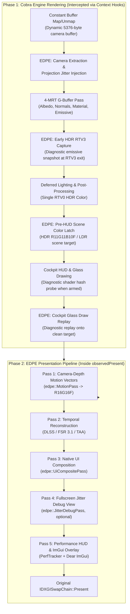

# EDPE Render Passes & Pipeline Architecture

Date: 2026-10-19. Target: Elite Dangerous Odyssey (2D Direct3D 11); build `2026.09.03.332841`.

This document provides a comprehensive reference of all render passes in EDPE: how Cobra engine render passes are observed and intercepted, and how EDPE custom temporal passes are constructed, isolated, and executed.

---

## 1. High-Level Frame Lifecycle & Pass Execution Order

The execution flow per frame consists of two major operational phases:
1. **Engine Pass Interception (Hooks on `ID3D11DeviceContext`)**: Observes constant buffer uploads, G-buffer binding, deferred lighting, and HUD draws in real-time as Cobra renders the frame.
2. **EDPE Reconstruction Pipeline (Inside `IDXGISwapChain::Present`)**: Executes motion vector generation, temporal upscaling/antialiasing, native UI composition, debug views, and Dear ImGui rendering right before presenting to the display.



---

## 2. Engine Passes Observed & Intercepted by EDPE

### Pass 0: Dynamic Camera Constant Buffer Upload & Jitter Injection
- **Hook mechanism**: [`patchSlot`](file:///F:/Code/%D0%A1++/EDPE/src/context_census.cpp#L3262-L3270) replaces `ID3D11DeviceContext::Map` ([slot 14](file:///F:/Code/%D0%A1++/EDPE/src/context_census.cpp#L38)) and `Unmap` ([slot 15](file:///F:/Code/%D0%A1++/EDPE/src/context_census.cpp#L39)).
- **Trigger point**: Elite maps the main per-view camera constant buffer (`ByteWidth == 5376`, `D3D11_USAGE_DYNAMIC`, `D3D11_BIND_CONSTANT_BUFFER`).
- **Code locations**:
  - Buffer detection: [`observedMap`](file:///F:/Code/%D0%A1++/EDPE/src/context_census.cpp#L996-L1037)
  - Camera extraction & validation: [`observedUnmap`](file:///F:/Code/%D0%A1++/EDPE/src/context_census.cpp#L1039-L1101)
  - Jitter injection: [`observedUnmap`](file:///F:/Code/%D0%A1++/EDPE/src/context_census.cpp#L1104-L1152)
- **Data processed**:
  - Authoritative camera matrices parsed via [`parseEliteCamera`](file:///F:/Code/%D0%A1++/EDPE/src/elite_camera.h#L12-L41) from words `932..943` (view/world) and `1080..1095` (projection).
  - Planar cockpit reflections and auxiliary probes rejected via [`isReflectionOrAuxiliaryCamera`](file:///F:/Code/%D0%A1++/EDPE/src/context_census.cpp#L179-L212) and aspect ratio verification [`isSceneCameraAspect`](file:///F:/Code/%D0%A1++/EDPE/src/context_census.cpp#L157-L162).
  - Subpixel Halton (2,3) projection jitter injected into words `1080..1095` using [`jitterEliteProjectionBlock`](file:///F:/Code/%D0%A1++/EDPE/src/temporal_math.h#L117-L135) (after verifying `depthB = words[1094] \in (0, 1]` and near-zero `words[1092, 1093, 1095]`) before unmapping, shifting subpixel vertex sampling without CPU overhead.

### Pass 1: Main Scene 4-MRT Geometry Pass (G-Buffer)
- **Hook mechanism**: [`patchSlot`](file:///F:/Code/%D0%A1++/EDPE/src/context_census.cpp#L3246-L3247) replaces `ID3D11DeviceContext::OMSetRenderTargets` ([slot 33](file:///F:/Code/%D0%A1++/EDPE/src/context_census.cpp#L42)).
- **Trigger point**: Cobra binds 4 simultaneous render targets alongside the primary depth-stencil buffer.
- **Code locations**:
  - Filter & format recognition: [`observedOMSetRenderTargets`](file:///F:/Code/%D0%A1++/EDPE/src/context_census.cpp#L2841-L2850)
  - Depth verification: [`isMainSceneMrtDepth`](file:///F:/Code/%D0%A1++/EDPE/src/context_census.cpp#L2740-L2755)
  - Target latching: [`observedOMSetRenderTargets`](file:///F:/Code/%D0%A1++/EDPE/src/context_census.cpp#L2871-L2897)
- **Render target layout**:
  - **RTV0**: `DXGI_FORMAT_R10G10B10A2_UNORM` (Albedo / base color / specular)
  - **RTV1**: `DXGI_FORMAT_R8G8B8A8_UNORM` (World-space normals)
  - **RTV2**: `DXGI_FORMAT_R8G8B8A8_UNORM` (Material parameters: roughness, metalness)
  - **RTV3**: `DXGI_FORMAT_R11G11B10_FLOAT` (HDR Emissive / illumination accumulation)
  - **DSV**: `DXGI_FORMAT_R32G8X24_TYPELESS` / `D32_FLOAT_S8X24_UINT` (Primary scene depth, reversed-Z convention: near=1.0, far=0.0)
- **EDPE action**: Latches `scene_depth_source` ([line 2872](file:///F:/Code/%D0%A1++/EDPE/src/context_census.cpp#L2872)) and `motion_color_source = targets[3]` ([line 2893](file:///F:/Code/%D0%A1++/EDPE/src/context_census.cpp#L2893)), sets `s_inside_main_scene = true` ([line 2882](file:///F:/Code/%D0%A1++/EDPE/src/context_census.cpp#L2882)).

### Pass 2: Emissive Pass Unbind & Diagnostic Early HDR Capture
- **Trigger point**: Cobra finishes the 4-MRT geometry pass and unbinds RTV3 while diagnostic `motion_pair_active` capture is armed.
- **Code locations**:
  - Exit detection: [`observedOMSetRenderTargets`](file:///F:/Code/%D0%A1++/EDPE/src/context_census.cpp#L2779-L2790)
  - Texture capture: [`captureEarlyMotionColor`](file:///F:/Code/%D0%A1++/EDPE/src/context_census.cpp#L1845-L1888)
- **Render target**: RTV3 (`DXGI_FORMAT_R11G11B10_FLOAT`).
- **EDPE action**: When `motion_pair_active` is active, copies RTV3 to `motion_early_color_view` at first exit for ImGui snapshot inspection (`ContextCensusTakeMotionEarlyColorSnapshot`). In-game verification confirmed this target contains isolated emissive elements (lamps, cockpit glowing indicators, thruster glow, laser fire) with non-emissive background at zero, making it a candidate for `TemporalFrameInputs::reactiveMask` (note: [`tryTemporalUpscale`](file:///F:/Code/%D0%A1++/EDPE/src/context_census.cpp#L2432-L2454) currently leaves `inputs.reactiveMask` as `nullptr`, though the backend evaluators support forwarding it).

### Pass 3: Deferred Lighting & Pre-HUD HDR Scene Color Pass
- **Trigger point**: Cobra transitions from 4-MRT to 1-RTV binding for deferred lighting and tone mapping.
- **Code locations**:
  - Transition detection: [`observedOMSetRenderTargets`](file:///F:/Code/%D0%A1++/EDPE/src/context_census.cpp#L2791-L2795)
  - HDR color latching: [`observedOMSetRenderTargets`](file:///F:/Code/%D0%A1++/EDPE/src/context_census.cpp#L2932-L2959)
  - LDR target latching: [`observedOMSetRenderTargets`](file:///F:/Code/%D0%A1++/EDPE/src/context_census.cpp#L2802-L2830)
- **Render targets**: Single RTV0 (`DXGI_FORMAT_R11G11B10_FLOAT` for HDR scene target, or `DXGI_FORMAT_R8G8B8A8_UNORM` / `R10G10B10A2_UNORM` for LDR scene target).
- **EDPE action**: Stores `scene_hdr_color_source` ([line 2954](file:///F:/Code/%D0%A1++/EDPE/src/context_census.cpp#L2954)) or `scene_ldr_source` ([line 2822](file:///F:/Code/%D0%A1++/EDPE/src/context_census.cpp#L2822)). This provides the clean, jittered 3D scene color buffer consumed by [`tryTemporalUpscale`](file:///F:/Code/%D0%A1++/EDPE/src/context_census.cpp#L2214-L2228) prior to cockpit HUD composition.

### Pass 4: Cockpit HUD Draw Interception & Canopy Glass Replay (One-Shot Diagnostic Probe)
- **Hook mechanism**: [`beginHudDrawProbe`](file:///F:/Code/%D0%A1++/EDPE/src/context_census.cpp#L913-L942) hooks `DrawIndexed` ([slot 12](file:///F:/Code/%D0%A1++/EDPE/src/context_census.cpp#L36)), `Draw` ([slot 13](file:///F:/Code/%D0%A1++/EDPE/src/context_census.cpp#L37)), `DrawIndexedInstanced` ([slot 20](file:///F:/Code/%D0%A1++/EDPE/src/context_census.cpp#L40)), `DrawInstanced` ([slot 21](file:///F:/Code/%D0%A1++/EDPE/src/context_census.cpp#L41)), storing original pointers in [`original_draw_*`](file:///F:/Code/%D0%A1++/EDPE/src/context_census.cpp#L66-L71).
- **Trigger point**: Armed during a one-shot `motion_pair_active` diagnostic capture ([`observedOMSetRenderTargets`](file:///F:/Code/%D0%A1++/EDPE/src/context_census.cpp#L3002-L3017)) when Cobra issues draw calls on `motion_color_source`, then disarmed via [`endHudDrawProbe`](file:///F:/Code/%D0%A1++/EDPE/src/context_census.cpp#L962-L994). (Not active during normal per-frame `reconstruction_active` upscaling.)
- **Code locations**:
  - Draw hook dispatches: [`observedDraw*`](file:///F:/Code/%D0%A1++/EDPE/src/context_census.cpp#L853-L911)
  - Shader hash identification: [`observeHudDraw`](file:///F:/Code/%D0%A1++/EDPE/src/context_census.cpp#L570-L654)
  - Canopy glass replay: [`replayGlassDraw`](file:///F:/Code/%D0%A1++/EDPE/src/context_census.cpp#L656-L683)
- **Shaders matched**:
  - Cockpit HUD UI pairs:
    - `VS=0xB7790CBFC6554097`, `PS=0x8DEF46452FA459F5`
    - `VS=0x81216C77F90DEDD6`, `PS=0xA2965EC2931A39C8`
    - `VS=0xE508648660A352B2`, `PS=0x63ABD86359B57D01`
  - Canopy glass shader pair:
    - `VS=0xF512712C40D93C12`, `PS=0x4A71EB0D34E9F2EF`
- **EDPE action**:
  - Immediately before the first matched HUD draw during the probe, executes [`captureEarlyMotionColor(context, true)`](file:///F:/Code/%D0%A1++/EDPE/src/context_census.cpp#L652) to retain a pristine copy of the HDR world before UI contamination.
  - Replays canopy glass back-face stencil draws onto `motion_clean_color_target` via [`replayGlassDraw`](file:///F:/Code/%D0%A1++/EDPE/src/context_census.cpp#L656-L683) during the diagnostic probe.

---

## 3. Custom EDPE Render Passes (Executed During Present)

All EDPE rendering passes run in sequence inside [`observedPresent`](file:///F:/Code/%D0%A1++/EDPE/src/dxgi_observer.cpp#L179-L192) between the completion of game rendering and the swapchain `Present` call:

```cpp
// src/dxgi_observer.cpp:183-189
edpe::PerfTracker::instance().onPresentStart(swap_chain);
ContextCensusOnPresent(swap_chain, frame, flags);
UiOnPresent(swap_chain, flags);
ContextCensusAfterOverlay(swap_chain, flags);
const auto original = reinterpret_cast<PresentFn>(tableOf(swap_chain)->original[kPresent]);
const HRESULT result = original(swap_chain, sync_interval, flags);
ContextCensusAfterPresent(swap_chain, flags);
edpe::PerfTracker::instance().onPresentEnd();
```

### Pass 1: Camera-Depth Motion Vector Generation Pass
- **Class**: [`edpe::MotionPass`](file:///F:/Code/%D0%A1++/EDPE/src/motion_pass.h#L11-L36)
- **Invocation**: [`tryTemporalUpscale`](file:///F:/Code/%D0%A1++/EDPE/src/context_census.cpp#L2354-L2356)
- **Implementation**: [`MotionPass::render`](file:///F:/Code/%D0%A1++/EDPE/src/motion_pass.cpp#L48-L71), [`MotionPass::renderInternal`](file:///F:/Code/%D0%A1++/EDPE/src/motion_pass.cpp#L91-L160)
- **Pipeline isolation**: Uses `ID3DDeviceContextState` ([line 141](file:///F:/Code/%D0%A1++/EDPE/src/motion_pass.cpp#L141)) via `context_->SwapDeviceContextState(state_.Get(), &prior)` to isolate state changes from game state.
- **Topology & Geometry**: Full-screen triangle (`D3D11_PRIMITIVE_TOPOLOGY_TRIANGLELIST`, 3 vertices, generated via vertex ID, null input layout).
- **Shaders**:
  - Vertex Shader: `vs` (`vs_5_0`) compiled from [`kMotionShader`](file:///F:/Code/%D0%A1++/EDPE/src/motion_shader.h).
  - Pixel Shader: `ps` (`ps_5_0`) or `ps_gpu` compiled from [`kMotionShader`](file:///F:/Code/%D0%A1++/EDPE/src/motion_shader.h).
- **Resources bound**:
  - **SRV 0**: `motion_depth_view` (`DXGI_FORMAT_R32_FLOAT_X8X24_TYPELESS`).
  - **CB 0**: 32 floats (current and previous `worldFromView` matrices, projection scales `scaleX`/`scaleY`, depth parameter `depthB`, target dimensions).
  - **RTV**: `output_rtv_` (`DXGI_FORMAT_R16G16_FLOAT`, render-resolution dimensions `width_ × height_`).
- **Mathematical operation**: Unprojects current screen NDC $(x, y, z)$ to camera space using $Z = B / z_{raw}$, transforms to world space using `worldFromViewNow`, then reprojects to previous camera and clip space using `previousViewFromWorld` and previous projection scales. Outputs pixel-space velocity $(u, v) = \text{pos}_{prev} - \text{pos}_{curr}$.
- **Fallback / Zero motion**: If motion vectors are disabled (`s_zero_motion_vectors`), executes [`MotionPass::clear`](file:///F:/Code/%D0%A1++/EDPE/src/motion_pass.cpp#L163-L167) to clear target to $(0, 0)$.

### Pass 2: Vendor Temporal Reconstruction / Upscaling Pass
- **Coordinator**: [`edpe::UpscalerManager::evaluate`](file:///F:/Code/%D0%A1++/EDPE/src/upscaler_backend.cpp#L695-L796)
- **Invocation**: [`tryTemporalUpscale`](file:///F:/Code/%D0%A1++/EDPE/src/context_census.cpp#L2526)
- **Input structure**: [`TemporalFrameInputs`](file:///F:/Code/%D0%A1++/EDPE/src/temporal_inputs.h#L110-L185):
  - `color`: Clean scene color copied to persistent `s_dlaa_input` (`R11G11B10_FLOAT` or typed LDR)
  - `depth`: Persistent `motion_depth` (`DXGI_FORMAT_R32_FLOAT_X8X24_TYPELESS`)
  - `motionVectors`: Output of MotionPass (`DXGI_FORMAT_R16G16_FLOAT`)
  - `jitterX`, `jitterY`: Subpixel projection offset applied to current frame
  - `reset`: Camera teleport or orientation discontinuity flag (`s_camera_reset || scene_cut`)
- **Backend implementations**:
  1. **NVIDIA DLSS Super Resolution / DLAA**:
     - Implementation: [`NvidiaUpscalerBackend::evaluate`](file:///F:/Code/%D0%A1++/EDPE/src/upscaler_backend.cpp#L107-L160) -> [`NgxContext::evaluateDlss`](file:///F:/Code/%D0%A1++/EDPE/src/ngx_context.cpp).
     - Execution: Dispatches NVIDIA NGX via `NVSDK_NGX_D3D11_EvaluateFeature`. Reconstructs into intermediate UAV `outputTexture_` (`DXGI_FORMAT_R11G11B10_FLOAT` or output format).
  2. **AMD FidelityFX FSR 3.1**:
     - Implementation: [`AmdUpscalerBackend::evaluate`](file:///F:/Code/%D0%A1++/EDPE/src/upscaler_backend.cpp#L366-L462).
     - Execution: Dispatches FidelityFX compute passes via `ffxFsr3UpscalerContextDispatch`.
  3. **Native Direct3D 11 TAA**:
     - Implementation: [`TaaUpscalerBackend::evaluate`](file:///F:/Code/%D0%A1++/EDPE/src/upscaler_backend.cpp#L490-L543) -> [`TaaPass::render`](file:///F:/Code/%D0%A1++/EDPE/src/taa_pass.cpp#L147-L230).
     - Shaders: `vs_main`, `ps_main` compiled from [`kTaaShader`](file:///F:/Code/%D0%A1++/EDPE/src/taa_shader.h).
     - Operation: 90% history blend with 3×3 YCoCg neighborhood variance clipping, camera-depth motion reprojection, and bicubic Catmull-Rom history sampling.
- **Fail-open behavior**: Any backend evaluation failure triggers fallback restoring the original game frame without interrupting execution ([src/upscaler_backend.cpp:772-780](file:///F:/Code/%D0%A1++/EDPE/src/upscaler_backend.cpp#L772-L780)).
- **GPU Timing**: Monitored asynchronously using non-blocking timestamp query ring ([src/upscaler_backend.cpp:736-766](file:///F:/Code/%D0%A1++/EDPE/src/upscaler_backend.cpp#L736-L766)).

### Pass 3: Native-Resolution UI / HUD Composition Pass
- **Class**: [`edpe::UiCompositePass`](file:///F:/Code/%D0%A1++/EDPE/src/ui_composite_pass.h#L8-L28)
- **Invocation**: [`tryTemporalUpscale`](file:///F:/Code/%D0%A1++/EDPE/src/context_census.cpp#L2542-L2586)
- **Implementation**: [`UiCompositePass::composite`](file:///F:/Code/%D0%A1++/EDPE/src/ui_composite_pass.cpp#L77-L134)
- **Pipeline isolation**: `ID3DDeviceContextState` ([line 105](file:///F:/Code/%D0%A1++/EDPE/src/ui_composite_pass.cpp#L105)) preserves context state.
- **Topology & Geometry**: Full-screen triangle (3 vertices).
- **Shaders**: `vs_main`, `ps_main` compiled from [`kUiCompositeShader`](file:///F:/Code/%D0%A1++/EDPE/src/ui_composite_shader.h).
- **Resources bound**:
  - **SRV 0**: `s_dlss_output_srv` (Temporally upscaled/reconstructed 3D world).
  - **SRV 1**: `s_backbuffer_copy_srv` (Copy of game backbuffer before upscaler evaluation, containing native-resolution Cobra HUD).
  - **SRV 2**: `s_dlaa_input_srv` (Low-resolution 3D world input).
  - **Sampler 0**: Bilinear clamp sampler (`linearSampler_`).
  - **CB 0**: `CompositeParams` (renderSize, renderTexel, outputSize, outputTexel, isHdr flag).
  - **RTV**: `targetBackbufferRtv` (Output swapchain backbuffer).
- **Mathematical operation**: Compares high-resolution game backbuffer with the upsampled low-res world to isolate pure UI alpha and color, then blends the crisp native-resolution UI onto the upscaled 3D scene without scaling blur or UI jitter.

### Pass 4: Subpixel Jitter / Motion Debug View Pass
- **Class**: [`edpe::JitterDebugPass`](file:///F:/Code/%D0%A1++/EDPE/src/jitter_debug_pass.h#L9-L44)
- **Invocation**: [`renderJitterDebugView`](file:///F:/Code/%D0%A1++/EDPE/src/context_census.cpp#L2624-L2706) from [`ContextCensusOnPresent`](file:///F:/Code/%D0%A1++/EDPE/src/context_census.cpp#L3288)
- **Implementation**: [`JitterDebugPass::render`](file:///F:/Code/%D0%A1++/EDPE/src/jitter_debug_pass.cpp#L157-L240)
- **Pipeline isolation**: `ID3DDeviceContextState` ([line 198](file:///F:/Code/%D0%A1++/EDPE/src/jitter_debug_pass.cpp#L198)).
- **Topology & Geometry**: Full-screen triangle (3 vertices).
- **Shaders**: `vs_main`, `ps_main` compiled from [`kJitterDebugShader`](file:///F:/Code/%D0%A1++/EDPE/src/jitter_debug_shader.h).
- **Resources bound**:
  - **SRV 0**: Backbuffer scene copy.
  - **SRV 1**: Previous frame scene color history (`historySrv_`).
  - **SRV 2**: Motion vector SRV.
  - **RTV**: Swapchain backbuffer.
- **Diagnostic output**: Converts scene to monochrome and renders green pulsing subpixel highlights at geometry edges where subpixel jitter shifts samples between frames, providing visual proof of temporal jitter injection.

### Pass 5: Dear ImGui & Performance Overlay Pass
- **Invocation**: [`UiOnPresent`](file:///F:/Code/%D0%A1++/EDPE/src/dxgi_observer.cpp#L185) -> [`src/ui.cpp:971-1647`](file:///F:/Code/%D0%A1++/EDPE/src/ui.cpp#L971-L1647)
- **Components rendered**:
  - Performance HUD overlay (FPS, frame times, CPU/GPU latency breakdown, VRAM) via [`PerfTracker::renderOverlay`](file:///F:/Code/%D0%A1++/EDPE/src/perf_overlay.cpp#L168-L335) called at [`src/ui.cpp:1128`](file:///F:/Code/%D0%A1++/EDPE/src/ui.cpp#L1128).
  - Main EDPE Control Surface (Upscaler selector, mode, sharpness, jitter/motion diagnostics, depth snapshots) at [`src/ui.cpp:1133-1490`](file:///F:/Code/%D0%A1++/EDPE/src/ui.cpp#L1133-L1490).
- **Draw call execution**:
  - Renders directly onto the swapchain backbuffer RTV:
    ```cpp
    // src/ui.cpp:1636-1637
    ui.context->OMSetRenderTargets(1, &ui.backbuffer_rtv, nullptr);
    ImGui_ImplDX11_RenderDrawData(ImGui::GetDrawData());
    ```
- **State safety**: Dear ImGui's DX11 backend saves and restores prior pipeline state (blend state, depth-stencil state, rasterizer state, shaders, render targets).

---

## 4. Summary Matrix of All Render Passes

| Pass Name | Phase / Trigger | Type | Input Bindings | Output Target | Shaders Used | Code Reference |
|---|---|---|---|---|---|---|
| **Constant Buffer Upload / Jitter** | Pre-Pass (`Map`/`Unmap`) | Engine Hook | Dynamic 5376B CB | CPU-mapped buffer | N/A (CPU injection) | [`observedMap`](file:///F:/Code/%D0%A1++/EDPE/src/context_census.cpp#L996), [`observedUnmap`](file:///F:/Code/%D0%A1++/EDPE/src/context_census.cpp#L1039) |
| **Main Scene 4-MRT Geometry** | Scene Pass (`OMSetRenderTargets`) | Engine Hook | Elite mesh geometry | 4 RTVs + Depth (`depth-dsv2`) | Elite scene VS/PS | [`observedOMSetRenderTargets`](file:///F:/Code/%D0%A1++/EDPE/src/context_census.cpp#L2841) |
| **Emissive / Illumination Capture** | G-Buffer Exit (`OMSetRenderTargets`, diagnostic) | Engine Hook | RTV3 (`R11G11B10F`) | `motion_early_color_view` | `CopyResource` | [`captureEarlyMotionColor`](file:///F:/Code/%D0%A1++/EDPE/src/context_census.cpp#L1845) |
| **Deferred Lighting / Pre-HUD Color** | Lighting Pass (`OMSetRenderTargets`) | Engine Hook | G-Buffer + lights | Single RTV0 (`R11G11B10F` / LDR) | Elite lighting PS | [src/context_census.cpp:2932-2959](file:///F:/Code/%D0%A1++/EDPE/src/context_census.cpp#L2932-L2959) |
| **HUD & Canopy Glass Draw Probe** | UI Passes (`Draw*` hooks, diagnostic) | Engine Hook | UI & glass meshes | RTV0 / `motion_clean_color_target` | Elite UI/glass PS | [`observeHudDraw`](file:///F:/Code/%D0%A1++/EDPE/src/context_census.cpp#L570), [`replayGlassDraw`](file:///F:/Code/%D0%A1++/EDPE/src/context_census.cpp#L656) |
| **Motion Vector Generation** | Present (`tryTemporalUpscale`) | EDPE Pass | `motion_depth` (`R32F`), CB 32f | `motionTexture` (`R16G16F`) | `kMotionShader` (`vs_5_0`, `ps_5_0`) | [`MotionPass::render`](file:///F:/Code/%D0%A1++/EDPE/src/motion_pass.cpp#L48) |
| **Temporal Upscaler / Reconstruct** | Present (`tryTemporalUpscale`) | EDPE Pass | Color, Depth, Motion, Jitter | `outputTexture_` / Backbuffer | DLSS / FSR / `kTaaShader` | [`UpscalerManager::evaluate`](file:///F:/Code/%D0%A1++/EDPE/src/upscaler_backend.cpp#L695) |
| **Native UI Composition** | Present (`tryTemporalUpscale`) | EDPE Pass | Upscaled SRV, Backbuffer SRV, Low-res SRV | Backbuffer RTV | `kUiCompositeShader` (`vs_main`, `ps_main`) | [`UiCompositePass::composite`](file:///F:/Code/%D0%A1++/EDPE/src/ui_composite_pass.cpp#L77) |
| **Subpixel Jitter Debug View** | Present (`renderJitterDebugView`) | EDPE Pass | Backbuffer copy, History SRV, Motion SRV | Backbuffer RTV | `kJitterDebugShader` (`vs_main`, `ps_main`) | [`JitterDebugPass::render`](file:///F:/Code/%D0%A1++/EDPE/src/jitter_debug_pass.cpp#L157) |
| **Dear ImGui & Perf Overlay** | Present (`UiOnPresent`) | EDPE Pass | ImGui draw lists, font atlas | Backbuffer RTV | ImGui DX11 vertex/pixel shaders | [`UiOnPresent`](file:///F:/Code/%D0%A1++/EDPE/src/ui.cpp#L971), [`ImGui_ImplDX11_RenderDrawData`](file:///F:/Code/%D0%A1++/EDPE/src/ui.cpp#L1637) |

---

## 5. Empirical RenderDoc Frame Census: Menu vs Gameplay

For the comprehensive draw-by-draw and pass-by-pass census derived from RenderDoc runtime captures (`menu.rdc` and `gameplay.rdc`), see [docs/renderdoc-pipeline-analysis.md](file:///f:/Code/С++/EDPE/docs/renderdoc-pipeline-analysis.md).

### Key Takeaways:
1. **Total Passes**: Main Menu executes **49 passes** (5,935 API calls); active Gameplay executes **55 passes** (9,412 API calls).
2. **Cascaded Directional Shadows (Gameplay Pass 06)**: 3 cascades on a single `3072×1024 D16_UNORM` texture with **386 draws**; absent in the menu.
3. **Cockpit Radar Sub-Renders (Gameplay Passes 25–26)**: Two isolated `512×512` passes with auxiliary cameras; confirmed immune from main projection jitter via [`isReflectionOrAuxiliaryCamera`](file:///F:/Code/%D0%A1++/EDPE/src/context_census.cpp#L179).
4. **Cockpit Holographic HUD (Gameplay Pass 35)**: **32 draws** directly into `Tex#6888` (`R11G11B10_FLOAT`) prior to Bloom downsampling.
5. **Reactive Mask Architecture**: G-Buffer `RTV3` (Pass 10 exit) + Cockpit HUD (Pass 35) provide the complete data needed for `TemporalFrameInputs::reactiveMask`.

