# Elite Dangerous RenderDoc Frame Analysis: Main Menu vs Gameplay

- **Date:** 2026-10-20
- **Target:** Elite Dangerous Odyssey (2D Direct3D 11); build `2026.09.03.332841`
- **Method:** RenderDoc API capture (`menu.rdc` and `gameplay.rdc`), converted via `renderdoccmd` to XML/Chrome-trace, automated XML chunk pass extraction
- **Display Resolution:** 2560×1440 (`DXGI_FORMAT_R8G8B8A8_UNORM`)
- **GPU Adapter:** NVIDIA GeForce RTX 3060 (12 GB VRAM)

---

## 1. Executive Summary

This empirical investigation provides a complete, draw-by-draw and pass-by-pass census of the Cobra engine rendering pipeline during two critical application states:
1. **Main Menu (`menu.rdc`)**: 49 distinct render/compute passes, 5,935 recorded API calls.
2. **Active Gameplay (`gameplay.rdc`)**: 55 distinct render/compute passes, 9,412 recorded API calls.

Both states utilize a modern **Hybrid Deferred / Cluster Lighting** pipeline with heavy Compute Shader usage, reversed-Z depth, an identical 10-level Bloom pyramid, and screen UI overlay rendering.

However, active **Gameplay introduces 6 critical rendering subsystems** that are absent in the Main Menu:

| Subsystem / Pass Category | Main Menu (`menu.rdc`) | Gameplay (`gameplay.rdc`) | Architectural Impact on EDPE |
|---|---|---|---|
| **Cascaded Directional Shadows** | ❌ None (ambient/baked) | **Pass 06**: 3 cascades across `3072×1024 D16_UNORM`, **386 draws** | Depth-only rasterization occurring *before* G-buffer. Completely independent of primary camera jitter. |
| **G-Buffer Scene Geometry** | Passes 04–05: 252 draws | Passes 09–10: **277 draws** (ships, stations, terrain) | Authoritative 4-MRT + DSV layout latched by EDPE (`RTV0..3` + `DSV #2`). |
| **Cockpit Sub-Renders (Radar/Holo)** | ❌ None | **Passes 25–26**: Two isolated `512×512` depth/color passes | 3D holographic ship/radar models rendered with auxiliary cameras. Confirms EDPE's `isReflectionOrAuxiliaryCamera()` filter. |
| **Cockpit World-Space UI** | ❌ None (only 2D screen UI) | **Pass 35**: **32 draws** directly into HDR world color | Holographic HUD rendered over 3D world *before* Bloom and tonemapping. Key candidate for reactive mask. |
| **Canopy Glass & Reflection** | Flat / inactive | **Pass 30**: 4 back-face stencil draws | Intercepted by EDPE glass replay mechanism. |
| **Post-Processing (Bloom/Tonemap)** | Passes 28–45 | Passes 36–52 | Identical 10-level Kawase/Dual-filtering downsample/upsample pyramid. |
| **Final Screen UI** | Passes 47–48 (8 menu draws) | Pass 54 (2D crosshair / overlay draws) | Drawn directly onto Swapchain backbuffer at native resolution. |

```mermaid
flowchart TD
    subgraph PrePasses["1. Pre-Passes & Shadows"]
        CS_Init["Compute Particle/Material Setup (Passes 01-05)"]
        CSM["Cascaded Shadow Maps: 3072x1024 D16 (Pass 06, Gameplay only)"]
    end

    subgraph GBuffer["2. G-Buffer 4-MRT Pass (2560x1440)"]
        GB_Draw["Base Scene Geometry (Passes 09-10)"]
        GB_RTV0["RTV0: R10G10B10A2 (Albedo)"]
        GB_RTV1["RTV1: R8G8B8A8 (World Normals)"]
        GB_RTV2["RTV2: R8G8B8A8 (Material Roughness/Metal)"]
        GB_RTV3["RTV3: R11G11B10F (Emissive / Glow)"]
        GB_DSV["DSV: D32F_S8 (Reversed-Z Depth)"]
        HiZ["Hi-Z & Linear Depth Downsample (Passes 11-12)"]
    end

    subgraph Lighting["3. Ambient Occlusion & Deferred Lighting"]
        SSAO["SSAO Compute & Bilateral Upsample (Passes 14-16)"]
        Cluster["Light Grid Clustering Compute (Passes 19-22)"]
        DefLight["Deferred Lighting Resolve -> R11G11B10F (Passes 23-24)"]
    end

    subgraph CockpitPasses["4. Cockpit & Forward Elements (Gameplay only)"]
        RadarHolo["Cockpit Radar / Hologram 512x512 (Passes 25-26)"]
        EnvProbe["Environment Reflection Probe 1024x1024 (Passes 28-29)"]
        Glass["Canopy Glass Forward Stencil (Pass 30)"]
        CockpitUI["Cockpit Holographic HUD: 32 draws (Pass 35)"]
    end

    subgraph PostProcess["5. Post-Processing & Tonemapping"]
        BloomDown["Bloom Downsample Pyramid (1440p -> 45p)"]
        BloomUp["Bloom Upsample Pyramid (45p -> 1440p)"]
        AutoExp["Auto-Exposure / Luminance Compute (Passes 50-51)"]
        Tonemap["Tonemapping & Color Grading -> R8G8B8A8 (Pass 52)"]
    end

    subgraph Presentation["6. Native UI & Presentation"]
        BackbufferBlit["Blit to Swapchain Backbuffer (Pass 53)"]
        FinalUI["Final 2D Screen UI / Menu / ImGui (Pass 54)"]
        Present["IDXGISwapChain::Present (Pass 55)"]
    end

    PrePasses --> GBuffer
    GBuffer --> Lighting
    Lighting --> CockpitPasses
    CockpitPasses --> PostProcess
    PostProcess --> Presentation
```

---

## 2. Chronological Pipeline Stages in Active Gameplay

### Stage 1: Pre-Passes & Directional Shadow Maps (Passes 01–08)
- **Passes 01–05 (Compute & Clears)**:
  - Dispatches compute shaders updating GPU particles, skinning buffers, and streaming resource flags.
- **Pass 06 [GAMEPLAY ONLY] — 3-Cascade Directional Shadow Map**:
  - **DSV**: `Tex#7647`, dimensions **3072×1024**, format `DXGI_FORMAT_D16_UNORM`.
  - **Layout**: 3 cascades of `1024×1024` side by side.
  - **Draws**: **386 draw calls** with depth-only rasterization (null RTV).
  - *Finding*: The main scene camera projection jitter does NOT contaminate shadow cascades because shadow matrices are calculated in light space.
- **Passes 07–08 [GAMEPLAY ONLY] — Shadow Filtering Compute**:
  - Dispatches compute filters onto `Tex#75708` / `Tex#48866` (`1536×512 R16G16B16A16_UNORM`) generating variance shadow maps / bilateral shadow blur.

---

### Stage 2: Main Scene 4-MRT Geometry Pass (Passes 09–13)
- **Passes 09–10 — Base Geometry Rasterization**:
  - **Viewport**: `2560×1440`
  - **Draw Calls**: **277 draws** (Gameplay) vs **252 draws** (Menu).
  - **Depth-Stencil**: `Tex#6883` (`DXGI_FORMAT_D32_FLOAT_S8X24_UINT`, Reversed-Z: near=1.0, far=0.0).
  - **Bound Render Targets (4-MRT)**:
    - **RTV 0**: `Tex#6885` (`2560×1440 DXGI_FORMAT_R10G10B10A2_UNORM`) — Albedo / Specular base.
    - **RTV 1**: `Tex#6886` (`2560×1440 DXGI_FORMAT_R8G8B8A8_UNORM`) — World-space Normals.
    - **RTV 2**: `Tex#6887` (`2560×1440 DXGI_FORMAT_R8G8B8A8_UNORM`) — Material parameters (roughness, metalness).
    - **RTV 3**: `Tex#6888` (`2560×1440 DXGI_FORMAT_R11G11B10_FLOAT`) — **Emissive / Illumination pass**.
- **Passes 11–12 — Linear Depth & Hierarchical-Z (Hi-Z)**:
  - Downscales depth to `Tex#6884` (`2560×1440 R32_FLOAT`) and `Tex#7197` (`320×180 R32_FLOAT`) for occlusion culling and ambient occlusion.
- **Pass 13 — G-Buffer Decals & Stencils**:
  - 4 draws applying decals onto normal/material targets.

---

### Stage 3: Screen-Space Ambient Occlusion (SSAO) & Decals (Passes 14–18)
- **Pass 14**: Linear depth downsample compute (`160×90 R32_FLOAT`).
- **Pass 15**: Raw SSAO compute dispatch (`160×90 R8_UNORM`).
- **Pass 16**: Bilateral upsample blur compute (`640×360 R8_UNORM`).
- **Passes 17–18**: AO resolve and light stencil masking.

---

### Stage 4: Light Clustering & Deferred Lighting (Passes 19–24)
- **Passes 19–22 — Light Grid Clustering**:
  - Compute dispatches binning point and spot lights into 3D view-frustum clusters (`Tex#16785`, `Tex#16788`).
- **Passes 23–24 — Deferred Lighting Evaluation**:
  - Evaluates clustered lighting reading G-buffer normals, roughness, and depth.
  - Accumulates illumination into `Tex#6888` (`2560×1440 DXGI_FORMAT_R11G11B10_FLOAT`).
  - Outputs specular reflections into `Tex#6889` (`2560×1440 DXGI_FORMAT_R16_FLOAT`).

---

### Stage 5: Cockpit Sub-Renders (Radar & Holograms) [GAMEPLAY ONLY] (Passes 25–26)
- **Pass 25**:
  - Viewport `512×512`, `DSV: Tex#46814`, `RTV: Tex#46815` (`R32_FLOAT`).
- **Pass 26**:
  - Viewport `512×512`, `DSV: Tex#46816`, 3 MRTs (`R32_FLOAT`, `R8_UNORM`, `R8G8B8A8_UNORM_SRGB`).
- **Function**:
  - Renders 3D holographic wireframes for the cockpit radar scanner and targeted ships.
  - **Crucial Architectural Verification**: These passes use secondary viewports and projection matrices. EDPE's aspect ratio check `isSceneCameraAspect()` and reflection filter `isReflectionOrAuxiliaryCamera()` properly prevent projection jitter from contaminating these sub-cameras.

---

### Stage 6: Forward Transparencies & Environment Probe (Passes 27–30)
- **Pass 27**: Forward rendering of space dust, thruster trails, and transparent particles (56 draws).
- **Passes 28–29**: Environment probe rendering (`1024×1024 R11G11B10_FLOAT`, `D16_UNORM`) and compute cubemap convolution.
- **Pass 30 [GAMEPLAY ONLY]**: **Canopy Glass**:
  - 4 draws applying cockpit glass tint, scratches, and back-face stencil reflections.

---

### Stage 7: Cockpit World-Space UI (Holographic HUD) [GAMEPLAY ONLY] (Pass 35)
- **Target**: `Tex#6888` (`2560×1440 DXGI_FORMAT_R11G11B10_FLOAT`).
- **Draw Calls**: **32 draw calls**.
- **Function**:
  - Renders speedometer, compass, targeting reticle, system pips, and sensor displays.
  - Because it draws directly into the HDR buffer *prior* to Bloom, bright holographic elements bleed naturally into the cockpit bloom.
  - **Implication**: This pass is the exact boundary where the clean 3D world is composited with in-cockpit UI.

---

### Stage 8: Bloom Dual-Filtering Pyramid (Passes 36–45)
A 10-step downsample/upsample Kawase pyramid executed in `R11G11B10_FLOAT`:
1. **Downsample Phase**:
   - `Pass 36`: `1280×720` (`Tex#44221`)
   - `Pass 37`: `640×360` (`Tex#44227`)
   - `Pass 38`: `320×180` (`Tex#44233`)
   - `Pass 39`: `160×90` (`Tex#44239`)
   - `Pass 40`: `80×45` (`Tex#44245`)
2. **Upsample & Blur Additive Blend Phase**:
   - `Pass 41`: `80×45` (`Tex#44248`)
   - `Pass 42`: `160×90` (`Tex#44242`)
   - `Pass 43`: `320×180` (`Tex#44236`)
   - `Pass 44`: `640×360` (`Tex#44230`)
   - `Pass 45`: `1280×720` (`Tex#44224`)

---

### Stage 9: Eye Adaptation & Luminance Histogram (Passes 46–51)
- Downsamples scene color to `320×180` (`R11G11B10F`, `R16F`, `R8_UNORM`).
- Dispatches compute shaders building a luminance histogram (`Tex#7249..7251`) and calculating dynamic eye adaptation exposure.

---

### Stage 10: Tonemapping & Backbuffer Blit (Passes 52–53)
- **Pass 52 — Tonemapping & Color Grading**:
  - Converts HDR Scene Color (`Tex#6888`) + Bloom (`Tex#44224`) -> LDR Scene Color (`Tex#6879`, `2560×1440 DXGI_FORMAT_R8G8B8A8_UNORM`).
- **Pass 53 — Backbuffer Blit**:
  - Copies tonemapped LDR scene to the swapchain backbuffer (`Tex#44`).

---

### Stage 11: Final 2D Screen UI & Presentation (Passes 54–55)
- **Pass 54 — Final 2D UI Overlay**:
  - Renders 2D menu elements (or in-game crosshair/overlay) directly onto the Swapchain Backbuffer (`Tex#44`) using UI depth `Tex#6882`.
- **Pass 55 — Swapchain Present**:
  - `IDXGISwapChain::Present` called to display the completed frame.

---

## 3. Verified Architectural Decisions for EDPE

1. **Reactive Mask Construction (Phase 12 Roadmap)**:
   - **Component A**: G-Buffer `RTV3` (`Tex#6888` at Pass 10 exit) isolates ship thrusters, external lamps, laser fire, and glowing cockpit instruments.
   - **Component B**: Cockpit HUD draws at Pass 35 isolate holographic flight instruments.
   - Combining Component A and Component B yields a 100% accurate, ghost-free `TemporalFrameInputs::reactiveMask` for both DLSS and FSR.

2. **Temporal Upscaling Point of Evaluation**:
   - The ideal point for temporal evaluation inside the Cobra pipeline is **between Pass 30 (post-lighting & canopy glass) and Pass 35 (pre-cockpit HUD)**.
   - If evaluation remains at `Present` (EDPE's current non-invasive path), the native UI composite pass (`UiCompositePass`) must continue separating the native-resolution UI from the pre-upscale backbuffer copy.

3. **Sub-Camera Jitter Immunity**:
   - Passes 25–26 confirm that auxiliary 3D scenes (the `512×512` radar scanner) are rendered in the middle of the frame.
   - Preserving the `isReflectionOrAuxiliaryCamera()` filter in [src/context_census.cpp](file:///F:/Code/%D0%A1++/EDPE/src/context_census.cpp) is mandatory to prevent subpixel jitter from causing radar jitter.
