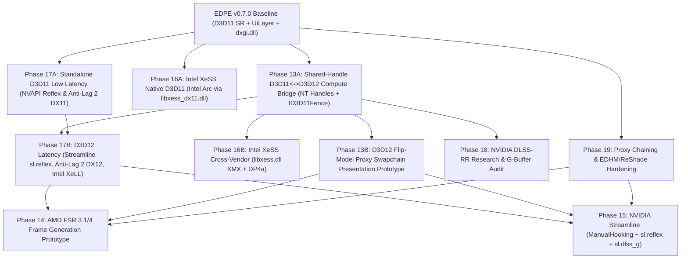

# Uncompleted Roadmap Phases (13–19): Technical Research Overview & Synthesis

**Date:** 2026-11-14  
**Scope:** Phases 13–19 ([README.md](https://github.com/filispeen/EDPE/blob/master/README.md#roadmap), [PLAN.md](../PLAN.md))  
**Target Baseline:** EDPE `v0.7.0` (`dxgi.dll` D3D11 proxy, `TemporalFrameInputs`, `IUpscalerBackend`, `UiLayer`, `UiCompositePass`)  
**Status:** RESEARCH COMPLETE — Ready for milestone-gated implementation planning.

---

## 1. Purpose & Evidence Conventions

This document synthesizes comprehensive SDK, reverse-engineering, and open-source ecosystem research for every uncompleted phase in EDPE's roadmap (Phases **13 through 19**). Each phase has a dedicated deep-dive specification in `docs/`:

| Phase | Milestone | Document | Current Status in `README.md` |
|:---:|:---|:---|:---|
| **13** | D3D11 / D3D12 Interoperability Research | [phase-13-d3d11-d3d12-interop-research.md](phase-13-d3d11-d3d12-interop-research.md) | `Not started` |
| **14** | AMD FSR Frame Generation Prototype | [phase-14-amd-fsr-frame-generation-research.md](phase-14-amd-fsr-frame-generation-research.md) | `Not started` |
| **15** | NVIDIA Streamline / DLSS Frame Generation | [phase-15-nvidia-streamline-dlssg-research.md](phase-15-nvidia-streamline-dlssg-research.md) | `Not started` |
| **16** | Intel XeSS (Native AA & Super Resolution) | [phase-16-intel-xess-research.md](phase-16-intel-xess-research.md) | `Planned` |
| **17** | Low-Latency Integration (Reflex & Anti-Lag 2) | [phase-17-low-latency-framework-research.md](phase-17-low-latency-framework-research.md) | `Planned` |
| **18** | NVIDIA DLSS-NR | [phase-18-nvidia-dlss-rr-research.md](phase-18-nvidia-dlss-rr-research.md) | `Research` |
| **19** | Third-Party Mod Compatibility (ReShade, EDHM, 3Dmigoto, Overlays) | [phase-19-mod-compatibility-research.md](phase-19-mod-compatibility-research.md) | `Planned` |

All technical assertions in these documents follow `PLAN.md` §50 and `AGENTS.md` classification tags:
* **`VERIFIED`**: Directly confirmed in EDPE's `v0.7.0` source code, RenderDoc captures, or in-game verification (`STATUS.md`).
* **`SDK-DOCUMENTED`**: Verified directly against official vendor headers or programming guides (`NVIDIA-RTX/Streamline` v2.14.16, `NVIDIA/DLSS`, `GPUOpen-LibrariesAndSDKs/FidelityFX-SDK`, `GPUOpen-LibrariesAndSDKs/AntiLag2-SDK`, `intel/xess`).
* **`REFERENCE-CODE`**: Verified by inspecting public open-source implementations (`Siegfried-Origin/EDAA`, `optiscaler/OptiScaler`, `optiscaler/fakenvapi`, `characterecho-sean/edvr-unofficial-patch`).
* **`EXPERIMENTAL` / `MEASURED`**: Proposed EDPE designs and metrics requiring standalone harness + in-game validation before production adoption.

---

## 2. Verified EDPE `v0.7.0` Baseline Entering Phases 13–19

EDPE already satisfies the foundational prerequisites mandated by `AGENTS.md` before entering D3D12 interop, XeSS, Low Latency, or Frame Generation:

1. **`VERIFIED` Scene & Temporal Inputs (`src/temporal_inputs.h`, `src/context_census.cpp`):**
   * Reversed-Z scene depth `DSV #2` (`DXGI_FORMAT_R32G8X24_TYPELESS`, $B=0.025$, clear `0.0`).
   * Primary 3D camera matrices parsed once per frame from 5376-byte `CB0` with Halton `(2,3)` subpixel jitter injection (`CB0` words `1080`–`1095`).
   * Current-to-previous render-pixel motion vectors in `DXGI_FORMAT_R16G16_FLOAT` (`motionJittered = false`, `motionIsLowRes = true`), including analytical rotational skybox motion.
2. **`VERIFIED` Native-Resolution HUD & World Separation (`src/ui_layer.h`, `src/ui_layer.cpp`):**
   * `s_clean_hdr_scene_texture` captures the pre-HUD linear world (`R11G11B10_FLOAT`) and `UiLayer` redirects cockpit HUD draws into `hdrLayerTex_` (`R16G16B16A16_FLOAT`), `ldrLayerTex_` (`R8G8B8A8_UNORM`), and `multLayerTex_` (`R8G8B8A8_UNORM`), compositing via `UiLayer::composite` / `UiLayer::compositeToRtv`.
   * **Strategic Implication:** Unlike middleware injectors such as `OptiScaler` that must heuristically guess where the HUD was drawn (`HUDFix`), EDPE **already owns a true HUD-less reconstructed world surface and separated UI overlay layers**, directly satisfying the hardest prerequisite for both AMD FSR FG (Phase 14) and NVIDIA DLSS-G (Phase 15).
3. **`VERIFIED` Multi-Backend Upscaler Boundary (`src/upscaler_backend.h`):**
   * `IUpscalerBackend` isolates NVIDIA NGX (`NvidiaUpscalerBackend`), AMD FSR 3.1.2 (`AmdUpscalerBackend`), and Native TAA (`TaaUpscalerBackend`) behind `UpscalerManager`, with fail-open fallback and async timestamp queries.
4. **`VERIFIED` Hooking & Input Safety (`src/dxgi_proxy.cpp`, `src/d3d11_proxy.cpp`, `src/vtable_hook.h`, `src/system_dll.h`, `src/dxgi_observer.cpp`, `src/input_hook.cpp`):**
   * EDPE runs as `dxgi.dll`, bypasses redirected `d3d11.dll` (e.g., EDHM/3Dmigoto) via `LoadSystemDll` (`src/system_dll.h#L6-L13`), `chooseSystemD3D11` (`src/vtable_hook.h#L45`), and `resolveRealSystemD3D11` (`src/d3d11_proxy.cpp#L129-L145`), and isolates `WndProc` and `DirectInput8` when the Dear ImGui menu (`F5`) is active.

---

## 3. Cross-Phase Dependency Graph & Recommended Execution Order



### Recommended Milestone Order (Minimal Risk, Highest Immediate User Value)

| Step | Phase Scope | Rationale |
|:---:|:---|:---|
| **1** | **Phase 17A** (Standalone D3D11 Reflex + Anti-Lag 2 DX11) | Requires **zero** D3D12 interop; immediately slashes HOTAS/mouse latency in GPU-bound stations/planets and establishes `ILatencyBackend` + frame-marker hooks required *before* FG (`AGENTS.md`). Note: `Intel XeLL` (`libxell.dll`) is D3D12-only and deferred to **Phase 17B**. |
| **2** | **Phase 19** (Proxy Chaining + EDHM Context-Gated HUD Fallback) | Hardens `UiLayer`'s 14 `(vsHash, psHash)` pairs against EDHM pixel-shader overrides and enables ReShade (`ReShade64.dll`) / Special K coexistence *before* adding FG swapchain wrappers that amplify overlay crashes. |
| **3** | **Phase 13A + Phase 16** (Compute D3D11↔D3D12 Bridge + Intel XeSS) | Validates zero-copy NT Shared Handles + `ID3D11Fence`/`ID3D12Fence` synchronization **without** touching DXGI swapchain ownership yet (proven in Elite by `Siegfried-Origin/EDAA`). Delivers Intel XeSS (both native Arc `libxess_dx11.dll` and cross-vendor `libxess.dll` DP4a). |
| **4** | **Phase 18** (DLSS-RR Feasibility Probe) | Evaluates official NGX `NVSDK_NGX_Feature_RayReconstruction` (`nvngx_dlssd.dll`, which supports both D3D11 and D3D12) against unpacked Cobra `RTV0..3` G-Buffer (`DlssRrGBufferPrepCs`) before committing to production integration. |
| **5** | **Phase 13B** (D3D12 Flip-Model Proxy Swapchain) | Isolates and measures the hardest piece of D3D11 FG: presenting a D3D12 Flip-model swapchain for a D3D11 game (`OptiScaler` `Dx11wDx12SC` pattern), measuring copy cost, resize stability, and HDR/tearing pacing *before* loading FG DLLs. |
| **6** | **Phase 14** (AMD FSR Frame Generation via `ffx_api`) | Prototype cross-vendor FG (works on RTX/GTX/RDNA/Arc with FSR 3.1.6 and RDNA4 ML FG with FSR 4.0) using EDPE's clean `s_clean_hdr_scene_texture`, 3-layer `UiLayer` (`packedUiColorAndAlpha` or `presentCallback`), and `ffx_antilag2_dx12.h`. |
| **7** | **Phase 15** (NVIDIA Streamline `sl.dlss_g` + `sl.reflex`) | Integrate Streamline v2.14+ using **`PreferenceFlag::eUseManualHooking`** (`slUpgradeInterface` / `slGetNativeInterface`) so EDPE's `dxgi.dll` proxy avoids fighting `sl.interposer.dll`, adding capability-driven 2x/3x/4x & Dynamic MFG. |

---

## 4. Target Backend-Neutral Extensions (for Future `src/` Implementation)

Per `AGENTS.md` and `PLAN.md` §§4–5, §§44–45, Elite-specific observation remains strictly isolated from vendor backends:

```cpp
// Extension to src/temporal_inputs.h (Phase 16)
enum class UpscalerBackend : uint32_t {
    None = 0,
    NvidiaDlss = 1,
    AmdFsr = 2,
    Taa = 3,
    IntelXess = 4,          // Phase 16 (Arc DX11 native or DX12 bridge DP4a/XMX)
    NvidiaDlssRR = 5        // Phase 18 (experimental, capability-gated)
};

// Independent Frame Generation contract (Phases 14 & 15, PLAN.md §5 & §15)
enum class FrameGenerationBackend : uint32_t {
    Off = 0,
    AmdFsrFg = 1,           // Phase 14 (ffx_api FSR 3.1 / 4 FG)
    NvidiaDlssG = 2         // Phase 15 (Streamline sl.dlss_g)
};

struct FrameGenerationInputs {
    // Shared D3D12 handles (bridged from EDPE D3D11 via Phase 13 NT handles)
    ID3D12Resource* hudlessColor = nullptr;         // Reconstructed world BEFORE UiCompositePass
    ID3D12Resource* finalBackbuffer = nullptr;      // Post-UI composited backbuffer (fallback/reference)

    // Option A (DLSS-G kBufferTypeUIColorAndAlpha & FSR RegisterUiResourceDX12):
    // Packed on D3D11 from hdrLayerTex_ + ldrLayerTex_ + multLayerTex_ via packPremultipliedUiForFgCs:
    ID3D12Resource* packedUiColorAndAlpha = nullptr; // Native-res premul R8G8B8A8_UNORM

    // Option B (FSR presentCallback exact 3-layer D3D12 port of kUiLayerCompositePsHlsl):
    ID3D12Resource* uiHdrLayer = nullptr;           // hdrLayerTex_ (R16G16B16A16_FLOAT, .a = transmittance)
    ID3D12Resource* uiLdrLayer = nullptr;           // ldrLayerTex_ (R8G8B8A8_UNORM)
    ID3D12Resource* uiMultLayer = nullptr;          // multLayerTex_ (R8G8B8A8_UNORM, panel backdrop darkening)

    ID3D12Resource* depth = nullptr;                // Reversed-Z depth (R32_FLOAT copy from DSV #2)
    ID3D12Resource* motionVectors = nullptr;        // Current->prev render-pixel MVs (R16G16_FLOAT)

    uint32_t renderWidth = 0;
    uint32_t renderHeight = 0;
    uint32_t outputWidth = 0;
    uint32_t outputHeight = 0;

    float jitterX = 0.0f;
    float jitterY = 0.0f;
    float frameTimeMs = 0.0f;
    uint64_t frameIndex = 0;                        // Monotonic +1; jump or reset=true resets FG
    bool reset = false;
    bool isHdr = false;

    CameraProjection cameraNow{};
    float viewSpaceToMeters = 1.0f;
};

// Independent Low-Latency contract (Phase 17, PLAN.md §44)
enum class LatencyBackendType : uint32_t {
    Off = 0,
    NvidiaReflex = 1,       // NVAPI (Phase 17A D3D11) or sl.reflex (Phase 17B DLSS-G)
    AmdAntiLag2 = 2,        // ffx_antilag2_dx11.h (Phase 17A) / ffx_antilag2_dx12.h (Phase 17B)
    IntelXeLL = 3           // Strictly Phase 17B / D3D12-only via libxell.dll (unavailable in pure D3D11)
};

enum class LatencyMode : uint32_t {
    Off = 0,
    LowLatency = 1,
    LowLatencyBoost = 2
};
```

---

## 5. Open-Source Reference & Licensing Matrix

Per `AGENTS.md` ("Licensing: inspect the license, record provenance, do not redistribute proprietary SDK material contrary to license terms"):

| Reference / SDK | License | Redistribution / Integration Guidance for EDPE |
|:---|:---|:---|
| `NVIDIA-RTX/Streamline` headers/docs (`v2.14.16`) | MIT (integration headers/samples); **NVIDIA Proprietary** (`sl.*.dll`) | Headers (`sl.h`, `sl_dlss_g.h`, `sl_reflex.h`, `sl_dlss_d.h`) are MIT. Runtime `sl.*.dll` binaries follow NVIDIA Streamline license & must be verified via `sl::security::verifyEmbeddedSignature` or user-staged. |
| `NVIDIA/DLSS` (`nvngx_dlss.dll`, `nvngx_dlssd.dll`) | NVIDIA RTX SDKs Proprietary | Retain EDPE's dedicated NGX Project ID `48d353f3-d07b-4048-876b-09f8622f5a27`. Never reuse EDVR's Project ID. Never bundle leaked/unofficial DLLs (e.g., unauthorized `nvngx_dlssnr.dll`). |
| `GPUOpen-LibrariesAndSDKs/FidelityFX-SDK` (`2.x`) | **MIT** | Cleanly usable in source/static/DLL form (`ffx_api.h`, `ffx_framegeneration.h`, `amd_fidelityfx_framegeneration.dll`). Preserve AMD copyright notice. |
| `GPUOpen-LibrariesAndSDKs/AntiLag2-SDK` | **MIT** | Header-only (`ffx_antilag2_dx11.h`, `ffx_antilag2_dx12.h`), zero extra binary dependencies; talks to `atidxx64.dll` / `amdxc64.dll` in driver. |
| `intel/xess` (`v2.x`) | **MIT** (C headers); **Intel Simplified Software License** (`libxess.dll`, `libxess_dx11.dll`) | Delay-load DLLs cleanly (`__HrLoadAllImportsForDll` / `LoadLibraryExW`) so missing runtime DLLs fail open without breaking startup. |
| [`Siegfried-Origin/EDAA`](https://github.com/Siegfried-Origin/EDAA) | **MIT** | Open-source Elite Dangerous ReShade addon on GitHub with verified D3D11↔D3D12 XeSS bridge ([`addon/src/xess.cpp`](https://github.com/Siegfried-Origin/EDAA/blob/master/addon/src/xess.cpp)) and Elite HUD/shadow discoveries. Safe to study and adapt with MIT attribution. |
| `optiscaler/fakenvapi` | **MIT** | Reference for NVAPI↔Anti-Lag 2 / XeLL / LatencyFlex marker mapping and FG frame-type swapchain private data. |
| `optiscaler/OptiScaler` | **GPL-3.0** | **Reference study only — DO NOT copy source code verbatim** into a permissive/non-GPL target without relicensing the project under GPL-3.0. Study architectural behaviors (`Dx11wDx12SC`, `LoadReShade`, `ManualHooking` interactions, known driver pitfalls). |
| `characterecho-sean/edvr-unofficial-patch` | **GPL-3.0** | Reference study only (`docs/third-party/EDVR-LICENSE.txt`). Already referenced for `LoadLibraryExW` EDHM recursive trap (`docs/troubleshooting.md`). |
| `crosire/reshade` & `bo3b/3Dmigoto` (`EDHM`) | BSD-3-Clause (ReShade), MIT/GPL-mixed (`3Dmigoto`) | Interoperate via documented environment variables (`RESHADE_DISABLE_LOADING_CHECK`), DLL proxy chaining, and shader/RTV state hygiene rather than binary coupling. |
